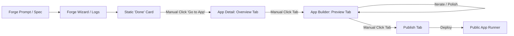
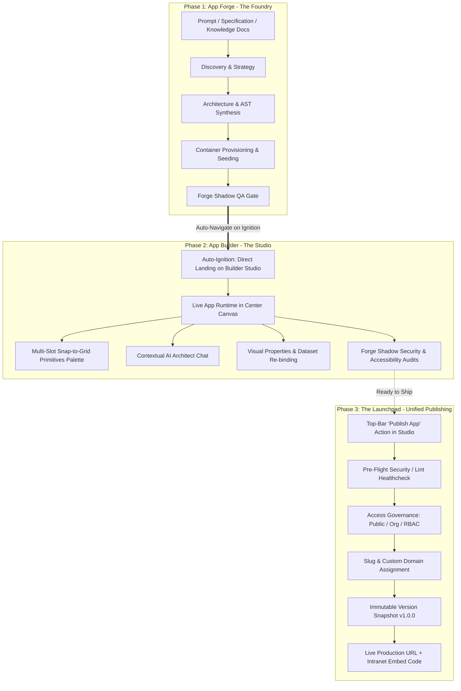

# App Forge to App Builder Lifecycle & Unified Publishing Pipeline

**Project**: Oddjob Autonomous Software Factory — Continuous App Lifecycle  
**Status**: Architecture & Product Proposal  
**Date**: September 3, 2026  
**Authors**: Oddjob Core Architecture Team  

---

## 1. Executive Summary

Oddjob currently contains all the high-powered engines needed to generate, customize, and run enterprise software:
1. **App Forge (`Mach 3 Engine`)**: Conversational 0-to-1 scaffolding, container provisioning, and automated AST generation.
2. **App Builder (`Armory Studio`)**: Visual grid canvas, drag-and-drop primitives arsenal, real-time telemetry, and LLM code synthesizers.
3. **App Deployment Engine**: Next.js reverse-proxy host, container runner, and public slug dispatcher.

However, these three pillars currently operate as **disconnected silos**. When a user forges an app, the process terminates at a static completion card and dumps the user back into an administrative table. The user must manually navigate through tabs to discover the Interactive Builder, and then switch away from the Builder to a separate tab to publish their work.

This proposal defines the unified **Forge → Builder → Publish** lifecycle pipeline, establishing **App Builder as the permanent cockpit and end-state** of the App Forge process.

```
┌──────────────────────────────┐
│          APP FORGE           │  0 ──► 1: Scaffold, AST Generation,
│        (The Foundry)         │  Postgres Seeding & Container Provisioning
└──────────────┬───────────────┘
               │  Instant Ignition Transition
               ▼
┌──────────────────────────────┐
│         APP BUILDER          │  1 ──► N: Live Snap-Grid Canvas,
│         (The Studio)         │  Primitives Arsenal, AI Chat Polish & Audits
└──────────────┬───────────────┘
               │  Top-Bar One-Click Go-Live
               ▼
┌──────────────────────────────┐
│        PUBLISH ENGINE        │  PRODUCTION: Access Governance,
│        (The Launchpad)       │  Custom Slugs/Domains, Version Snapshots
└──────────────────────────────┘
```

---

## 2. Current State vs. Target State

### Current User Journey (Friction & Fragmented Context)


**Pain Points in Current Experience:**
* **Drop-Off at Ignition**: Once Forge reaches 100%, the momentum stalls. Users receive a generic "App Forged Successfully" alert instead of immediately touching their live creation.
* **Hidden Studio**: Many users never discover the full Interactive Builder (`?tab=preview`) because `AppDetail` defaults to the static `overview` or `launch` tab.
* **Context Fracture on Publish**: To publish, the user must leave the active preview, navigate to the `publish` tab, click deploy, and lose their visual workspace context.

---

### Target Unified Journey (Seamless Continuous Flow)


---

## 3. Detailed Phase Architecture

### Phase 1: App Forge (The Foundry — 0 to 1)

* **Mission**: Take natural language requirements, enterprise knowledge docs, or database schemas and scaffold a production-ready Next.js + Tailwind + Postgres application.
* **Execution**:
  - Mach 3 Engine provisions an isolated container workspace (`/forged/{appSlug}`).
  - Generates initial page routes (`pages/index.tsx`, `pages/api/...`).
  - Sets up the Eulerian H3 spatial analytics mesh and telemetry daemon.
  - Automatically runs **Forge Shadow** adversarial security & accessibility audits.
* **The Ignition Handoff**:
  - When the 8th stage (`Ignition`) passes, Forge triggers an animated **Ignition Sequence**:
    ```
    ┌─────────────────────────────────────────────────────────────┐
    │  🚀 IGNITION COMPLETE: RESCUE DISPATCH CONTROL IS ONLINE    │
    │  Container running on Port 10009 · Health: 200 OK           │
    │                                                             │
    │  Entering Customization Studio in 3s...                     │
    │                                                             │
    │  [ Open Builder Studio Now ]      [ View Build Trace ]      │
    └─────────────────────────────────────────────────────────────┘
    ```
  - Directly sets location to: `/armory/apps/{id}?tab=preview&autofocus=studio`.

---

### Phase 2: App Builder (The Studio — 1 to N Customization)

The App Builder is the primary workspace where the user customizes, polishes, and tests the application:

#### A. Center Workspace: Live Interactive Canvas
* **Live Runtime**: Displays the running application inside an optimized, responsive iframe running directly against the assigned port (`http://localhost:10009`).
* **Multi-Slot Targeted Snap-Grid**:
  - Dragging any primitive (`Gauge`, `VideoPlayer`, `DataTable`, `Modal`, etc.) from the palette activates the **4-Zone Grid Placement Overlay** (Top Hero, Left Column, Right Column, Bottom Section).
  - Dropping snaps the component into that exact grid column and prompts the AI synthesizer with strict positioning constraints.
* **Visual Inspector & Selector**:
  - Clicking any element in the live app highlights its bounding box (`hoverRect`) and reveals its parametric properties in the right inspector.

#### B. Right Rail: Multi-Modal Customization Arsenal
* **Visual Tab**: Interactive node tree, data source re-binding (`rescues`, `squads`, `providers`), theme accent colors, and refresh frequencies.
* **Primitives Tab**: 53 representative building blocks with full schema configurators.
* **Plan Tab**: Strategic architecture roadmap, milestone waves, and live task checklist.
* **Audits Tab**: Real-time Forge Shadow QA findings with one-click self-healing prompts.
* **Chat Architect**: Natural language code modifications (`"Make the table search bar sticky"`, `"Switch status badges to glow mode"`).

#### C. Top Navigation Bar: Studio Status & Controls
The Builder header displays:
1. **App Identity**: Icon, Name, and Version (`v1.0.0-draft`).
2. **Runtime Status**: Live port beacon (`🟢 LIVE // PORT 10009`).
3. **Lifecycle State Badge**: `DRAFT` (amber) / `STAGED` (cyan) / `PUBLISHED` (emerald).
4. **Interactive Modes**: `Select Mode`, `Full Screen`, `Device Viewport Switcher` (Desktop, Tablet, Mobile).
5. **Primary Action**: **`[🚀 Publish App]`** (glowing primary button).

---

### Phase 3: The Launchpad (Unified Publishing Flow)

Publishing no longer requires leaving the Studio. Clicking **`[Publish App]`** opens a focused, glassmorphic **Go-Live Modal** directly within the Builder:

```
┌─────────────────────────────────────────────────────────────────────────┐
│  🚀 PUBLISH APPLICATION: RESCUE DISPATCH CONTROL                        │
├─────────────────────────────────────────────────────────────────────────┤
│                                                                         │
│  1. PRODUCTION ACCESS & ROUTING                                         │
│     Public URL:    https://oddjob.app/forged/ [ rescue-dispatch       ] │
│     Custom Domain: [ dispatch.citysafety.org                 ] (CNAME)  │
│                                                                         │
│  2. ACCESS GOVERNANCE (RBAC)                                            │
│     ( ) Public (Anyone with link)                                       │
│     (•) Organization Only (Oddjob Org 473 authenticated members)        │
│     ( ) Role Restricted (Super Admin & Operator only)                   │
│                                                                         │
│  3. PRE-FLIGHT VERIFICATION                                             │
│     ✅ AST Syntax & TypeScript Compilation: Clean                       │
│     ✅ Forge Shadow Security Gate: Passed (0 critical, 0 high)          │
│     ✅ Responsive Grid Checks: Validated (Mobile / Tablet / Desktop)    │
│                                                                         │
│  4. VERSION SNAPSHOT & CHANGELOG                                        │
│     Release Version: [ v1.0.0 ]                                         │
│     Notes: Added Tactical Gauge and live Squad Readiness feed.          │
│                                                                         │
│  [ Cancel ]                                       [ Deploy to Production ]
└─────────────────────────────────────────────────────────────────────────┘
```

#### On Successful Publish:
1. The app status changes to **`PUBLISHED`** with a permanent green beacon.
2. A success modal displays:
   - **Live Production URL**: `https://oddjob.app/forged/rescue-dispatch` (with a "Copy" and "Open in New Window" button).
   - **Intranet Embed Snippet**: `<iframe src="https://oddjob.app/forged/rescue-dispatch?embed=true" width="100%" height="800px" frameborder="0"></iframe>`
   - **QR Code**: For instant mobile testing and field deployment.
3. The published application is indexed into the organization's **App Marketplace & Fleet** (`/armory/apps`).

---

## 4. Technical Architecture & Database Schema

### Database Schema Updates (`schema.ts`)

```typescript
// 1. Extend App Lifecycle States
export const appLifecycleStateEnum = pgEnum('app_lifecycle_state', [
  'drafting',      // Initial prompt / wizard stage
  'forging',       // Active Mach 3 background forge build
  'polishing',     // In App Builder Studio (dev container active)
  'staged',        // Internal QA review completed
  'published',     // Active in production with public slug
  'archived'       // Deprecated / offline
]);

// 2. Add columns to `apps` table
export const apps = pgTable('apps', {
  id: serial('id').primaryKey(),
  name: text('name').notNull(),
  slug: text('slug').notNull().unique(),
  description: text('description'),
  lifecycleState: appLifecycleStateEnum('lifecycle_state').default('drafting').notNull(),
  publishedVersion: text('published_version').default('0.1.0'),
  publishedAt: timestamp('published_at'),
  publicUrl: text('public_url'),
  customDomain: text('custom_domain'),
  accessPolicy: text('access_policy').default('organization').notNull(), // 'public' | 'organization' | 'role_restricted'
  allowedRoles: jsonb('allowed_roles').$type<string[]>().default([]),
  activeSnapshotHash: text('active_snapshot_hash'),
  // Existing fields: organizationId, developerOrgId, config, icon, createdAt, updatedAt
});

// 3. Immutable Version Snapshots Table (`app_snapshots`)
export const appSnapshots = pgTable('app_snapshots', {
  id: serial('id').primaryKey(),
  appId: integer('app_id').references(() => apps.id, { onDelete: 'cascade' }).notNull(),
  version: text('version').notNull(),
  releaseNotes: text('release_notes'),
  publishedBy: integer('published_by').references(() => users.id),
  fileTree: jsonb('file_tree').notNull(), // Complete snapshot of all source files
  configSnapshot: jsonb('config_snapshot').notNull(),
  auditScore: integer('audit_score').default(100),
  createdAt: timestamp('created_at').defaultNow().notNull(),
});
```

---

## 5. API Layer Specifications

| Method | Endpoint | Description | Lifecycle Impact |
|:---|:---|:---|:---|
| `POST` | `/api/apps/forge/ignite` | Starts Mach 3 build process | `drafting` → `forging` |
| `POST` | `/api/apps/:id/transition-to-builder` | Completes forge & allocates dev port | `forging` → `polishing` |
| `GET` | `/api/apps/:id/builder-state` | Fetches live port, files, audits, and publish status | Read-only |
| `POST` | `/api/apps/:id/publish` | Validates pre-flight, takes snapshot, assigns slug | `polishing` → `published` |
| `POST` | `/api/apps/:id/unpublish` | Removes public route, keeps in builder | `published` → `polishing` |
| `POST` | `/api/apps/:id/rollback/:version` | Restores files from `app_snapshots` | Reverts code state |

---

## 6. Implementation Plan & Delivery Phases

### Phase 1: Forge-to-Builder Transition (Quick Win)
* **Goal**: Eliminate the drop-off after Forge finishes.
* **Tasks**:
  1. In `AppForge.tsx`, replace the static "App Forged Successfully" card with an **Ignition Completion Sequence**.
  2. Implement an automatic 3-second countdown to route to `/armory/apps/{id}?tab=preview`.
  3. Ensure the primary button explicitly reads: **"Open in Builder Studio"**.

### Phase 2: Top-Bar Publish Action in App Builder
* **Goal**: Bring the publish capability into the user's primary view.
* **Tasks**:
  1. In `AppInteractiveBuilderTab.tsx`, add a glowing **`[Publish App]`** button to the top toolbar.
  2. Build a modern `PublishModal.tsx` component that accepts slug, access policy, and version notes.
  3. Wire the modal to the existing `POST /api/apps/{id}/publish` endpoint.
  4. Show the live `PUBLISHED` status badge in the builder header.

### Phase 3: Version Snapshots & Pre-Flight Quality Gate
* **Goal**: Ensure published apps are stable, audited, and rollback-ready.
* **Tasks**:
  1. Run Forge Shadow QA and AST syntax checks prior to confirming publication.
  2. Persist code snapshots to `app_snapshots` on publish.
  3. Add a "Rollback to Previous Version" selector in the Plan / History rail.

### Phase 4: Shareable Launchpad & Intranet Embeds
* **Goal**: Make deployed apps instantly shareable across the organization.
* **Tasks**:
  1. Generate embed code (`<iframe>`) and QR code upon publication.
  2. Provide one-click deep link to the public production slug (`/forged/:slug`).

---

## 7. Expected Impact & Value

1. **Zero-Drop-Off Flow**: Users move fluidly from prompt → generation → interactive visual polish → live release in a single session.
2. **Autonomous Software Velocity**: Cuts the time from idea to deployed organizational tool from hours to under 3 minutes.
3. **Enterprise Governance**: Guarantees that every app deployed into production has passed AST linting, Forge Shadow security checks, and role-based access enforcement.

---

## 8. Complete Acceptance Test Suite (AT-1 to AT-6)

To guarantee that the unified pipeline behaves deterministically, securely, and seamlessly, the following 22 acceptance tests across 6 stages must pass.

### Stage 1: Forge Ignition & Transition to Studio
* **AT-1.1: Automated Ignition Detection**
  - *Given*: An active Mach 3 Forge build reaches stage 8 (`Ignition`) with status `done`.
  - *When*: The SSE stream receives `{ stage: 'Ignition', status: 'done', port: 10009, appId: 824 }`.
  - *Then*: The UI immediately transitions from the progress log into the **Ignition Success Banner** displaying container port and health status.
* **AT-1.2: 3-Second Countdown & Immediate Bypass**
  - *Given*: The Ignition Banner is active.
  - *When*: 3 seconds elapse without user interaction, OR the user clicks `[ Open Builder Studio Now ]`.
  - *Then*: The router calls `setLocation('/armory/apps/824?tab=preview')`. Clicking `[ View Build Trace ]` cancels the timer and retains the log view.
* **AT-1.3: Deep-Link Route Integrity**
  - *Given*: Direct navigation to `/armory/apps/824?tab=preview`.
  - *Then*: The page mounts in full-screen Studio mode (`isFullScreenTab === true`), hiding extraneous outer headers and maximizing canvas area.
* **AT-1.4: Container Health & Port Verification**
  - *Given*: Transition to the Builder Studio occurs.
  - *When*: The studio mounts.
  - *Then*: An HTTP ping to `http://localhost:10009` (proxied via `/forged/rescue-dispatch`) returns `HTTP 200` within 5 seconds; otherwise, an auto-restart toast is displayed.

---

### Stage 2: App Builder Customization & Polish
* **AT-2.1: Live Runtime Iframe Rendering**
  - *Given*: Builder Studio is mounted.
  - *Then*: The live Next.js application is rendered in the center iframe with zero cross-origin frame blocking.
* **AT-2.2: Multi-Slot 4-Zone Targeted Drag-and-Drop**
  - *Given*: The user drags a primitive (e.g. `PlatformMetricGaugeBlock` or `DataTable`) from the Primitives or Block Palette.
  - *When*: Dragging over the canvas, the **4-Zone Grid Overlay** displays Top Hero, Left Column, Right Column, and Bottom Section.
  - *Then*: Hovering over a quadrant illuminates it with an active badge. Releasing the drop dispatches `handleDirectDropComponent(comp, slot)` with explicit spatial prompt instructions.
* **AT-2.3: Visual Editor Card Inspection & Parametric Re-binding**
  - *Given*: The user selects the `Visual` tab in the right studio rail.
  - *When*: A block node is selected.
  - *Then*: The Properties panel displays live text fields, dataset selector buttons (`rescues`, `squads`, `providers`), and theme colors. Applying changes updates the node state.
* **AT-2.4: Primitives Arsenal Code Materialization**
  - *Given*: Any of the 53 primitives is configured via its form.
  - *When*: The user clicks `Materialize Component`.
  - *Then*: Prompt DNA is sent to `POST /api/apps/824/enhance`, code is synthesized, hot-reloaded, and validated without JSON schema errors.
* **AT-2.5: AI Chat Architect Code Synthesis**
  - *Given*: The user enters a natural language modification prompt in the Chat tab.
  - *Then*: The synthesizer generates valid JSX edits, updates the container files, and refreshes the live iframe.
* **AT-2.6: Forge Shadow QA Live Audits**
  - *Given*: The user opens the `Audits` tab.
  - *Then*: Real-time adversarial security, accessibility, and performance findings are rendered with severity pulse badges and one-click self-healing remediation buttons.

---

### Stage 3: Pre-Flight Verification Gate
* **AT-3.1: AST Syntax & TypeScript Compilation Gate**
  - *Given*: The user clicks `[Publish App]`.
  - *When*: Pre-flight validation executes.
  - *Then*: An AST validator checks all project files. If any TypeScript syntax errors exist, publication is blocked with an actionable error list.
* **AT-3.2: Adversarial Security Gate**
  - *Given*: An app has outstanding `critical` security findings (e.g., exposed unauthenticated mutating API routes).
  - *When*: Pre-flight validation executes.
  - *Then*: Publication is halted until critical issues are acknowledged or remediated via Forge Shadow.
* **AT-3.3: Responsive Viewport Check**
  - *Given*: The pre-flight check runs.
  - *Then*: The system confirms the layout structure supports mobile (`375px`), tablet (`768px`), and desktop (`1280px`) breakpoints without horizontal scroll overflow.

---

### Stage 4: Publishing & Release Execution
* **AT-4.1: Top-Bar Publish Modal Launch**
  - *Given*: The user is in App Builder Studio.
  - *When*: Clicking `[Publish App]` in the top header.
  - *Then*: A glassmorphic modal opens without navigating away or tearing down the live preview iframe.
* **AT-4.2: Public Slug Conflict Resolution**
  - *Given*: The user enters or confirms a public slug (e.g., `rescue-dispatch`).
  - *When*: The slug is already owned by another active app in the same scope.
  - *Then*: The form displays an inline error with auto-suggestions (e.g. `rescue-dispatch-2`).
* **AT-4.3: Access Governance (RBAC) Configuration**
  - *Given*: The user selects `Organization Only` with role `Operator`.
  - *When*: The app is published.
  - *Then*: The reverse proxy intercepts incoming requests to `/forged/:slug` and enforces session authentication and role checks before serving assets.
* **AT-4.4: Immutable Version Snapshot (`app_snapshots`)**
  - *Given*: A publish request is confirmed.
  - *When*: `POST /api/apps/824/publish` executes.
  - *Then*: A new record is inserted into `app_snapshots` containing the full file tree JSON, version string (`v1.0.0`), user ID, and timestamp.
* **AT-4.5: Lifecycle State Transition**
  - *Given*: Successful publication.
  - *Then*: The app record in table `apps` updates `lifecycle_state` from `polishing` to `published`, and sets `published_at` to current timestamp.

---

### Stage 5: Post-Publish Production & Distribution
* **AT-5.1: Public Route Routing & Reverse Proxy**
  - *Given*: An app is published with slug `rescue-dispatch`.
  - *When*: Any authorized client visits `http://localhost:5000/forged/rescue-dispatch`.
  - *Then*: The production Next.js application renders cleanly with HTTP 200 and stylesheets loaded.
* **AT-5.2: Intranet Iframe Embed Rendering**
  - *Given*: A third-party web page embeds `<iframe src="http://localhost:5000/forged/rescue-dispatch?embed=true" />`.
  - *Then*: The page renders in embedded mode (omitting outer chrome) with responsive height adaptations and valid CORS headers.
* **AT-5.3: QR Code Generation & Mobile Readability**
  - *Given*: The publish success modal is displayed.
  - *Then*: A high-contrast SVG QR code encoding the production URL is rendered and scannable by mobile cameras.
* **AT-5.4: Live Status Badge Transition**
  - *Given*: An app transition to published.
  - *Then*: In both the Builder Studio top bar and the App Arsenal list, the status badge transforms from amber `DRAFT` to glowing emerald `PUBLISHED`.
* **AT-5.5: Organization App Fleet / Marketplace Indexing**
  - *Given*: Successful publish.
  - *When*: Navigating to `/armory/apps`.
  - *Then*: The app appears in the active fleet with the `Published` filter active and direct `Launch` CTA.

---

### Stage 6: Rollback & Unpublish Lifecycle
* **AT-6.1: One-Click Unpublish**
  - *Given*: An active published app.
  - *When*: An administrator clicks `Unpublish App` from the publish menu.
  - *Then*: `lifecycle_state` reverts to `polishing`, the public slug route is disabled, and traffic receives a standard 404/Maintenance screen while the builder remains editable.
* **AT-6.2: One-Click Snapshot Rollback**
  - *Given*: An app with multiple published versions (`v1.0.0`, `v1.1.0`).
  - *When*: An operator clicks `Rollback to v1.0.0`.
  - *Then*: The file tree from `app_snapshots` for `v1.0.0` overwrites the workspace, the container restarts, and the live preview reflects the restored state.

---

## 9. Multi-Archetype Scenarios & Headless API Builder Architecture

Apps forged in Oddjob span distinct structural archetypes. While UI-centric applications naturally populate a visual grid canvas, **Headless APIs, Background Daemons, and Spatial Data Engines** have zero graphical interface.

The App Builder is designed as an **Adaptive Multi-Modal Studio** that automatically morphs its central canvas and arsenal based on the app's structural archetype.

```
┌────────────────────────────────────────────────────────────────────────────────────────┐
│                              ODDJOB ADAPTIVE STUDIO CANVAS                             │
├──────────────────────────┬─────────────────────────────────────────────────────────────┤
│  APP ARCHETYPE           │  CENTER CANVAS PRIMARY RENDERING                            │
├──────────────────────────┼─────────────────────────────────────────────────────────────┤
│  1. Full-Stack / UI      │  Live Interactive Webpage (Next.js React Runtime + Snap-Grid│
│  2. Headless API         │  Interactive OpenAPI 3.1 Console, Endpoint Tester & Schema  │
│  3. Background Daemon    │  Live Mission Execution Stream, Queue Visualizer & Cron     │
│  4. Spatial Mesh / Data  │  Eulerian H3 Hexagonal Map, Telemetry Stream & GeoJSON      │
└──────────────────────────┴─────────────────────────────────────────────────────────────┘
```

---

### Scenario A: Full-Stack Web Application / Operations Dashboard
* **Example**: `Rescue Dispatch Control` (The current App 824).
* **Forge Objective**: *"Scaffold a tactical rescue dispatch operations center with live squad readiness and map."*
* **Forge Selected Packs**: `core-node-express`, `ui-oddjob-design-system`, `data-postgres-drizzle`.
* **Builder Canvas**:
  - Center: Live Next.js application inside the responsive iframe.
  - 4-Zone Snap Grid: Dragging `Gauge` or `VideoPlayer` drops directly into top, left, right, or bottom columns.
  - Customization: Style tweaking, real-time SSE frequency, responsive device switcher.
* **Publish Action**:
  - Generates public web route: `https://oddjob.app/forged/rescue-dispatch`.
  - Provides iframe embed snippet for intranet integration.

---

### Scenario B: Headless API Microservice (No Frontend UI)
* **Example**: `Autonomous Routing & Geospatial Calculation API`.
* **Forge Objective**: *"Build a high-throughput REST API that receives emergency coordinates, queries the Eulerian H3 spatial index, and returns optimized vehicle routing vectors."*
* **Forge Selected Packs**: `core-node-express`, `data-postgres-drizzle`, `auth-jwt` (UI packs omitted).
* **How Headless APIs are Handled in App Builder**:
  1. **Adaptive Canvas — OpenAPI 3.1 Swagger & Request Playground**:
     - Instead of a blank HTML page, the center workspace renders an interactive **API Explorer** ([`ForgeLiveAssemblyPreview.tsx`](../server/domain/apps/ui/modules/apps/components/ForgeLiveAssemblyPreview.tsx#L343) API Contract mode).
     - Renders all defined endpoints (`POST /api/v1/routes/calculate`, `GET /api/v1/sectors/:id/metrics`).
     - **Live "Try It Out" Playground**: Operators can craft test JSON request payloads, execute requests against the running container on port 10009, and inspect real-time responses, headers, latency (ms), and status codes.
  2. **API Primitives Palette (Replacing UI Components)**:
     - The Primitives menu morphs from visual widgets (Buttons/Cards) into **API Architecture Primitives**:
       - `JWT Auth Middleware Block`: Enforces Bearer token verification.
       - `Rate Limiter Block`: Token-bucket 100 req/min throttling.
       - `Postgres CRUD Generator`: Automatic REST endpoints over a Drizzle table.
       - `Webhook Dispatcher Block`: Outbound event fan-out on record mutations.
       - `Zod Request Validator`: Schema enforcement on incoming JSON bodies.
     - Dragging a `Rate Limiter` onto an endpoint card prompts the AI synthesizer to inject the middleware into `server/routes/...`.
  3. **Live Request Forensics**:
     - The bottom console streams incoming HTTP requests, headers, execution time, and database query latency.
* **Publish Action for Headless APIs**:
  - Deploys endpoint: `https://api.oddjob.app/forged/routing-engine/v1`.
  - **API Key Provisioning**: Generates and manages consumer secret keys (`odd_live_sk_...`).
  - **Contract Export**: Downloadable `openapi.json` and interactive docs link.
  - **Client SDK Generation**: Generates ready-to-copy code snippets (`curl`, `TypeScript`, `Python`, `Go`).

---

### Scenario C: Autonomous Background Daemon / Agent Swarm
* **Example**: `Forensic SaaS Sync & Anomaly Detection Daemon`.
* **Forge Objective**: *"Deploy an autonomous worker that polls Salesforce and Jira every 15 minutes, executes sentiment scoring, and triggers workflow healer missions on anomalies."*
* **Forge Selected Packs**: `core-node-express`, `data-postgres-drizzle`, `auth-jwt`.
* **How Background Daemons are Handled in App Builder**:
  1. **Adaptive Canvas — Live Task Queue & Pipeline Visualizer**:
     - Center canvas displays a live **Mission Control Graph** showing the worker cycle state: `IDLE` → `POLLING` → `ANALYZING` → `EMITTING`.
     - Queue backlog counter (BullMQ / Redis active jobs).
     - Cron scheduler trigger timeline (next execution in 08m:42s).
  2. **Daemon Primitives Palette**:
     - `Cron Schedule Block`: Configurable cron expressions (`*/15 * * * *`).
     - `Event Bus Sink`: Subscribe to Oddjob platform telemetry events.
     - `Dead Letter Queue`: Automatic retry and error alerting policies.
     - `Human-in-the-Loop (HIL) Escalator`: Triggers review requests on low confidence.
  3. **Interactive Simulation**:
     - `[Trigger Immediate Execution]` button allows running an ad-hoc cycle inside the dev container to verify data transformations without waiting for the cron timer.
* **Publish Action for Daemons**:
  - Registers the worker with Oddjob's production **Container Reconciliation Service**.
  - Deploys as a permanent background daemon with health monitoring and automatic crash restarts.

---

### Scenario D: Eulerian Spatial Mesh & Real-Time Sensor Hub
* **Example**: `Uber H3 Hexagonal Grid Fleet Intelligence`.
* **Forge Objective**: *"Create a spatial telemetry ingestion app that projects vehicle pings onto H3 resolution-8 hexagonal bins and calculates real-time fleet density."*
* **Forge Selected Packs**: `core-node-express`, `ui-oddjob-design-system`, `data-postgres-drizzle`.
* **Builder Canvas**:
  - Center: Full-bleed 3D Mapbox / MapLibre canvas rendering interactive H3 hexagons with color-coded density heatmaps.
  - Right Rail: Hexagon resolution controls (H3 Res 6-10), GPS jitter filters, and simulated vehicle ping generators.
* **Publish Action**:
  - Deploys live telemetry dashboard and streaming WebSocket endpoint (`wss://oddjob.app/forged/fleet-mesh/stream`).


