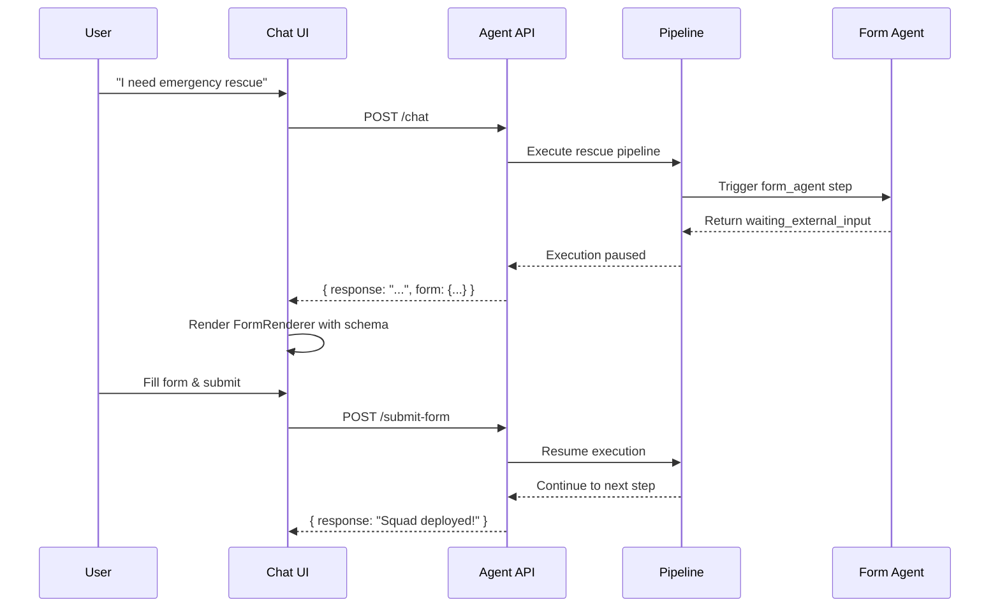

# Published Agent AI - Form Support

## Overview
Published Agent AI chat now supports interactive forms through the chat interface. When an agent invokes a pipeline with a `form_agent` step, the form schema is returned in a structured format that the frontend can render.

## API Changes

### 1. Chat Response with Form

**Endpoint:** `POST /api/public/agents/:slug/chat`

When a form is detected, the response includes:

```json
{
  "sessionId": "sess_123",
  "response": "Please fill out this rescue request form to continue...",
  "requiresInput": true,
  "form": {
    "type": "form_agent",
    "schema": {
      "fields": [
        {
          "key": "location",
          "type": "text",
          "label": "Incident Location",
          "required": true
        },
        {
          "key": "severity",
          "type": "select",
          "label": "Severity Level",
          "required": true,
          "options": ["Critical", "High", "Medium", "Low"]
        },
        {
          "key": "casualties",
          "type": "number",
          "label": "Number of Casualties",
          "required": false
        }
      ]
    },
    "submitUrl": "/api/public/agents/rescue-coordinator/submit-form",
    "sessionId": "sess_123",
    "executionId": 456,
    "stepExecutionId": 789
  },
  "metadata": {
    "model": "gemini-2.0-flash",
    "timestamp": "2026-05-01T04:20:00Z"
  }
}
```

### 2. Form Submission

**Endpoint:** `POST /api/public/agents/:slug/submit-form`

**Request Body:**

```json
{
  "sessionId": "sess_123",
  "formData": {
    "location": "Sector 7, Building A",
    "severity": "Critical",
    "casualties": 3
  },
  "executionId": 456,
  "stepExecutionId": 789
}
```

**Response:**

```json
{
  "success": true,
  "message": "Form submitted and pipeline resumed",
  "executionId": 456,
  "pipelineStatus": "running",
  "sessionId": "sess_123"
}
```

## How It Works

### Form Detection

The system detects forms in three ways:

1. **Tool Call Output Detection**
   ```typescript
   const formToolCall = lastStep.toolCalls.find(tc => 
       tc.name?.includes('form') || 
       tc.output?._type === 'form_agent_context' ||
       tc.output?.formSchema
   );
   ```

2. **Response Content Parsing**
   ```typescript
   const jsonMatch = responseContent.match(/\{[\s\S]*"formSchema"[\s\S]*\}/);
   ```

3. **Pipeline Execution Context**
   - When a pipeline step returns `waiting_external_input` with form schema

### Flow Diagram



## Frontend Integration

### React Component Example

```tsx
import { useState } from 'react';
import FormRenderer from "@domain-ui/core/ui/components/shared/FormRenderer";

function AgentChat({ slug }) {
  const [messages, setMessages] = useState([]);
  const [activeForm, setActiveForm] = useState(null);

  const handleChatResponse = (data) => {
    setMessages(prev => [...prev, { 
      role: 'agent', 
      content: data.response 
    }]);
    
    if (data.requiresInput && data.form) {
      setActiveForm(data.form);
    }
  };

  const handleFormSubmit = async (formData) => {
    const res = await fetch(`/api/public/agents/${slug}/submit-form`, {
      method: 'POST',
      headers: { 'Content-Type': 'application/json' },
      body: JSON.stringify({
        sessionId: activeForm.sessionId,
        formData,
        executionId: activeForm.executionId,
        stepExecutionId: activeForm.stepExecutionId
      })
    });
    
    const result = await res.json();
    setActiveForm(null);
    
    // Continue chat
    if (result.success) {
      // Poll for next agent response or refresh messages
    }
  };

  return (
    <div>
      <ChatMessages messages={messages} />
      
      {activeForm && (
        <FormRenderer 
          schema={activeForm.schema}
          onSubmit={handleFormSubmit}
        />
      )}
      
      {!activeForm && <ChatInput onSend={sendMessage} />}
    </div>
  );
}
```

## Supported Form Field Types

| Type | Description | Example |
|------|-------------|---------|
| `text` | Single line text input | Name, ID |
| `textarea` | Multi-line text | Description |
| `markdown` | Rich text editor | Detailed report |
| `number` | Numeric input | Count, amount |
| `select` | Dropdown selection | Priority, status |
| `boolean` | Checkbox/toggle | Yes/No question |
| `rating` | Star rating | Satisfaction |
| `date` | Date picker | Due date |

## Pipeline Configuration

### Example Pipeline with Form Agent

```yaml
steps:
  - name: "Collect Rescue Details"
    job: "rescue_intake_form"
    config:
      formSchema:
        fields:
          - key: location
            type: text
            label: Incident Location
            required: true
          - key: severity
            type: select
            label: Severity
            options: [Critical, High, Medium, Low]
            required: true
      timeoutMinutes: 30
      retryOnFailure: false

  - name: "Process Request"
    job: "rescue_processor"
    dependsOn: "Collect Rescue Details"
```

## Testing

### Test Script

```bash
# Test form detection in chat
npx tsx scripts/test-agent-form-support.ts
```

### Manual Test Flow

1. **Start the server**
   ```bash
   npm run dev
   ```

2. **Create a form agent job**
   ```bash
   curl -X POST http://localhost:5000/api/jobs \
     -H "Content-Type: application/json" \
     -d '{
       "name": "Rescue Intake Form",
       "type": "form_agent",
       "config": {
         "formSchema": {
           "fields": [
             { "key": "location", "type": "text", "label": "Location", "required": true }
           ]
         }
       }
     }'
   ```

3. **Create a pipeline with the form**

4. **Create a published agent** that triggers the pipeline

5. **Chat with the agent** and verify form appears

6. **Submit the form** and verify pipeline resumes

## Security Considerations

1. **Rate Limiting**: Form submission endpoint uses `chatRateLimiter` (100 requests per 15min)

2. **Organization Scoping**: All forms are scoped to the agent's organization

3. **Session Validation**: Form submissions require matching sessionId

4. **No PII in Logs**: Form data is stored in agentChatMessages with metadata flag

## Limitations

1. **Single Form at a Time**: Only one pending form per chat session
2. **No Draft Saving**: Partial form submissions are not persisted
3. **Timeout**: Forms must be submitted within pipeline timeout (default 30min)
4. **No File Uploads**: Current implementation supports text/number/select fields only

## Future Enhancements

- [ ] Multi-step wizard forms
- [ ] Form validation with custom rules
- [ ] Conditional field visibility
- [ ] File attachment support
- [ ] Draft auto-save
- [ ] Form templates library
