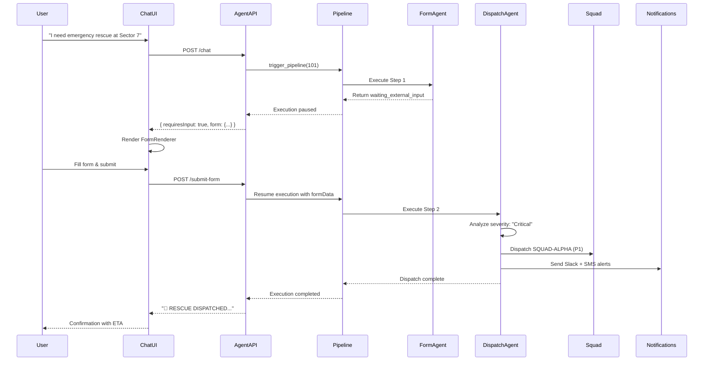

# Rescue Dispatch Workflow with Form Agent

## Scenario
A chat user needs emergency rescue. The workflow:
1. User chats with published rescue agent
2. Agent triggers pipeline with form + dispatch
3. Form collects problem details
4. Pipeline automatically dispatches rescue based on form data

## Pipeline Configuration

```yaml
# Pipeline: Emergency Rescue Intake & Dispatch
steps:
  # Step 1: Collect incident details via form
  - name: "Collect Incident Details"
    job: "emergency_intake_form"
    type: "form_agent"
    config:
      formSchema:
        fields:
          - key: location
            type: text
            label: "Incident Location"
            required: true
            placeholder: "e.g., Sector 7, Building A"
          
          - key: severity
            type: select
            label: "Severity Level"
            required: true
            options: ["Critical", "High", "Medium", "Low"]
          
          - key: casualties
            type: number
            label: "Number of Casualties"
            required: false
          
          - key: description
            type: textarea
            label: "Incident Description"
            required: true
          
          - key: contact_phone
            type: text
            label: "Contact Phone"
            required: true
            pattern: "^\\d{10}$"
      timeoutMinutes: 15
      retryOnFailure: false

  # Step 2: Analyze and dispatch
  - name: "Dispatch Rescue Squad"
    job: "rescue_dispatcher"
    type: "dispatcher"
    dependsOn: "Collect Incident Details"
    config:
      dispatchLogic: |
        // Access form data from previous step
        const formData = steps["Collect Incident Details"].output;
        
        // Logic to select squad based on severity and location
        if (formData.severity === "Critical") {
          return { squad: "SQUAD-ALPHA", priority: "P1" };
        } else if (formData.severity === "High") {
          return { squad: "SQUAD-BRAVO", priority: "P2" };
        } else {
          return { squad: "SQUAD-GHOST", priority: "P3" };
        }
      notificationConfig:
        channels: ["slack", "sms"]
        messageTemplate: |
          🚨 RESCUE DISPATCHED 🚨
          Squad: {{squad}}
          Location: {{location}}
          Severity: {{severity}}
          ETA: {{eta}} minutes
```

## Published Agent Setup

### 1. Create Form Agent Job
```typescript
POST /api/jobs
{
  name: "Emergency Intake Form",
  type: "form_agent",
  config: {
    formSchema: { /* ... fields ... */ },
    timeoutMinutes: 15
  }
}
```

### 2. Create Dispatch Agent Job
```typescript
POST /api/jobs
{
  name: "Rescue Dispatcher",
  type: "dispatcher",
  config: {
    dispatchLogic: "...",
    notificationConfig: { ... }
  }
}
```

### 3. Create Pipeline
```typescript
POST /api/pipelines
{
  name: "Emergency Rescue Dispatch",
  steps: [
    { jobId: 123, order: 1, outputName: "intake_data" },
    { jobId: 456, order: 2, dependsOn: 1 }
  ]
}
```

### 4. Create Published Agent
```typescript
POST /api/agent-deployments
{
  slug: "rescue-coordinator",
  title: "Rescue Coordinator",
  jobId: 789,  // Job that triggers the pipeline
  allowedTools: ["trigger_pipeline", "get_pipeline_status"],
  allowedPipelineIds: [101]  // Emergency Rescue Dispatch pipeline
}
```

## Chat Flow

### User Initiates Request
```
User: "I need emergency rescue at Sector 7"
```

### Agent Triggers Pipeline
```javascript
// Agent decides to trigger rescue pipeline
tool: "trigger_pipeline"
params: {
  pipelineId: 101,  // Emergency Rescue Dispatch
  inputData: {
    requestedLocation: "Sector 7"
  }
}
```

### Pipeline Hits Form Step - Returns to Chat
```json
{
  "sessionId": "sess_rescue_001",
  "response": "I'll help you immediately. Please provide details about the emergency:",
  "requiresInput": true,
  "form": {
    "type": "form_agent",
    "schema": {
      "fields": [
        { "key": "location", "type": "text", "label": "Incident Location", "required": true },
        { "key": "severity", "type": "select", "label": "Severity", "options": ["Critical", "High", "Medium", "Low"], "required": true },
        { "key": "casualties", "type": "number", "label": "Casualties", "required": false },
        { "key": "description", "type": "textarea", "label": "Description", "required": true },
        { "key": "contact_phone", "type": "text", "label": "Contact Phone", "required": true }
      ]
    },
    "submitUrl": "/api/public/agents/rescue-coordinator/submit-form",
    "executionId": 5678,
    "stepExecutionId": 9012
  }
}
```

### Frontend Renders Form
```tsx
<FormRenderer 
  schema={data.form.schema}
  onSubmit={async (formData) => {
    await fetch(data.form.submitUrl, {
      method: 'POST',
      body: JSON.stringify({
        sessionId: data.sessionId,
        formData,
        executionId: data.form.executionId,
        stepExecutionId: data.form.stepExecutionId
      })
    });
  }}
/>
```

### User Fills Form
```
Location: "Sector 7, Building C, Floor 3"
Severity: "Critical"
Casualties: 2
Description: "Structural collapse with trapped workers"
Contact Phone: "5551234567"
[Submit Button]
```

### Form Submission Resumes Pipeline
```bash
POST /api/public/agents/rescue-coordinator/submit-form
{
  "sessionId": "sess_rescue_001",
  "formData": { /* user input */ },
  "executionId": 5678,
  "stepExecutionId": 9012
}
```

### Pipeline Continues to Dispatch Step
```javascript
// Pipeline step 2 executes with form data
const formData = steps["Collect Incident Details"].output;
// { location: "Sector 7...", severity: "Critical", casualties: 2, ... }

// Dispatch logic selects squad
if (formData.severity === "Critical") {
  dispatchSquad("SQUAD-ALPHA", { priority: "P1", eta: "8 min" });
  sendNotifications({ channels: ["slack", "sms"], priority: "high" });
}
```

### Agent Returns Dispatch Confirmation
```json
{
  "sessionId": "sess_rescue_001",
  "response": "🚨 RESCUE DISPATCHED 🚨\n\nSquad: SQUAD-ALPHA\nLocation: Sector 7, Building C, Floor 3\nPriority: P1 (Critical)\nETA: 8 minutes\n\nYou will receive updates on your phone: 5551234567"
}
```

## Complete Sequence Diagram



## Key Implementation Points

### Form Data Flow
```
User Input → FormRenderer → submit-form API → Pipeline Resume → Step Output → Dispatch Logic
```

### Dispatch Logic Accesses Form Data
```typescript
// In dispatch agent config
const dispatchLogic = `
const formData = context.pipeline.steps["Collect Incident Details"].output;

// Route based on severity
switch(formData.severity) {
  case "Critical": return { squad: "ALPHA", priority: 1, escalate: true };
  case "High": return { squad: "BRAVO", priority: 2 };
  default: return { squad: "GHOST", priority: 3 };
}

// Include location in dispatch
const location = formData.location;
const casualties = formData.casualties || 0;
`;
```

### Notifications Include Form Data
```typescript
const notificationConfig = {
  messageTemplate: `
🚨 RESCUE DISPATCHED

Location: {{location}}
Severity: {{severity}}
Casualties: {{casualties}}
Description: {{description}}
Contact: {{contact_phone}}

Squad: {{assignedSquad}}
ETA: {{eta}} minutes
  `
};
```

## Testing the Flow

```bash
# 1. Start pipeline trigger
POST /api/public/agents/rescue-coordinator/chat
{ "message": "I need rescue at Sector 7", "sessionId": "test_001" }

# 2. Verify form response
# Should return: { requiresInput: true, form: {...} }

# 3. Submit form
POST /api/public/agents/rescue-coordinator/submit-form
{
  "sessionId": "test_001",
  "formData": {
    "location": "Sector 7",
    "severity": "Critical",
    "casualties": 2,
    "description": "Test incident",
    "contact_phone": "5551234567"
  },
  "executionId": 5678,
  "stepExecutionId": 9012
}

# 4. Check pipeline status
GET /api/public/agents/rescue-coordinator/messages?sessionId=test_001

# 5. Verify dispatch confirmation
# Should include squad assignment and ETA
```

## Summary

✅ **Yes, this workflow is fully supported!**

1. **Chat user** requests rescue → **Agent** triggers pipeline
2. **Pipeline** hits form agent step → **Form** returned to chat
3. **User** fills form → **Submit** resumes pipeline
4. **Pipeline** continues to dispatch step → **Rescue** dispatched automatically
5. **Agent** confirms dispatch with details to user

The form data flows seamlessly from user input through to the dispatch decision logic.
