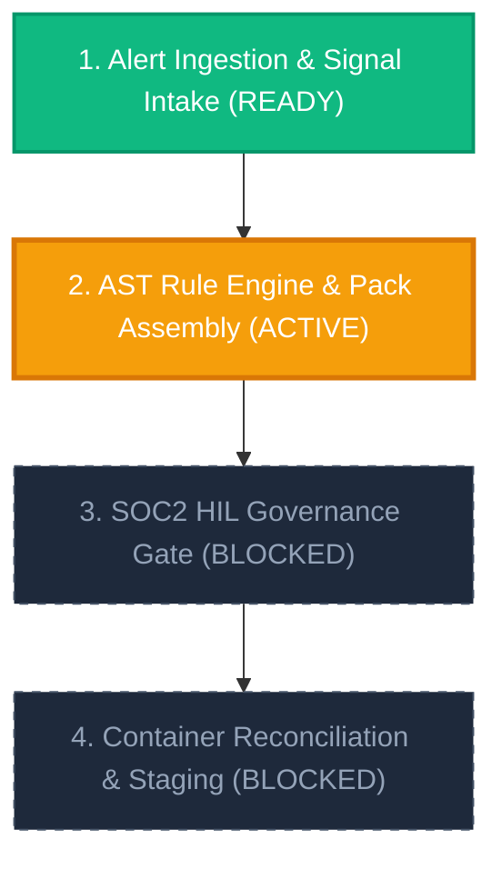
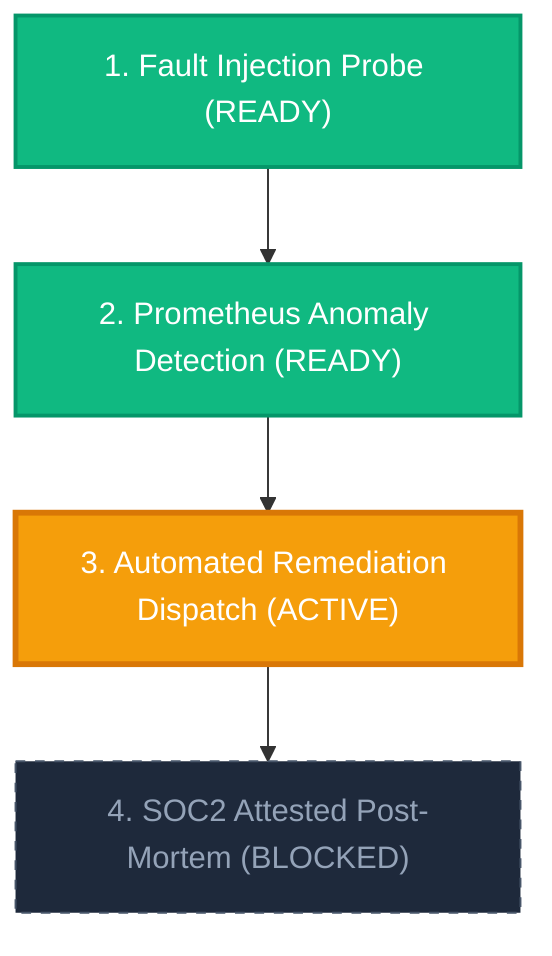
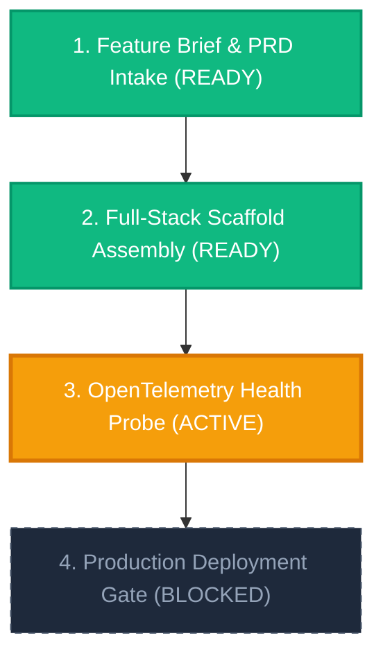

# Oddjob Platform X-Ray Specifications & Visual Blueprint Contracts

This document provides the authoritative **X-Ray Specifications** for all visual blueprint execution stages, Mermaid DAG representations, state transitions, and component topology contracts in the Oddjob Platform.

---

## 1. Universal Blueprint Stage Topology & Readiness States

Every Assembly Blueprint and Operational Cycle consists of a Directed Acyclic Graph (DAG) of execution stages. Each stage is assigned a visual readiness state:

| State Class | Badge Color | Description | Visual Contract |
| :--- | :--- | :--- | :--- |
| `ready` | Green (`#10b981`) | Stage prerequisites fulfilled; ready for immediate execution. | `safeId["Stage Name (READY)"]:::ready` |
| `active` | Amber (`#f59e0b`) | Stage currently executing in worker container or agent turn. | `safeId["Stage Name (ACTIVE)"]:::active` |
| `blocked` | Dashed (`#1e293b`) | Prerequisite stages pending or awaiting Human-in-the-Loop approval. | `safeId["Stage Name (BLOCKED)"]:::blocked` |

---

## 2. Standard Operational Cycle X-Ray Blueprint



---

## 3. Chaos Engineering & Auto-Recovery X-Ray Blueprint



---

## 4. Product Launch Cycle X-Ray Blueprint



---

## 5. Tool Integration & Rendering Contracts

- **Tool Definition**: `render_workflow_diagram(stages: Array<{ id, name, status, dependsOn }>)`
- **Output Envelope**:
  ```json
  {
    "type": "workflow_diagram",
    "title": "Blueprint Workflow & Execution Diagram",
    "chart": "graph TD\n...",
    "markdownBlock": "```mermaid\ngraph TD\n...```"
  }
  ```
- **UI Render Component**: Mounted via `<MermaidRenderer chart={chart} />` inside [`AgentChatPanel.tsx`](../client/src/components/agent-chat/AgentChatPanel.tsx).
