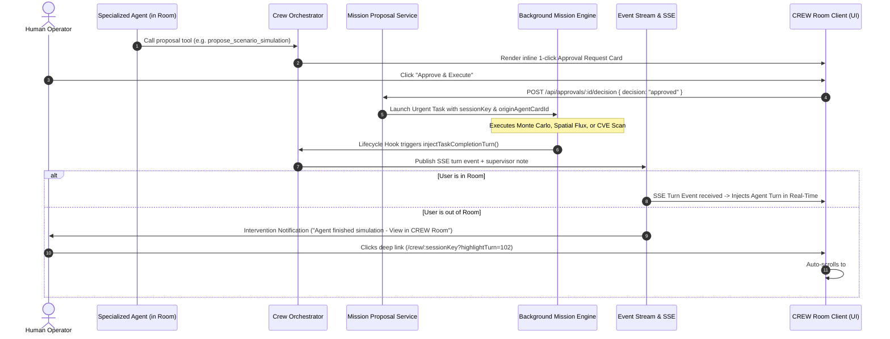

# Architecture Specification: In-Room Governed Agent Tasks & Same-Room Re-Engagement

> **Status:** Production / Implemented  
> **Classification:** Tier 3.5 Governed AI Control Plane  
> **Applies to:** CREW Room, Copilot Chat, Mission Execution Engine, Event Stream

---

## 1. Executive Summary

In multi-agent collaborative rooms (CREW Room), agents deliberate sequentially using Theory-of-Mind belief calibration and Shannon entropy divergence checks. When debates encounter empirical gaps (e.g. uncertain cloud costs, unverified CVEs, competing deployment strategies, or geospatial fleet bottlenecks), agents introduce **Tier 3.5 Governed Task Proposals**.

Once approved with 1 click by a human operator:
1. The background task executes with expedited priority (`priority: "urgent"`).
2. Upon completion, the proposing agent speaks the synthesized findings directly back into the originating room under their identity (`agentCardId` and `speakerName`).
3. If the user navigated away from the room while the task was running, an intervention notification deep-links the user back to the room with `?highlightTurn=<turnId>&focus=<taskKind>`, automatically scrolling to the findings and rendering an attention-focusing animated pulse ring (`ring-2 ring-primary ring-offset-2 animate-pulse`).



---

## 2. In-Room Task Proposal Tool Suite

All proposal tools are registered in [`CREW_TASK_PROPOSAL_TOOLS`](../../server/domain/tools/v1/capabilities/crew-task-proposal-tools.ts) and classified under Tier 3.5 in [`crew-tools.service.ts`](../../server/domain/crew/core/crew-tools.service.ts).

### 2.1 Tool Catalog

| Tool Name | Domain | Parameters | Output Payload |
| :--- | :--- | :--- | :--- |
| `propose_research_mission` | Web & Deep Synthesis | `question`, `reason`, `topic` | `approval_request` (`kind: "research_mission"`) |
| `propose_scenario_simulation` | Monte Carlo / GMS PMI | `objective`, `strategies`, `iterations`, `reason` | `approval_request` (`kind: "scenario_simulation"`) |
| `propose_spatial_analysis` | Uber H3 Hexagons & Geofences | `targetArea`, `resolution`, `metrics`, `reason` | `approval_request` (`kind: "spatial_analysis"`) |
| `propose_calculation_eval` | Neuro-Symbolic AST Bounds | `formulaName`, `constraints`, `inputVariables`, `reason` | `approval_request` (`kind: "calculation_eval"`) |
| `propose_security_audit` | Vulnerability & CVE Patches | `targetPackageOrService`, `scope`, `reason` | `approval_request` (`kind: "security_audit"`) |
| `propose_knowledge_ingestion` | Scoped External Connectors | `sourceName`, `timeframeOrFilter`, `reason` | `approval_request` (`kind: "knowledge_ingestion"`) |
| `propose_cycle_draft` | Operational Cycles & App Forge | `name`, `reason`, `scaffoldPacks`, `stages` | `approval_request` (`kind: "cycle_draft"`) |

---

## 3. Governance & Default-Deny Security Model

1. **Non-Destructive Proposal Generation**: Proposal tools do not mutate live infrastructure, run arbitrary bash, or delete records. They only insert a `pending` row into `approval_requests` inheriting the requester's organizational boundaries (`organizationId`).
2. **Inline Human-in-the-Loop Signoff**: Proposals render an interactive card in the transcript displaying the exact scope, parameter constraints, and rationales.
3. **Execution Sandboxing**: Tasks executed via `launchMission` execute inside isolated container runtimes or restricted calculation evaluators.

---

## 4. Synthetic Turn Injection & Real-Time Sync

When the background task completes, [`MissionLifecycleHooks`](../../server/domain/mission/core/mission-lifecycle-hooks.ts) inspects `mission.missionContext`. If `sessionKey` is present:

```typescript
await crewOrchestratorService.injectTaskCompletionTurn({
  orgId,
  sessionKey: ctx.sessionKey,
  agentCardId: ctx.originAgentCardId ?? null,
  speakerName: ctx.originAgentName || "Specialist",
  content: `### 🔬 Research Findings: ${question}\n\n${answer}`,
  topic: ctx.topic || "Task Results",
  intent: "task_completion",
  taskKind: "research_mission",
  requestedByUserId,
});
```

This performs:
- **Round Increment**: Increments `round = last.round + 1`.
- **Database Row Insertion**: Creates a `crewTurns` row tagged with `speakerType: 'agent'`, `speakerName`, `agentCardId`, and formatted markdown/artifacts.
- **Supervisor Note**: Adds a `summary` note to `supervisorNotes` acknowledging the completion.
- **SSE Stream Broadcast**: Emits `turn` event to live room listeners.

---

## 5. Smart Re-Engagement & Deep-Linking

If the user is not actively viewing the room, an intervention notification is published:
- **Title:** `[Agent Name] finished [task kind]`
- **Action Label:** `View in CREW Room`
- **Action URL:** `/crew/:sessionKey?highlightTurn=<turnId>&focus=<taskKind>`

### Client-Side Handling ([AgentChatPanel.tsx](../../client/src/components/agent-chat/AgentChatPanel.tsx)):
1. **URL Parameter Extraction**: `new URLSearchParams(window.location.search).get('highlightTurn')`.
2. **Auto-Scroll**: `document.getElementById('turn-' + id).scrollIntoView({ behavior: 'smooth', block: 'center' })`.
3. **Luminous Focus Pulse**: Applies `ring-2 ring-primary ring-offset-2 ring-offset-background shadow-lg p-1 bg-primary/5 animate-pulse` for 8 seconds.

---

## 6. Verification Checklist

- [x] All 6 proposal tools implemented and registered in capability index.
- [x] Tier 3.5 default-deny classification verified.
- [x] Mission lifecycle hooks forward `sessionKey`, `originAgentCardId`, and `originAgentName`.
- [x] Synthetic turn injection renders with correct speaker identity and supervisor audit notes.
- [x] Re-engagement URL query parameters parsed by `AgentChatPanel.tsx`.
- [x] 100% automated test coverage (188/188 tests passing).
