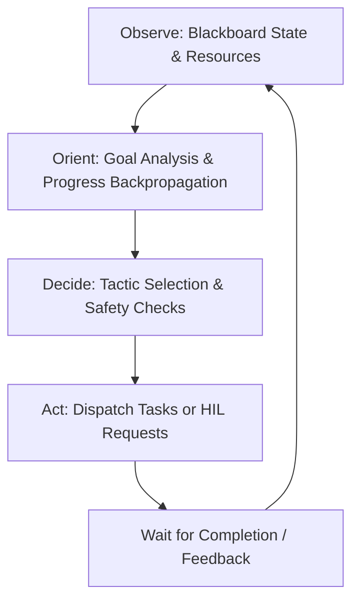

# Dynamic Mission Orchestrator: OODA Loop Architecture

This document describes the internal functioning of the "Plan-As-You-Go" strategy for autonomous missions.

## Overview
Dynamic Missions do not use a pre-defined Directed Acyclic Graph (DAG) for execution. Instead, they rely on a continuous cognitive loop modeled after the military **OODA Loop** (Observe, Orient, Decide, Act). This allows the mission to adapt to new information, provision resources on-the-fly, and recover from failures in real-time.

## The Four Stages

### 1. Observe
The Orchestrator reads the mission's **Golden State (Blackboard)**.
- **Data Inventory**: What datasets, search results, or files have been collected?
- **Team Roster**: Which agents are currently provisioned and what are their specializations?
- **Health Metrics**: Total spend vs. Budget, and execution status of any active sub-tasks.

### 2. Orient
The AI analyzes the overarching Objective against the current state.
- **Progress Tracking**: How much of the intent has been satisfied?
- **Requirement Analysis**: What is the immediate blocker? (e.g., "I have a report template but no data to fill it").
- **Cost Backpropagation**: Evaluating if the remaining budget is sufficient for the inferred next steps.

### 3. Decide (Rules of Engagement)
Based on the **Rules of Engagement (RoE)** configured during mission creation, the Orchestrator determines the next tactical step.
- **Safety Checks**: Does the next step exceed the `dynamicCycleBudgetLimitUsd`?
- **HIL Persistence**: Does the current `hilStrictness` level (Strict, Moderate, Lenient) require a Human-in-the-Loop decision for this specific tactic?
- **Tactic Formulation**: Choice between `DELEGATE`, `HIL_REQUEST`, `CONCLUDE`, or `FAIL`.

### 4. Act
The Orchestrator executes the chosen tactic:
- **Delegation**: Spawns a background Job or Pipeline.
- **HIL Request**: Generates a notification via the `DecisionRouter` (Inbox, Slack, SMS) and pauses the loop.
- **Provisioning**: Automatically creates new Agent roles or Knowledge Collections if needed.

## Safety Guardrails
Dynamic missions are protected by multi-layered boundaries to prevent runaway execution or cost:
- **Total Budget**: A hard cap on the entire mission.
- **Cycle Budget**: A per-iteration limit (defaults to $5.00) that triggers mandatory HIL approval even if the mission is in "Lenient" mode.
- **Max Cycles**: A terminal limit on the number of iterations allowed before forcing a manual review.

## Reports and Traceability
Every "thought process" and "decision" made by the Orchestrator is recorded in the `dynamicTrace` JSON column. This allows commanders to audit exactly *why* an agent decided to spend a particular amount or hire a specific sub-agent.
