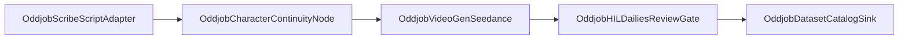

# Media Studio Documentation

> **Spec References:**
> - Oddjob 5-Layer AI Control Plane (`.agent/skills/oddjob-5layer-ai-control-plane/SKILL.md`)
> - [Oddjob Film Production Manual](../film-production/ODDJOB_AI_FILM_PRODUCTION_MANUAL.md)
> - [ComfyUI Media Studio Architecture](../proposals/COMFYUI_MEDIA_STUDIO_RESEARCH.md)
> - Distributed Tracing & Forensic Logging (`.agent/workflows/distributed-tracing-implementation.md`)

---

## **Feature Overview**

### **Purpose & Business Value**
Media Studio is Oddjob's governed cinematic video and multi-scene film production environment. It bridges screenwriting narrative intent (from Scribe Studio) directly into generative video synthesis, character and world continuity management, ComfyUI node graph orchestration, human-in-the-loop (HIL) dailies evaluation, and timeline reel assembly. 

Media Studio replaces disjointed third-party AI video generators with an in-engine collaborative creative studio where directors, prompt engineers, and autonomous agent crews collaborate with deterministic workflow compilation, verifiable budget caps, and cryptographic asset ledgering.

### **User Personas & Use Cases**
- **Creative Directors & Film Producers**: Transitioning screenplays into shot lists, auditioning takes, reviewing dailies, and assembling multi-shot scene reels.
- **AI Prompt Engineers & Technical Directors**: Fine-tuning ComfyUI node graphs, configuring Seedance generative parameters, and defining LoRA/character seed anchors.
- **Autonomous Agent Crews**: Multi-agent assistant director panels (Story Analyst, Continuity Sentinel, Render Supervisor, Editorial Critic) coordinating shot execution and budget estimation.
- **Reviewers & Studio Executives**: Performing A/B take evaluations, approving cuts, checking continuity compliance, and triggering scene timeline renders.

### **Key Requirements & Constraints**
- **Multi-Tenant Org Boundary**: Strict tenant scoping across all productions, scenes, shots, takes, and assemblies via `getOrgConditions` and `requireOrgId()`.
- **Non-Destructive Scene Revisions**: Scene mutations use optimistic concurrency control via SHA-256 `baseDigest` validation (`propose_media_change` / `apply_media_change`).
- **Deterministic Workflow Compilation**: All ComfyUI workflows compile with canonical JSON serialization and SHA-256 topological fingerprinting (`computeWorkflowFingerprint`).
- **Continuity Assurance**: Character seeds, wardrobe tags, camera movements, and lighting profiles are systematically extracted and tracked across all shots in a scene.
- **Headless & Theme Neutrality**: All studio UI components strictly use design system tokens (`bg-background`, `text-foreground`, `border-border`, etc.) and dual-export packaged pod contracts for Component Gallery registration (`MediaStudioPod`, `MediaConfigPod`).

### **Success Metrics**
- **100% Theme Token Compliance**: Zero violations under `npm run lint:theme`.
- **Zero Take Collision**: 100% rejection rate on stale change cards when the underlying scene digest drifts.
- **Budget Ceiling Enforcement**: Pre-flight cost calculation (`seedance_estimate_cost`) before any Seedance GPU generation task executes.
- **100% Headless Pod Reliability**: Measured 100% pass rate in `npm run components:verify` headless smoke execution.

---

## **User Interface Documentation**

### Create: prompt to finished video

New productions open in **Create**. Existing productions can select the Create tab while retaining their saved director workspace preferences.

1. Describe a clip or start from a product, cinematic, or nature prompt. Choose its scene and duration (4–15 seconds), and optionally an approved storyboard frame. fal renders also offer an audio toggle.
2. Check the configured engine, aspect ratio, resolution, estimated take cost, and production budget. Generate saves a shot and requests a take through the existing service. Live takes retain the Decision Inbox approval gate; an unconfigured provider is explicitly labeled as simulation with no generated video.
3. Preview returned videos in the clip gallery. Use **Use in reel** to approve a ready take, **Review take** for detailed review, or **Reuse prompt** to create another clip. Download links use the current organization's asset URLs.
4. Assemble each scene's approved clips into a reel, preview and download it, or open the timeline for further editing. Assembly status and generation progress use the production's existing polling.

If a render request fails after the shot was saved, the shot remains available in Shots for recovery. ComfyUI workflows that require an image cannot submit without an approved starting frame. Provider credentials and workflow imports remain in the existing configuration flow.

### **Screens & Navigation**

#### **1. Media Studio Pod View (`/workspace/chat?studio=media` or in-chat embedded pod)**
- **Purpose**: Main film production environment anchored beside the CREW chat panel.
- **Navigation Tabs**:
  - **Story Tab**: Scene breakdown, sluglines, dramatic beats, and human shot direction annotations.
  - **Shots Tab**: Shot grid displaying framing, camera motion, prompt seeds, duration, and status indicators.
  - **Film / Sequencer Tab**: Multi-track timeline reel editor with transition controls, audio tracks, and FFmpeg assembly triggers.
  - **Dailies Review Tab**: Take inspector with side-by-side A/B split-wipe visual comparison and human approval gates.
  - **ComfyUI Graph Tab**: Interactive Mermaid and node-graph visualization of the live workflow pipeline.

#### **2. Scribe-Style Exit & Focus Mode Controls**
- **Prominent Header Bar**: Features standardized high-contrast, theme-tokenized header buttons:
  - **Exit Button**: Clean teardown of the active media room state returning the user smoothly to the Scaffold and Assembler view.
  - **Focus Studio / Show Chat Button**: Distraction-free full-canvas toggle with synchronized keyboard shortcuts (`⌘J` / `Ctrl+J`).

#### **3. Assembler Integration**
- Anchored directly on the right rail, exposing the **5-Layer Assembly Stack**:
  - **Layer 0**: Scribe Screenplay Input & Beat Parser
  - **Layer 1**: Character & World Continuity Engine
  - **Layer 2**: ComfyUI / Seedance Video Generation Pipeline
  - **Layer 3**: HIL Dailies Review & Editorial Gate
  - **Layer 4**: Media Takes Dataset Catalog Sink
- Supports seamless collapse (`32px`) and expand (`320px`) with stacked vertical handles and Playwright-verified click targets.

### **Component Hierarchy**

```
client/src/modules/media/
├── MediaStudio.tsx                         # Primary studio container with tab routing & controls
├── MediaStudioPod.tsx                      # Packaged pod variant for in-chat & gallery embedding
├── StoryPanel.tsx                          # Screenplay text, beat outlines, and shot direction
├── ShotsPanel.tsx                          # Shot card list, generation status, and prompt editors
├── StoryboardSequencer.tsx                 # Timeline sequencer, transition cut blocks, assembly trigger
├── components/
│   ├── MediaDailiesInspector.tsx           # A/B split-wipe take comparison and approval buttons
│   ├── MediaStageCanvas.tsx                # Video player canvas, 5-stage status progress bar
│   ├── MediaGraphViewer.tsx                # ComfyUI Mermaid pipeline diagram & X-Ray links
│   └── MediaTimelineSequencer.tsx          # Multi-track playback and frame scrubbing
server/domain/core/ui/components/packaged/
├── MediaStudioPod.tsx                      # Dual-export registered pod contract
└── MediaConfigPod.tsx                      # Configuration pod for aspect ratio & model selection
```

---

## **Technical Architecture & Data Flow**

### **5 Custom ComfyUI Adapter Nodes**
Oddjob defines native adapter nodes (`shared/media-adapter-nodes.ts`) bridging platform database entities into ComfyUI graph topologies:



1. **`OddjobScribeScriptAdapter` (Layer 0)**: Ingests structured scenes from Scribe Studio, extracting sluglines, dialog, and `[SHOT <n>]` annotations.
2. **`OddjobCharacterContinuityNode` (Layer 1)**: Injects character face seeds, wardrobe tokens, and environment reference latents.
3. **`OddjobVideoGenSeedance` (Layer 2)**: Compiles model checkpoints, positive/negative prompts, camera motion vectors, and aspect ratios.
4. **`OddjobHILDailiesReviewGate` (Layer 3)**: Holds execution until a human director or agent supervisor approves the rendered take.
5. **`OddjobDatasetCatalogSink` (Layer 4)**: Persists approved video clips into the organizational media catalog (`media_takes_catalog`) with vector embeddings.

### **Deterministic Workflow Compiler**
- **Location**: `server/domain/media-studio/core/comfy-workflow-compiler.ts`
- **Topological Hashing**: Computes a SHA-256 fingerprint of sorted nodes, parameters, and input links. Unchanged shots skip re-compilation, enabling incremental caching and instant generation verification.

### **Semantic Take Indexer**
- **Location**: `server/domain/media-studio/core/media-dataset-indexer.ts`
- **Capabilities**: Automatically vectors approved take summaries, shot descriptions, and tags for semantic retrieval in the Knowledge Garden and Swarm marketplace.

---

## **Agent Capabilities & API Reference**

| Capability ID | Purpose | Parameters | Idempotency |
| --- | --- | --- | --- |
| `mount_media_studio` | Opens Media Studio beside CREW chat | `productionId`, `productionTitle`, `create`, `aspectRatio`, `sceneId` | Declared read-safe |
| `assemble_scene_timeline` | Cuts approved takes into one seamless scene reel | `sceneId`, `productionId`, `sceneKey` | Non-idempotent (triggers FFmpeg) |
| `seedance_submit_shot` | Dispatches shot generation to Seedance 2.0 | `shotId`, `note`, `endOnNextKeyframe` | Medium risk |
| `seedance_check_status` | Polls take generation state and video URLs | `takeId` | Declared read-safe |
| `seedance_estimate_cost` | Pre-flight cost estimation against budget ceiling | `shotCount`, `durationSeconds`, `resolution` | Pure calculation |
| `render_dailies_deck` | Writes markdown Dailies review summary card | `sceneId`, `sceneTitle`, `budgetSpendUsd`, `shots` | Pure presentation |
| `propose_media_change` | Drafts surgical scene change proposal card | `selection`, `instruction` | Read-safe |
| `apply_media_change` | Commits author-accepted change proposal | `proposal` | State mutation |

---

## **Verification Gates & Operational Rules**

1. **Theme Linting**: Must pass `npm run lint:theme` (zero hardcoded hex or raw dark classes).
2. **Component Gallery Registration**: Packaged pods must be registered in `server/domain/core/ui/components/packaged/registry.ts` and synced via `npm run component-index:sync`.
3. **Headless Verification**: Must pass `npm run components:verify -- --filter Media` with 100% success rate.
4. **Tenant Scoping**: All queries must use `getOrgConditions` from `server/utils/org-conditions.ts`.
