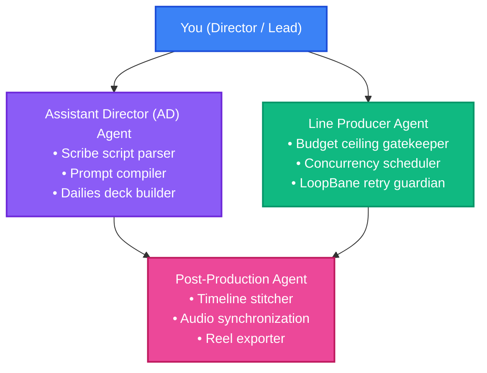

# Oddjob AI Film Production: Comprehensive Operational Manual & Best Practices

This manual provides the definitive architectural, creative, and operational guidelines for producing multi-scene cinematic films in Oddjob using **Scribe Studio**, **Seedance**, and **Governed Operational Cycles**.

---

## Volume 1: Pre-Production & Narrative Ingestion (Scribe Studio)

### 1.1. Screenplay Structuring with Scribe Studio Archetypes
Oddjob's [Scribe Studio](../../server/domain/tools/v1/capabilities/scribe.ts) supports multiple dramatic and structural archetypes. When authoring screenplays intended for AI video generation, select the appropriate framework:

* **`save_the_cat`**: Optimal for structured 3-act narrative shorts with clear beat pacing (Opening Image, Catalyst, Break into Two, Midpoint, Dark Night of the Soul, Climax, Final Image).
* **`story_circle`**: Optimal for character-centric cyclical narratives (You, Need, Go, Search, Find, Take, Return, Change).
* **`heros_journey`**: Optimal for mythic, adventure, or world-building cinematic journeys.
* **`freeform`**: Optimal for experimental shorts, music videos, or commercials with non-linear timelines.

Each station in the Scribe subway spine corresponds to a **Scene Node** containing sluglines, character dialogue, and shot direction.

---

### 1.2. The Human Shot Direction Annotation Standard
To ensure the Assistant Director Agent extracts your creative intent deterministically without hallucinating unwanted compositions, format each shot block within the scene text using this exact specification:

```markdown
[SHOT <number>]
- Framing: <Extreme Wide | Wide | Medium | Close-Up | Extreme Close-Up | Macro>
- Camera: <Static | Pan | Tilt | Push-In | Pull-Out | Dolly | Orbit | Crane | Handheld>
- Subject: <Action, character blocking, emotional expression>
- Lighting: <Key light, fill, backlighting, color temperature, atmospheric haze>
- Seed: <#CHARACTER_ID or numeric seed>
- Duration: <Duration in seconds, e.g. 4s or 5s>
- AspectRatio: <16:9 | 2.39:1 | 9:16>
```

#### Example Shot Block:
```markdown
### SCENE 2 - THE NEON ARCHIVE - NIGHT (EXT)

[SHOT 1]
- Framing: Low-angle medium close-up, 35mm anamorphic
- Camera: Slow push-in, subtle handheld shake
- Subject: Elena clutching the copper cylinder, raindrops rolling down trench coat collar
- Lighting: Cold cyan neon rim backlight, warm sodium vapor spill from cracked doorway
- Seed: #ELENA-CYBER-01
- Duration: 5s
- AspectRatio: 2.39:1
```

---

### 1.3. Building the Story Bible in the Knowledge Garden
Store your world continuity assets as **Knowledge Nodes** in Oddjob's Knowledge Garden:
1. **Character Consistency Cards**:
   * Exact facial features, hair color, eye shape, wardrobe tags, and approved seed IDs.
2. **Cinematographic Style Cards**:
   * Color grading references (e.g., *teal/amber duotone*, *Kodak Vision3 500T 5219 film grain*), lens flare characteristics, and bloom softness.
3. **Environment Reference Cards**:
   * Architectural geometry, signage styles, weather conditions, and spatial orientation.

---

## Volume 2: The Agentic Film Crew (Roles & Tool Grants)



### 2.1. Assistant Director (AD) Agent
* **Intent**: `Video`, `Document Authoring` | **Topic**: `Media`
* **Tool Grants**: `seedance_submit_shot`, `seedance_check_status`, `render_dailies_deck`, `scribe_get_document`.
* **Primary Duty**: Translates human shot blocks into formatted Seedance payloads, injects continuity seeds from the Story Bible, and compiles the interactive Dailies deck for the Director.

### 2.2. Line Producer Agent
* **Intent**: `Analysis`, `Alert` | **Topic**: `Media`
* **Tool Grants**: `seedance_estimate_cost`, `query_project_budget`, `audit_cycle_guardrails`.
* **Primary Duty**: Validates that all batches satisfy `currentSpendUsd + estimatedCost <= budgetLimitUsd`, throttles parallel submissions to prevent rate-limit 429 errors, and monitors queue latency.

### 2.3. Post-Production Agent
* **Intent**: `Video`, `Code Execution` | **Topic**: `Media`
* **Tool Grants**: `assemble_scene_timeline`.
* **Primary Duty**: Takes approved takes from the Blackboard, applies scene transitions (cuts, crossfades, dip-to-black), aligns audio/dialogue tracks, and exports the final sequence.

---

## Volume 3: Seedance Cinematography & Prompt Engineering Lexicon

### 3.1. Camera Motion Lexicon
Seedance maps textual camera directions to motion vectors. Use verified cinematic terms:

| Camera Movement | Prompt Keyword Structure | Recommended Motion Score | Best Use Case |
| :--- | :--- | :---: | :--- |
| **Push-In** | `"Slow cinematic push-in toward subject, smooth dolly"` | 3–5 | Heightening dramatic tension or revealing emotion. |
| **Pull-Out** | `"Slow pull-out revealing wider environment, smooth dolly"` | 3–5 | Transitioning from intimate character moment to world context. |
| **Orbit / Arc** | `"Slow camera arc around subject, 45-degree orbit left"` | 4–6 | Showcasing hero character or central prop. |
| **Tracking / Dolly** | `"Lateral dolly tracking shot alongside running subject"` | 6–8 | Action sequences, chase scenes, hallway strides. |
| **Crane / Boom** | `"Vertical crane shot rising from ground to bird's eye view"` | 5–7 | Scene openings, grand establishing shots. |
| **Static Lock** | `"Locked-off tripod static frame, zero camera movement"` | 1–2 | Dialogue confrontation, architectural majesty. |

---

### 3.2. Lighting, Optics & Texture Grammar
Prevent plastic or synthetic AI video artifacts by grounding prompts in real-world cinematography:
* **Optics**: Specify physical lenses: `"Shot on Arri Alexa Mini LF, Cooke Anamorphic/i Full Frame Plus 40mm T2.3, horizontal streak blue flare, subtle edge vignetting"`.
* **Lighting**: Use lighting positions: `"High-contrast chiaroscuro, key light at 45 degrees, negative fill on shadow side, sharp specular rim light from rain reflections"`.
* **Texture**: Add atmospheric particles: `"Volumetric dust motes suspended in warm afternoon window light"`, `"Fine rain droplets refracting streetlight bokeh"`.

---

### 3.3. Character & Environment Seed Anchoring
1. **Never generate scene coverage with unanchored seeds**: Establish a verified seed key (`#CHARACTER-NAME-VERSION`) in Wave 1.
2. **Propagate Seed Tags**: In every downstream prompt featuring that character, pass the seed parameter directly to `seedance_submit_shot`.
3. **Negative Prompting Standard**:
   `"plastic skin, cartoonish, 3d render CGI, distorted fingers, extra limbs, warped eyes, oversaturated, morphing objects, jittery frame skips, watermark, text"`.

---

## Volume 4: Operational Cycles, CPM Waves & Fiscal Governance

### 4.1. Critical Path Method (CPM) Wave Architecture

```
[Operational Cycle: Scene 2 Production]
  │
  ├── Wave 1: Anchor Generation (Critical Path)
  │     └── Shot 1: Master Establishing Plate (#LOC-01, #ELENA-01)
  │
  ├── Wave 2: Coverage Generation (Parallel Execution)
  │     ├── Shot 2: Medium Two-Shot (Inherits Wave 1 Palette)
  │     └── Shot 3: Over-the-Shoulder Dialogue
  │
  ├── Wave 3: Dynamic Inserts
  │     └── Shot 4: Macro Close-up of Artifact
  │
  ├── Wave 4: Dailies Review Gate (status: 'reviewing')
  │     └── Director HIL Inspection & Approval
  │
  └── Wave 5: Post-Production Assembly
        └── FFmpeg Stitched Master Reel
```

---

### 4.2. Fiscal Guardrails & Cost Rules
* **Strict Cost Checking**: Always call `seedance_estimate_cost` before dispatching a wave.
* **Ceiling Enforcement**: If a wave’s projected cost breaches the cycle’s `budgetLimitUsd`, the Line Producer halts execution and prompts the Director for budget adjustment.
* **Concurrency Cap**: Always cap concurrent requests via `executionPolicy.maxParallelMissions` (default: 2 parallel renders) to ensure compliance with API rate limits.

---

## Volume 5: Dailies, HIL Direction & Re-Shoot Decision Matrix

### 5.1. Navigating the Dailies Deck
When a generation wave finishes, the Assistant Director executes `render_dailies_deck` in the CREW room:
* Review each take side-by-side with original shot directions.
* Check for facial consistency, lighting match, and camera trajectory.

### 5.2. The Re-Shoot vs. Re-Roll Decision Matrix

```
                      ┌───────────────────────────────────────┐
                      │    Does the Take Match Direction?     │
                      └──────────────────┬────────────────────┘
                                         │
                        ┌────────────────┴────────────────┐
                        ▼                                 ▼
                     [ YES ]                            [ NO ]
                        │                                 │
             Click "Approve Take"                         │
                        │                                 │
             Lock to Timeline Manifest                    ▼
                                         ┌───────────────────────────────────┐
                                         │      Identify Defect Class        │
                                         └────────────────┬──────────────────┘
                                                          │
          ┌───────────────────────────┬───────────────────┴───────────────────────────┐
          ▼                           ▼                                               ▼
  [ Character Drift ]         [ Unnatural Motion ]                            [ Wrong Composition ]
  • Keep prompt text          • Lower camera motion score                     • Adjust framing / camera tags
  • Lock / re-specify Seed    • Add "smooth slow camera" to prompt            • Add explicit negative prompts
  • Action: Re-roll with Seed • Action: Re-roll with Motion Delta             • Action: Re-roll with Prompt Delta
```

---

## Volume 6: Timeline Assembly, Audio Synchronization & Mastering

### 6.1. Timeline Sequencing & Transition Styling
Once all shots in a scene are approved, the Post-Production Agent invokes `assemble_scene_timeline`:
* **Cut**: Hard cut between consecutive shots for rapid, natural dialogue editing.
* **Crossfade (Dissolve)**: 0.5s–1.0s dissolve for temporal transitions or emotional montage.
* **Dip-to-Black**: 1.5s fade to black between major acts or scene boundaries.

### 6.2. Audio Mixdown
1. **Dialogue Tracks**: Pre-synthesized dialogue (e.g., ElevenLabs) synced to character mouth movements.
2. **Ambience / Room Tone**: Continuous background soundscape (rain, neon hum, city traffic) across all shots to prevent audio dropouts during cut transitions.
3. **Score Track**: Low-level musical bed mixed at -18dB under dialogue.

---

## Volume 7: Troubleshooting, Safety Guardrails & Edge Cases

### 7.1. API & Rate-Limit Handling
* **HTTP 429 (Too Many Requests)**: Handled automatically by Oddjob's exponential jitter backoff:
  $$t_{\text{backoff}} = 2^{\text{attempt}} \times 1000\text{ms} + \text{random}(0, 500\text{ms})$$
* **Generation Timeout**: If a job remains in `rendering` status for $>180\text{s}$, the Line Producer cancels the dangling request and queries the DLQ fallback.

### 7.2. Likeness & IP Protection
* All prompts are screened prior to submission:
  * Prompts referencing real-world actors, copyrighted franchises, or unauthorized brand trademarks are automatically blocked by the Line Producer with an advisory remediation.
