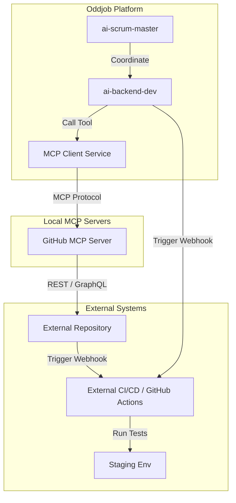

# Operator Guide: Managing Coding Agents for External Systems

This guide explains how to configure and manage autonomous coding agents (such as `ai-backend-dev`, `ai-frontend-dev`, and `ai-qa-engineer`) to work on **external repositories and staging/production environments** using the Oddjob Business Operations Cycle engine.

---

## 1. Architectural Overview

By default, Oddjob's developer agents modify files directly on the local server's filesystem. To target an **external codebase**, agents operate via the **Model Context Protocol (MCP)** using the `github` MCP server. This allows them to read, write, commit, and open pull requests remotely over HTTP APIs, eliminating the need to sync files to the local filesystem.



---

## 2. Secure Integration Authentication

All external credentials must be referenced dynamically in the cycle configuration file using the `${ENV.VAR}` format. This guarantees that API keys, passwords, and tokens are encrypted and managed in the organization's secure store.

Before deploying the cycle, ensure the following environment variables are registered in your environment or credentials manager:

| Variable | Usage | Example |
| :--- | :--- | :--- |
| `GIT_PROVIDER` | Git hosting provider | `github` |
| `GIT_REPO_URL` | Target remote repository URL | `https://github.com/my-org/external-project` |
| `GIT_API_TOKEN` | GitHub Personal Access Token (PAT) with `repo` scope | `ghp_xxxxxxxxxxxx` |
| `GITHUB_MCP_URL` | Endpoint of the running GitHub MCP Server | `http://localhost:3003/mcp` |
| `JIRA_BASE_URL` | Enterprise JIRA domain endpoint | `https://my-org.atlassian.net` |
| `JIRA_API_TOKEN` | JIRA email API token | `token_xxxxxxxxxxxx` |

---

## 3. GitHub Model Context Protocol (MCP) Server Setup

The agent runner interacts with the external repository by calling tools exposed by the `github` MCP server. Ensure you have the `github` MCP server running:

1. **Local Setup via Stdio/SSE**:
   If running the MCP server locally or as a sidecar, expose it on an accessible port (e.g., `3003`). The server requires the GitHub token injected:
   ```bash
   npx @modelcontextprotocol/server-github
   ```
2. **Cycle Registration**:
   In your cycle YAML (`external-sdlc.cycle.yaml`), declare the server:
   ```yaml
   mcp_servers:
     github:
       enabled: true
       endpoint: "${ENV.GITHUB_MCP_URL}"
       tools: ["get_file", "update_file", "create_pr"]
   ```

When the cycle is loaded, the `mcpClientService` connects to this endpoint, registers the `get_file`, `update_file`, and `create_pr` capabilities, and adds them to the tools catalog for developer agents.

---

## 4. Agent Permissions & Tools Configuration

To prevent agents from modifying local files:
1. Set their workspace `boundaries` to `["*"]` or remote namespaces.
2. Remove local filesystem tools (`read_file`, `write_file`, `shell`).
3. Add remote MCP tools to their `tools` list.

### Backend Developer Agent Configuration Example:
```yaml
  - id: "ai-backend-dev"
    name: "Backend Developer"
    role: "worker"
    boundaries: ["*"]
    permissions: ["github:read", "github:write:pr", "slack:read"]
    tools: 
      - "github_list_prs"
      - "github_create_pr"
      - "mcp:github/get_file"    # Reads from remote GitHub repo via MCP
      - "mcp:github/update_file" # Writes to remote GitHub repo via MCP
```

---

## 5. Orchestrated Workflow Sequence

### Phase 1: Code Writing & Pull Request
1. A JIRA ticket transition to `In Progress` triggers `mission-3-core-dev`.
2. `ai-frontend-dev` and `ai-backend-dev` read task specifications.
3. The agents read code using `mcp:github/get_file`, modify files using `mcp:github/update_file`, and commit the modifications.
4. Once completed, they invoke `github_create_pr` to raise a pull request targeting the external `staging` branch.

### Phase 2: Remote Testing (QA Stage)
Instead of executing local testing scripts (e.g. Vitest or Playwright CLI commands), the QA agent uses webhooks to trigger remote test suites (e.g., GitHub Actions workflows, Jenkins pipelines, or Vercel preview checks).

```yaml
  - id: "mission-4-qa"
    name: "QA & Remote Testing"
    sequence:
      - step_code: "QUALITY_ASSURANCE-1"
        action: "trigger_remote_tests"
        tool: "webhook_trigger"
        payload:
          event_type: "run-qa-suite"
          client_payload:
            pr_number: "{{pull_request.number}}"
      - step_code: "QUALITY_ASSURANCE-2"
        action: "poll_test_status"
        tool: "webhook_get"
```
The QA agent uses `webhook_trigger` to hit the GitHub Repository Dispatch API (`POST /repos/{owner}/{repo}/dispatches`) and polls the test status with `webhook_get`.

### Phase 3: Production Deployment
Once User Acceptance Testing (UAT) is signed off by a human stakeholder via the HIL Form, the Release Manager triggers the production deployment pipeline.

```yaml
      - step_code: "DEPLOYMENT-2"
        action: "trigger_production_deploy"
        tool: "cloud_invoke_function"
        provider: "aws"
        functionName: "prod-deploy-pipeline-trigger"
```
The Release Manager calls `cloud_invoke_function` to invoke a secure AWS Lambda or GCP Cloud Function that executes the production CD pipeline deployment.

---

## 6. Best Practices & Security Guardrails

1. **Egress Controls**: Ensure the execution sandbox where the agent runner executes has egress firewall rules allowing outbound traffic to the GitHub API, JIRA, Slack, and your cloud provider.
2. **Branch Protection**: Enforce strict branch protection rules on your external repository. Do not allow agents to push directly to `main` or `master`. They must commit to feature branches and open PRs.
3. **Human-in-the-Loop (HIL) Gates**: Always configure UAT and CAB approval steps as `requires_human: true` to prevent agents from deploying unauthorized code directly to production.
