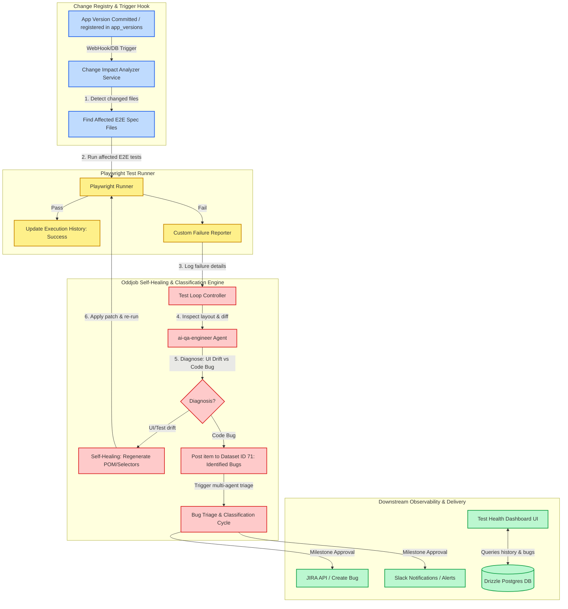

# Playwright E2E Test Repository & Bug Reporting Integration
## Expanded Proposal: Change Registry Integration & Test Self-Healing

This proposal outlines the design, architecture, and roadmap for establishing a decoupled **Playwright Test Repository** for the Oddjob frontend. It describes how tests are scheduled natively, how failed tests flow into the **Bug Report/Triage Pipeline** (dataset ID 71), and how the system integrates with the **Change Registry** to automatically evaluate, run, and self-heal E2E tests when code changes are registered.

---

## 1. Architectural Overview

The integration spans five main layers: the Playwright E2E Suite, the Oddjob API/Database, the Change Registry monitoring hook, the Self-Healing Test Loop, and downstream bug/incident management systems.



---

## 2. Decoupled Playwright Test Repository Design

Creating a standalone repository (e.g., `oddjob-playwright-tests`) keeps heavy browser binaries and test frameworks separate from the main repository.

### Suggested Project Structure
```text
oddjob-playwright-tests/
├── .github/workflows/
│   └── scheduled-e2e.yml       # Optional CI/CD trigger workflow
├── page-objects/               # Page Object Model (POM) classes
│   ├── auth.page.ts
│   ├── dashboard.page.ts
│   └── cycles.page.ts
├── tests/
│   ├── auth.setup.ts          # Handles global sign-in & session storage
│   ├── smoke/                  # Critical path tests (dashboard, navigation)
│   │   └── dashboard.spec.ts
│   └── regression/             # Comprehensive features tests
│       └── cycles-crud.spec.ts
├── utils/
│   └── oddjob-reporter.ts      # Custom reporter communicating with Oddjob API
├── playwright.config.ts        # Browser settings, timeouts, and auth storage
├── package.json
└── README.md
```

---

## 3. Integration with the Bug Triage Pipeline

When a test failure is identified as an actual application bug, it is logged to the **"Identified Bugs"** dataset (ID 71) via the REST API. This triggers the multi-agent `bug-triage` workflow (`bug-triage.cycle.yaml`), running the following steps:

1. **Analyze Bug**: `ai-qa-engineer` parses the logs, screenshots, and trace data to locate the failing client route and queries JIRA for similar historical defects.
2. **Classify & Assign**: `ai-systems-analyst` maps the bug to a priority level (P1–P4) and recommends a code assignee.
3. **Milestone Review**: Pauses for human operator approval via the `triage_review` form.
4. **Log JIRA Ticket**: On approval, automatically creates the JIRA ticket (via `jira_create_bug` tool), publishes a Confluence summary, and triggers Slack channel alerts.

---

## 4. Change Registry Integration & Test Self-Healing

When a developer registers a new change (e.g., a new frontend build, a commit, or an app version entry in `app_versions`), Oddjob automatically triggers a validation loop to verify E2E integrity and self-heal broken test specs.

### Sequence Flow: Code Change to Healed Test

```mermaid
sequenceDiagram
    autonumber
    participant Dev as App Registry / Git Commit
    participant Analyzer as Change Impact Analyzer
    participant Loop as Test Loop Controller
    participant Playwright as Playwright Runner
    participant Agent as E2E QA Agent (AI)
    participant Rep as Git Repository / POM Files

    Dev->>Analyzer: New Change Registered (Modified Files List)
    Analyzer->>Analyzer: Traverse reverse dependency graph (depth=3)
    Analyzer-->>Loop: List of Affected E2E Spec Files
    Loop->>Playwright: Execute Playwright (affected spec files only)
    
    alt All Tests Pass
        Playwright-->>Loop: Success (Exit Code 0)
        Loop->>Dev: Mark change version verified
    else Tests Fail
        Playwright-->>Loop: Failure JSON + Screenshot + Trace Logs
        Loop->>Agent: Send failure diagnosis request
        Agent->>Agent: Compare old page layout vs new page layout (UI Drift?)
        
        alt Option A: Failure is due to UI Drift (e.g., element ID/testid changed)
            Agent->>Agent: Generate locator replacement patch
            Agent->>Rep: Apply selector fix to POM or Spec file
            Loop->>Playwright: Re-run affected E2E tests
            
            alt Re-run Passes
                Playwright-->>Loop: Success
                Loop->>Rep: Commit healed test to repository
                Loop->>Dev: Log: "Test healed successfully. Changed locators."
            else Re-run Fails again
                Loop->>Loop: Escalate to Bug Report Pipeline (Dataset ID 71)
            end
            
        else Option B: Failure is a functional code bug
            Agent-->>Loop: Diagnostic outcome: Code Bug
            Loop->>Dev: Route to Dataset ID 71 (Triggers Bug Triage Cycle)
        end
    end
```

---

## 4.1 UI Behavior Contracts & Automatic Test Authoring

The implemented change-validation bridge treats an externally observable UI behavior as the shared contract between code, documentation, the system graph, and Playwright.

Each `UIBehavior` records its route, actor, preconditions, action, expected outcome, source file/references, confidence, risk, and introducing app version. The knowledge graph persists these relationships:

- `AppVersion -> INTRODUCED -> UIBehavior`
- `UIScreen -> IMPLEMENTS -> UIBehavior`
- `APIEndpoint -> SUPPORTS -> UIBehavior`
- `DocumentationSpec -> DOCUMENTS -> UIBehavior`
- `E2ETest -> VERIFIES -> UIBehavior`

After `version.commit`, the reconciler compares the current and previous snapshots for new routes, controls, submissions, and API-backed actions. It ignores styling-only changes. An uncovered behavior has no `VERIFIES` edge.

When `E2E_AUTO_AUTHOR_ENABLED=true`, high-confidence, low-risk uncovered behaviors are sent to the E2E authoring service. Drafts are restricted to `tests/regression/generated/`, must contain one atomic test and a stable `@behavior` marker, and must pass two Playwright runs. Failed drafts are rolled back. Ambiguous or higher-risk behaviors remain staged for human review.

The orchestrator emits `version.validation.*`, `ui.behavior.detected`, `e2e.test.authoring.*`, and `documentation.validation.updated` events through the `pipeline` source so System Pulse exposes the loop in real time.

---

## 5. Scheduling Playwright Tests in Oddjob

Oddjob’s native schedules engine (`schedules`, `scheduled_jobs`, `schedule_execution_history` tables) will run the Playwright tests on a recurring basis.

1. **Create the Shell Job**: Create a new Job configuration in Oddjob of type `shell` that clones/pulls the test repo and runs Playwright.
   ```json
   {
     "name": "Playwright E2E Suite Run",
     "description": "Pulls latest tests and executes the full Playwright E2E suite.",
     "type": "shell",
     "config": {
       "executable": "node",
       "parameters": "scripts/run-e2e-suite.mjs",
       "workingDirectory": "."
     }
   }
   ```
2. **Scheduling**: Create a schedule pattern (e.g. Daily at 12:00 AM) and link it to the scheduled job.
3. **Execution History**: The run records are automatically logged to `schedule_execution_history`, capturing execution duration, exit codes, output logs, and completion status (`completed`/`failed`).

---

## 6. Health Reporting & Dashboard

To visualize test trends and health status, we propose building a **Test Health Dashboard** within the Oddjob frontend.

### Premium Design Aesthetics
- **Color Palette**: Sophisticated slate backgrounds (dark mode default) with vibrant state indicators (emerald for passing, coral/rose for failing, amber for flaky, violet for active triages).
- **Typography & Details**: Inter font family, glassmorphism card containers, clean borders, and smooth transitions.
- **Charts**: Interactive SVG/Canvas charts (pass-rate area charts, bar charts showing historical execution times, component failure heatmaps).

---

## 7. Implementation Roadmap

### Phase 1: Repository Setup & Core Infrastructure (Weeks 1-2)
- [x] Create the local prototype of the decoupled Playwright repository `playwright-test-repo`.
- [x] Configure global login session setup (`auth.setup.ts`) to avoid logging in before every single test.
- [x] Author E2E smoke test suite (`dashboard.spec.ts` covering Login and main views).
- [x] Implement the `OddjobReporter` custom reporter in the Playwright repository.

### Phase 2: Pipeline Integration & Bug Hook (Weeks 3-4)
- [x] Connect custom reporter authentication using `SESSION_SECRET` via `x-internal-token` header.
- [x] Confirm dataset hook that automatically triggers a new `Bug Triage & Classification` cycle (`bug-triage.cycle.yaml`) when a new test failure is reported to dataset ID 71.
- [x] Test the pipeline end-to-end (fail a smoke test -> verify bug dataset updates -> verify Triage cycle kicks off).

### Phase 3: Change Registry & Impact Analyzer Integration (Weeks 5-6)
- [x] Implement a trigger handler on `app_versions` database inserts or PR mergers.
- [x] Reconcile changed UI snapshots into behavior contracts and map them to related atomic Playwright tests.
- [x] Execute the scoped E2E tests through the governed validation orchestrator.

### Phase 4: Self-Healing Test Loop (Weeks 7-8)
- [x] Hook the runner script to the `testLoopControllerService` self-healing engine.
- [x] Implement pluggable `FailureDiagnoser` and `FixGenerator` configurations for the E2E repo (updating POM locators, CSS selectors, or route parameters based on LLM suggestions).
- [x] Add gated missing-test authoring with atomic behavior markers, two-run validation, and rollback.
- [ ] Verify test self-healing logic (make minor dashboard HTML element id changes -> verify test fails -> verify E2E agent patches test spec -> verify re-run succeeds).

### Phase 5: Health Dashboard UI & Observability (Weeks 9-10)
- [x] Design and build the Test Health Dashboard UI page inside the Oddjob client.
- [x] Connect the dashboard UI to endpoints querying the `schedule_execution_history` and `datasets`/`dataset_items` tables.
- [ ] Implement interactive success-rate and duration charts.
- [x] Add a "Run Suite Now" button to trigger the scheduled shell job on-demand.
- [x] Emit behavior, authoring, documentation, and validation lifecycle events into System Pulse.
