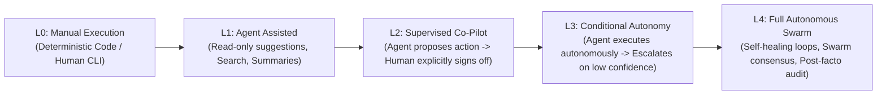

# The Agentic Operating Model & Autonomy Tiers `[🤝 HYBRID]`

> **Audience:** `🤝 Hybrid: Builder + Agent` &nbsp;|&nbsp; **Classification:** Platform Architecture

---

## 1. The 5 Autonomy Levels (L0 to L4) `[🧑 Human]`

Oddjob enforces clear operational boundaries based on task risk and model certainty:

| Autonomy Tier | Description | Execution Permission | HIL Review Requirement |
| :--- | :--- | :--- | :--- |
| **L0 (Manual)** | Deterministic SQL/Code | Direct user trigger | None (Human directly operates) |
| **L1 (Assisted)** | Read-only analysis & search | Read tools only | No mutations permitted |
| **L2 (Supervised)** | Guided mutation proposals | Prepared mutation draft | **100% Pre-Execution Signoff Required** |
| **L3 (Conditional)** | Autonomous with risk guardrails | Direct bounded mutation | **Escalates when confidence < 0.85 or spend limit reached** |
| **L4 (Full Swarm)** | Multi-agent autonomous loops | Full bounded toolset | **Post-execution audit log & anomaly alerting** |

---

## 2. Delegation & Subagent Handoff Protocol `[🤖 Agent]`

When a primary Mission agent delegates a sub-task to a specialized worker subagent:
1. **Pass Traceparent:** Forward the current W3C `traceparent` so child spans nest under the root mission.
2. **Quota Bounding:** Specify a strict maximum step count (default: 10 steps) and token allocation (default: 50,000 tokens).
3. **Deterministic Output Requirement:** The subagent must return a validated JSON object conforming to the parent's requested schema.
