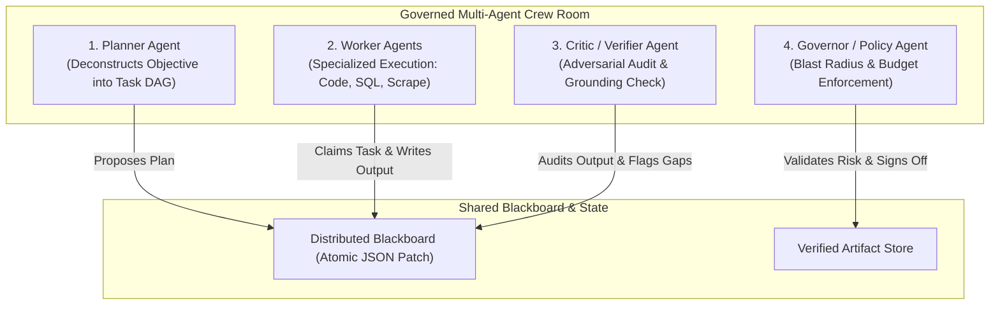
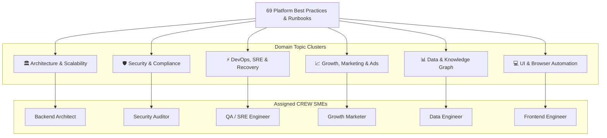
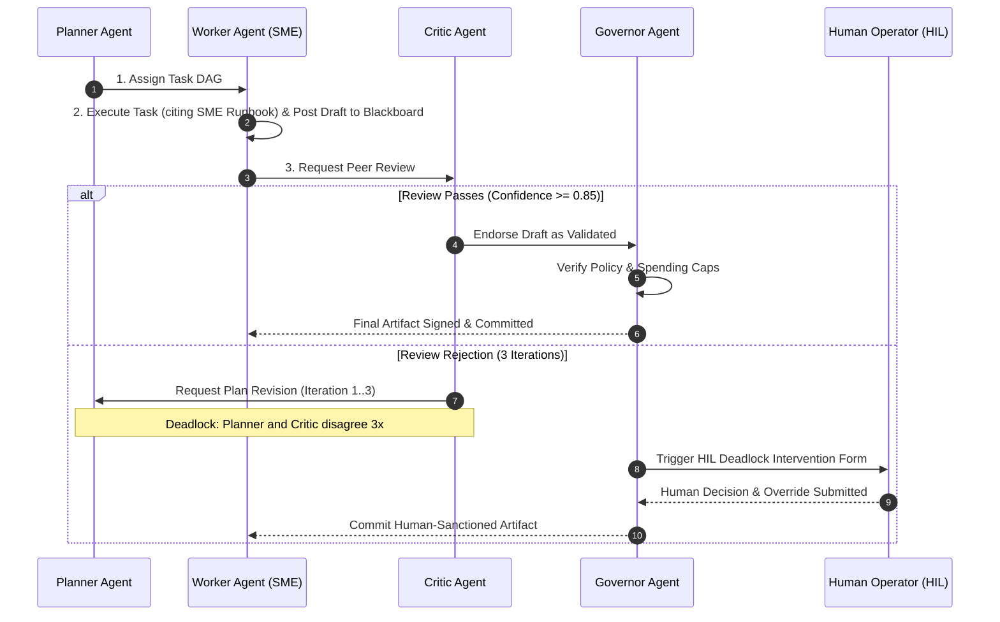

# Multi-Agent Crew Room Protocols, Swarm Consensus & SME Hand-Raising `[🤝 HYBRID]`

> **Audience:** `🤝 Hybrid (Agent Architects + Autonomous Swarms)` &nbsp;|&nbsp; **Classification:** Platform Architecture & Swarm Coordination

---

## 1. Crew Room Role Segregation `[🧑 Human]`

Oddjob Crew Rooms enforce separation of concerns across 4 specialized agent roles:



| Role | Core Objective | Key Tool Capabilities | Mutation Permission |
| :--- | :--- | :--- | :--- |
| **Planner** | Problem decomposition, DAG scheduling | `resolve_assembly_dag`, `propose_mission` | Writes plan nodes to blackboard |
| **Worker** | Execution of domain tasks | Code editing, SQL querying, MCP tools | Writes draft task outputs |
| **Critic** | Adversarial verification, ground truth validation | `evaluate_functional_gaps`, `run_dependency_audit` | Appends review critiques |
| **Governor** | Security boundary, spend limits, HIL gating | `propose_crew_decision`, `trigger_hil_approval` | Promotes drafts to final artifacts |

---

## 2. Topic-Based SME Partitioning & The Hand-Raising Protocol `[🤖 Agent Reference]`

To prevent prompt bloat and the "bystander effect," platform best practices are partitioned across **6 Domain SME Clusters**. Each agent carries only its domain-specific runbook index (~60–80 tokens) and operates under the **SME Hand-Raising Protocol**:



### Domain SME Matrix:

| Domain SME Specialty | Core Assigned Platform Runbooks | Hand-Raising Trigger & Behavior |
| :--- | :--- | :--- |
| **Security & Compliance** | `secure-code-sandbox-and-python-runtime`, `compliance-and-audit-trails`, `escalation-and-confidence-gates`, `hil-form-schema-standards` | **Trigger:** Auth, credentials, sandbox execution, or audit logs discussed.<br/>**Behavior:** Takes lead immediately, cites security runbook, enforces non-negotiable policy constraints. |
| **DevOps & Reliability** | `agent-error-recovery`, `debugging-and-xray-playbook`, `chaos-engineering-and-fault-injection`, `dynamic-llm-routing-and-cost-arbitrage` | **Trigger:** Runtime exceptions, outages, timeouts, or debugging.<br/>**Behavior:** Takes lead immediately, prescribes exact state machine transition, backoff formula, or X-Ray triage. |
| **Architecture & Infrastructure** | `distributed-fleet-and-worker-isolation`, `zero-downtime-database-migrations`, `crew-room-collaboration-and-swarms`, `system-limits-and-quotas` | **Trigger:** Scaling, fleet worker allocation, schema migrations, or DAG assembly.<br/>**Behavior:** Takes lead immediately, prescribes zero-downtime migration steps and worker isolation boundaries. |
| **Data & Knowledge Graph** | `knowledge-graph-linking`, `multi-source-reconciliation`, `hybrid-vector-and-graph-retrieval`, `unstructured-document-parsing`, `transactional-writeback` | **Trigger:** Entity resolution, data pipelines, vector search, or database writes.<br/>**Behavior:** Takes lead immediately, defines similarity scoring thresholds and transactional writeback Sagas. |
| **Growth & Marketing** | `ai-marketing-and-ad-campaign-orchestration`, `email-marketing-and-lifecycle-automation`, `enterprise-saas-data-ingestion` | **Trigger:** Advertising, ad creative synthesis, cold email, or deliverability.<br/>**Behavior:** Takes lead immediately, prescribes OCEAN psychographic angles and DNS authentication rules. |
| **UI & Browser Automation** | `browser-automation-and-playwright-standards`, `neuro-symbolic-calculation-nodes`, `antipatterns-and-pitfalls` | **Trigger:** Web scraping, Playwright automation, or instant app assembly.<br/>**Behavior:** Takes lead immediately, defines robust selector strategies, network idle timeouts, and UI layouts. |

### The 2 Core Hand-Raising Invariants:
1. **The Leadership Invariant:** When a turn touches an agent's assigned domain, the agent MUST begin with:
   `"✋ As the [Domain] SME, I am taking the lead on this recommendation. Under platform runbook [pattern-id], we must..."`
2. **The Deferral Invariant:** When discussions focus on domains outside an agent's designated specialty, that agent MUST defer technical authority to the corresponding domain SME in the room and support them with complementary data.

---

## 3. Shared Blackboard Protocol & Memory Synchronization `[🤖 Agent Reference]`

The Crew Room blackboard functions as the single source of truth for the swarm.

### Rules of Engagement:
1. **Atomic RFC 6902 JSON Patches**:
   Agents NEVER overwrite the blackboard root. All state changes MUST be submitted via atomic JSON patch operations:
   ```json
   [
     { "op": "add", "path": "/tasks/task_03/status", "value": "IN_REVIEW" },
     { "op": "add", "path": "/artifacts/draft_report_uri", "value": "s3://oddjob-vault/reports/draft-12.md" }
   ]
   ```
2. **Task Claiming Invariant**:
   An agent must execute `propose_crew_claim` before beginning work on any task node. Double-claiming a task results in a lock collision error.
3. **No Unreviewed Commits**:
   No worker agent may mark a task `COMPLETED` without a corresponding `VERIFIED` endorsement signature from the Critic agent.

---

## 4. Consensus & Deadlock Resolution Protocol `[🧑 Human]`



---

## 5. Swarm Exit Conditions `[🤖 Agent Reference]`

A Crew Room lifecycle concludes when:
- **`ALL_TASKS_VERIFIED`**: Every DAG task is marked `COMPLETED` and endorsed by Critic + Governor.
- **`BUDGET_EXHAUSTED`**: Total token spend or wall-clock duration crosses configured limit, forcing immediate partial snapshot flush.
- **`HIL_ESCALATION`**: Irreconcilable conflict or high-risk mutation triggers user intervention modal.
