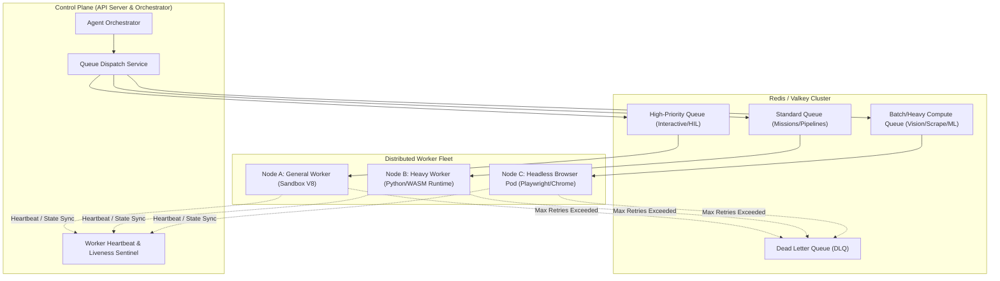
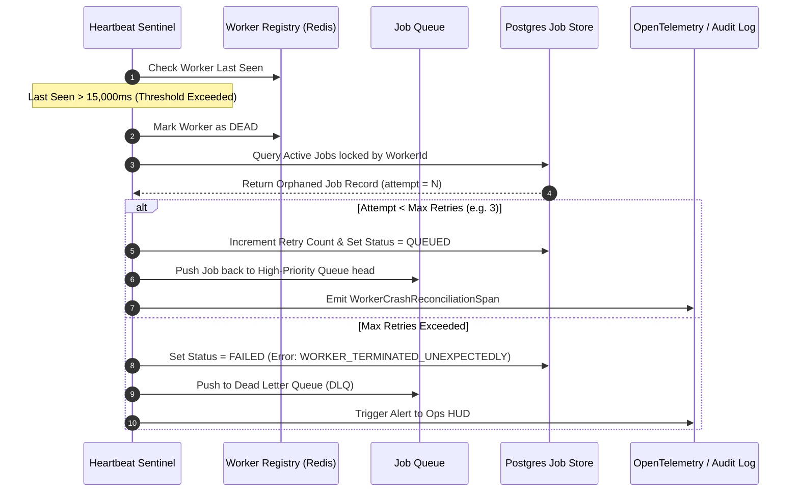

# Distributed Fleet Orchestration & Worker Isolation Standards `[🤝 HYBRID]`

> **Audience:** `🤝 Hybrid (Platform Engineers + Autonomous Agents)` &nbsp;|&nbsp; **Classification:** Platform Architecture & Runtime Operational Standard

---

## 1. Architectural Topology `[🧑 Human]`

Oddjob distributes heavy workloads across a heterogeneous fleet of worker nodes. Jobs are dispatched through priority queues and isolated in hardened worker processes:



---

## 2. Worker Lifecycle & Heartbeat Contract `[🤖 Agent Reference]`

Every worker instance MUST strictly implement the 5-state lifecycle:

1. **`BOOTING`**: Worker initializes runtime dependencies (V8 isolates, Python environments, Playwright binaries) and verifies broker connectivity.
2. **`IDLE / READY`**: Worker registers with `fleet_worker_registry`, advertising capabilities, CPU/Memory capacity, and supported job types.
3. **`PROCESSING`**: Worker locks a job envelope with a distributed atomic lock (`SETNX` + 30s TTL). Emits heartbeat every **5,000ms**.
4. **`DRAINING`**: Upon SIGTERM/preemption signal, worker ceases claiming new jobs and allows existing jobs up to **30,000ms** to reach a safe checkpoint.
5. **`TERMINATED / DEAD`**: Worker unregisters. If heartbeat misses 3 consecutive cycles (15s), Sentinel marks node dead and reconciles orphaned jobs.

### Worker Heartbeat Payload Schema

```typescript
export interface WorkerHeartbeatPayload {
  workerId: string;
  hostName: string;
  tenantId: string;
  status: "IDLE" | "BUSY" | "DRAINING";
  activeJobId?: string;
  activeJobType?: string;
  concurrency: {
    current: number;
    max: number;
  };
  metrics: {
    memoryUsedMb: number;
    memoryLimitMb: number;
    cpuLoadPercent: number;
  };
  timestamp: string; // ISO-8601 UTC
}
```

---

## 3. Worker Crash Recovery & Orphaned Job Reconciliation `[🧑 Human]`

When a worker node experiences sudden hardware failure, OOM termination, or network partition:



---

## 4. Resource Containment & Isolation Invariants `[🤖 Agent Reference]`

1. **Process Hard Memory Caps**:
   - Standard workers: Max `1024 MB` RSS.
   - Browser/Puppeteer workers: Max `2048 MB` RSS per tab pool.
   - Python ML workers: Max `4096 MB` RSS.
   - If a job exceeds 90% of memory limit, the worker must initiate graceful context compaction or checkpointing rather than crashing.
2. **Job Isolation Boundaries**:
   - Each job execution occurs within an isolated worker child process or throwaway container.
   - Shared disk `/tmp/oddjob_sandbox/{jobId}` must be wiped immediately on job completion or failure.
3. **Idempotency Checkpoints**:
   - Long-running multi-step jobs must persist checkpoint tokens to the database at every step boundary. On failover, the replacement worker resumes from the last validated checkpoint.
