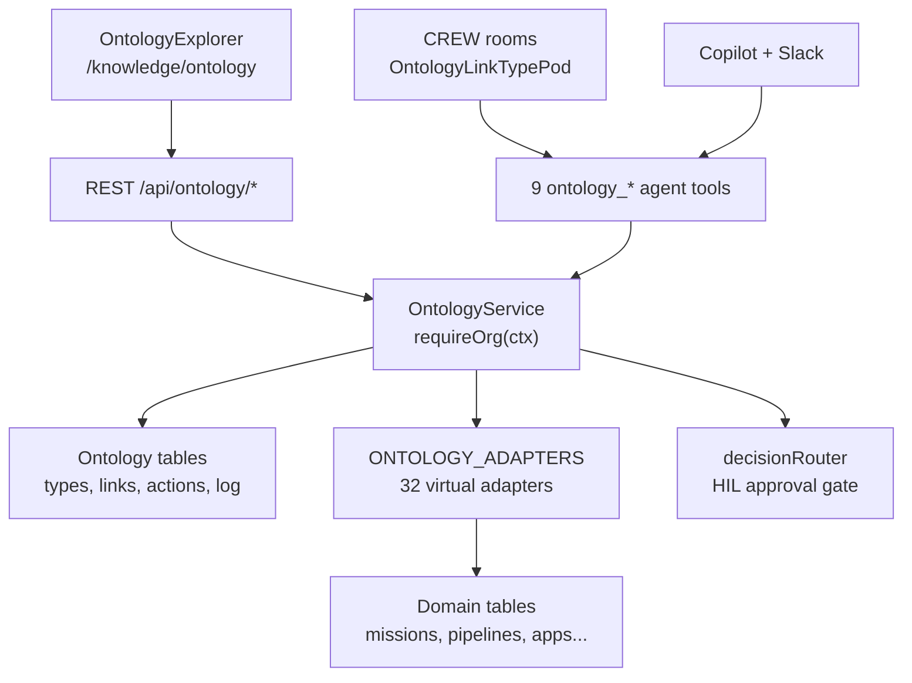
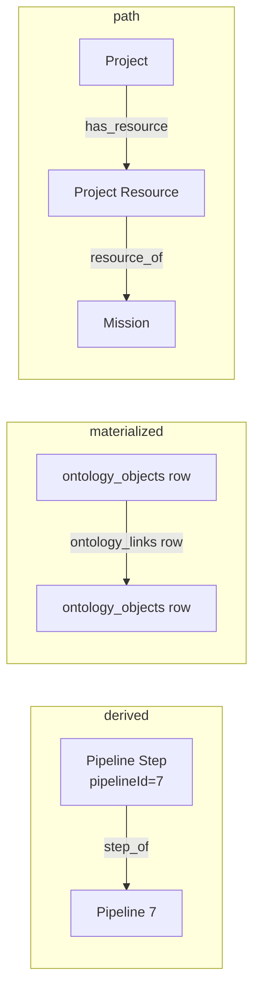
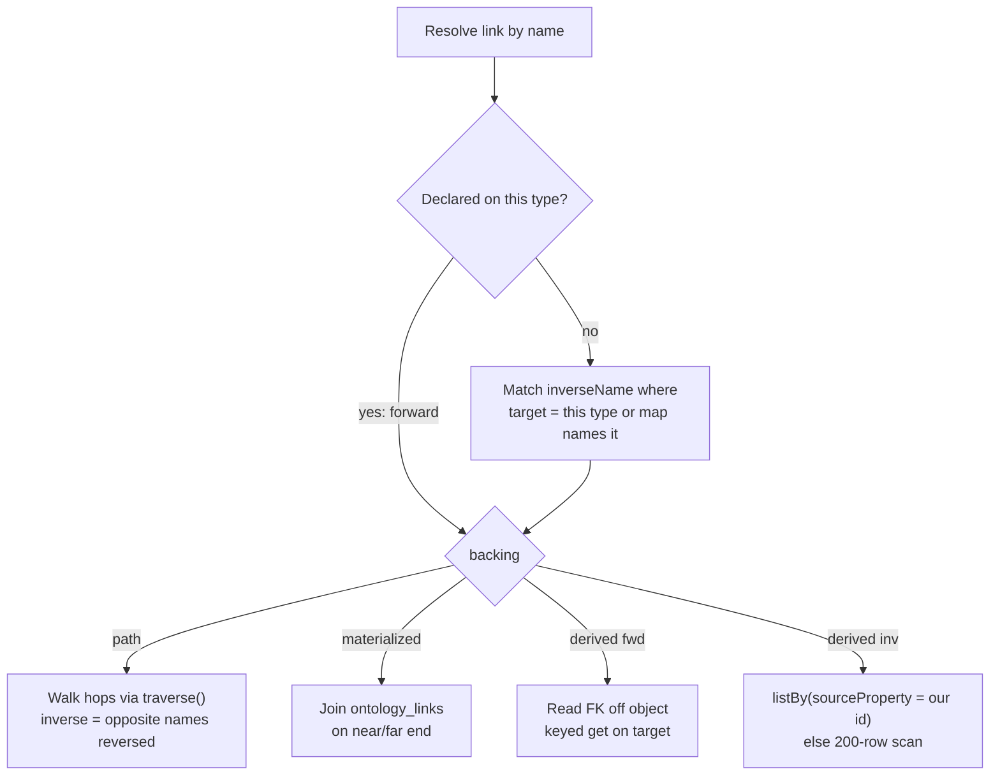

# Knowledge Relationships — Ontology Link Types, Knowledge Graph Edges & Lessons for a New Graph

> **Audience:** Knowledge architects and agents designing relationships &nbsp;|&nbsp; **As of:** 2026-09-16 (branch `refactor/crew-round-context`; row counts from the dev database) &nbsp;|&nbsp; **Classification:** Architecture reference and lessons learned

## Purpose and TL;DR

Oddjob's ontology is a Palantir-AIP-style layer: org-scoped **Object Types**, **Objects**, **Link Types** and governed **Actions**. It sits on top of Oddjob's existing Postgres tables rather than copying them. This document records how it is built, what went wrong while building it, and what a new knowledge graph system should reuse or avoid.

The short version:

- **Declare over existing data; don't copy it.** Most Object Types are *virtual* (an adapter reads an existing table). Most Link Types are *derived* (a declaration over a foreign key the source row already carries). Nothing is stored, so nothing goes stale.
- **Links have three backings.** `derived` resolves a foreign key, `materialized` reads stored edges in `ontology_links`, and `path` composes other links by name (for example, walking through a junction table).
- **Every link has two names.** `inverseName` is NOT NULL on purpose. A link you can't read from the far end loses most of its value.
- **Isolation is the hardest part, not traversal.** Several backing tables have no org column, or a mostly-NULL one. Each adapter has to scope through a JOIN to a parent that is reliably org-owned.
- **Silent failure was the main enemy.** Missing migrations, seeders that log instead of throwing, 404ing client paths and skipped test suites all looked like working features.
- **The ontology is a different thing from the extracted knowledge graph.** `knowledge_nodes`/`knowledge_edges` hold facts *extracted* from content. The ontology holds *curated* business objects that an assistant can query and act on. There are also at least two other graph-shaped systems (Section 7).

## Architecture overview

The ontology is one service (`OntologyService`, about 2,000 lines) in front of six Postgres tables and 32 read adapters. Every caller reaches it through an `OntologyCtx` whose org id comes from the session, never from a parameter.



The diagram shows the two ways in (HTTP and agent tools), the single service, and the three things behind it: metadata tables, adapters over domain tables, and the approval gate for writes.

### The four AIP primitives

| Primitive | What it is | Stored in | Notes |
| --- | --- | --- | --- |
| Object Type | A business entity definition: name, property map, title property, backing | `ontology_object_types` | `virtual` (adapter over an existing table) or `materialized` (rows in `ontology_objects`) |
| Object | An instance of an Object Type | Domain table (virtual) or `ontology_objects` (materialized) | Caller-facing id is `externalId`, falling back to the numeric PK |
| Link Type | A named, directional, typed relationship between two Object Types, with an inverse name | `ontology_link_types` (+ `ontology_links` for stored edges) | Backings: `derived`, `materialized`, `path` |
| Action | A typed, governed operation with a handler | `ontology_actions` (+ `ontology_action_log`) | Handler kinds: `builtin`, `sql`, `tool`, `pipeline`. Writes route through human approval |

### Key design properties

- **Isolation by construction.** Every public method starts with `requireOrg(ctx)`, which throws `ForbiddenError` on a missing org instead of defaulting. The route layer builds the context from `getUserOrgContext` + `assertOrgId`.
- **Lazy, idempotent defaults.** `ensureDefaultsSeeded` runs before every read and back-fills missing default types, then actions, then link types. It compares by name, is memoized per org per process, and never fails the read. A type or link an org switched off (`isActive=false`) is not revived.
- **Name-generic consumers.** The Explorer, the 9 tools and the CREW pod hardcode no type names. A new Object Type or Link Type shows up everywhere as soon as it's seeded.
- **Schema changes are governed like data changes.** Declaring a link type, linking and unlinking are all Actions with `effect=write` and `requiresApproval=true`.
- **Honest partial answers.** Traversal returns `complete: false` plus a `note` whenever the result may be truncated, instead of letting a row count pass for the whole set.

## Object Types

Every org gets 32 default Object Types, all `virtual`. Each one maps a business name to an adapter in `ONTOLOGY_ADAPTERS` (`server/domain/knowledge/core/ontology-adapters.ts`). No default type is `materialized`; that backing exists for types an org defines itself.

### Two backings

- **virtual**: `sourceAdapter` names a code adapter that reads an existing domain table. The adapter supplies the property map and the title property. A stored `titleProperty` on the row is ignored.
- **materialized**: instances are rows in `ontology_objects` with a JSONB `properties` bag and an optional `externalId` (unique per org and type). The property map comes from `propertiesSchema` on the type row. There is an optional `kgNodeId` bridge to `knowledge_nodes.id`.

### The adapter contract

```ts
interface OntologyAdapter {
  properties: Record<string, string>;   // name -> "integer" | "string" | "number" | "boolean" | "object"
  titleProperty: string;
  list(ctx, { limit }): Promise<Row[]>;    // MUST filter by ctx.organizationId
  get(ctx, id): Promise<Row | null>;
  listBy?(ctx, property, value, { limit }): Promise<Row[]>;  // inbound traversal
}
```

- `listBy` is optional. Without it, inbound traversal falls back to scanning 200 rows and matching in memory, and reports `complete: false`.
- `listBy` is built with `makeListBy(columns, from, orgWhere, orderBy, filterable)`. The `filterable` map is deliberately narrower than `properties`. Computed or joined values like `appName`, `label` and `cellCount` have no column to filter on.
- `listBy` **must throw** `UnfilterablePropertyError` for a property it can't filter. If it ignored the filter, it would return every row in the org, and traversal would present unrelated objects as related.
- `orgWhere` is passed in, not assumed, because the org boundary has a different shape per table (see below).
- Limits are clamped to 1–200. Unbounded or sensitive columns are left out on purpose: step `output`, skill `code`, agent-card JSONB arrays, and the approval `token`, `toolArgs` and `modifiedOutput`.
- Types are loose. Drizzle `decimal()` comes back as a **string**. Signal, Prediction and Surprise ids are strings. User ids are strings.

### Default Object Type catalog

| Object Type | Adapter key | Backing table | Org boundary | Join-key properties |
| --- | --- | --- | --- | --- |
| Project | `projects` | `projects` | own `organization_id` | — |
| Project Resource | `project_resources` | `project_resources` | JOIN `projects` | projectId, resourceType, resourceId |
| Project Event | `project_events` | `project_events` | own org (ordered ascending) | projectId |
| Cycle | `operational_cycles` | `operational_cycles` | `cycleOrgWhere` | projectId |
| Mission | `missions` | `missions` | own org | — |
| Mission Run | `mission_runs` | `mission_runs` | own org + `deleted_at IS NULL` | missionId, parentId, currentPipelineId, pipelineExecutionId, cycleId |
| Job | `jobs` | `jobs` | own org | — |
| Pipeline | `pipelines` | `pipelines` | own org | — |
| Pipeline Step | `pipeline_steps` | `pipeline_steps` | JOIN `pipelines` (no org column) | pipelineId, jobId, fallbackJobId |
| Pipeline Run | `pipeline_runs` | `pipeline_executions` | JOIN `pipelines` (own org mostly NULL) | pipelineId, missionId, missionRunId, parentExecutionId |
| Pipeline Step Run | `pipeline_step_runs` | `pipeline_step_executions` | JOIN executions → `pipelines` | pipelineExecutionId, pipelineStepId, jobId |
| Schedule | `schedules` | `schedules` | own org | calendarId |
| Scheduled Job | `scheduled_jobs` | `scheduled_jobs` | own org | scheduleId, jobId, pipelineId, missionId |
| Alert | `alerts` | `alerts` | own org | scheduledJobId, pipelineRunId (jobRunId points at nothing) |
| Approval | `approvals` | `approval_requests` | 3-way OR: own org, else job's org, else mission's org | jobId, missionId, knowledgeNodeId |
| Dataset | `datasets` | `datasets` | own org | — |
| Knowledge Entity | `knowledge_graph` | `knowledge_nodes` | own org + `verification_status = 'verified'` | missionId |
| Query | `saved_queries` | `saved_queries` | own org | — |
| Calculation | `calculations` | `calculation_nodes` | own org | nodeId |
| Signal | `signals` | `event_primitives` | own org | — |
| Prediction | `predictions` | `state_transition_events` | own org | signalId (column `event_primitive_id`) |
| Surprise | `surprises` | `cycle_signal_deliveries` | own org + `payload ? 'surprise'` | signalId, cycleId |
| App | `apps` | `apps` | authored by org, or `is_system` built-in | oddjobMissionId, projectId |
| App Deployment | `app_deployments` | `app_deployments` | own org, JOIN `apps` | appId, projectId |
| Transference Rule | `transference_rules` | `transference_rules` | platform-wide: super-admin only, `[]` for tenants | — |
| Swarm Task | `swarm_tasks` | `swarm_tasks` | JOIN `missions` (no org column) | missionId, requestingAgentId, winningBidId |
| Prompt Version | `prompt_versions` | `prompt_versions` | own org | parentVersionId |
| Spatial Region | `spatial_regions` | `spatial_regions` | `spatialRegionOrgWhere` | parentRegionId |
| User | `users` | `users` | `default_org_id` = org OR membership in `user_orgs` | defaultOrgId |
| Team | `teams` | `teams` | own org + `deleted_at IS NULL` | leadUserId |
| Skill | `skills` | `skills` | own org | — |
| AgentCard | `agent_cards` | `agent_cards` | own org | — |

### Identity and titles

- A virtual object's id is its domain table's primary key. A materialized object's caller-facing id is `externalId`, falling back to the numeric PK. `materializedRow` tries `externalId` first, then the PK when the id is all digits.
- Some tables have no usable name column, so the title is computed. Pipeline Step uses `coalesce(outputName, jobs.name, toolName, 'Step ' || order)`, and Approval uses `coalesce(toolName, 'Approval ' || id)`. Computed titles can't be filtered.
- Definition and execution are **separate types on purpose**: Pipeline Step vs Pipeline Step Run, Schedule vs Scheduled Job. "Which step fails most?" and "did it fail this run?" are different questions. One merged type would make every count ambiguous.

### Seeding

- `DEFAULT_VIRTUAL_TYPES` is inserted with `onConflictDoNothing` on `(org, name)`. It runs at org creation and lazily through `ensureDefaultsSeeded` on any read.
- Seeding compares **names**, not counts, so a single new default reaches every existing org. Before this fix, all 22 dev orgs had 0 types and read an empty ontology forever.
- A unit test asserts every `ONTOLOGY_ADAPTERS` key is claimed by some default type. Five adapters (Signal, Prediction, Surprise, Project Event, Calculation) were once written but reachable by nothing.
- Removing a name from the defaults does **not** delete existing rows.

## Link Types

A Link Type is a named, directional relationship from a source Object Type to a target Object Type. It always has an inverse name, so it can be read from either end. Every org gets 33 default Link Types: 30 `derived` and 3 `path`. None are `materialized`.

### Anatomy of a Link Type

| Field | Meaning | Used by |
| --- | --- | --- |
| `name` | Forward name, read source → target (`step_of`) | all |
| `inverseName` | Reverse name, read target → source (`has_step`). NOT NULL by design | all |
| `sourceTypeId` | Object Type the link leaves from | all |
| `targetTypeId` | Object Type it lands on. NULL means polymorphic | all but polymorphic |
| `cardinality` | `one_to_one` \| `one_to_many` \| `many_to_many`, stated source → target | display only |
| `backing` | `derived` \| `materialized` \| `path` | all |
| `sourceProperty` | Property on the source row holding the join key (`pipelineId`) | derived |
| `targetProperty` | Property on the target it matches, default `id` | derived |
| `targetTypeProperty` | Source property naming the target's type (`resourceType`) | polymorphic derived |
| `targetTypeMap` | Discriminator value → Object Type name (`{"mission":"Mission"}`) | polymorphic derived |
| `path` | Ordered hop names (`["has_resource","resource_of"]`) | path |
| `isActive` | Soft switch. Seeders never revive a switched-off link | all |

### The three backings



A derived link reads a foreign key the source row already has. A materialized link reads stored edge rows. A path link chains other links by name.

- **derived**: the edge *is* the foreign key. Nothing is stored, so it can't go stale. Its edges can't be written directly; `link()` refuses and tells you to change the property instead. This is the default and the backing for 30 of the 33 seeded links.
- **materialized**: edges are rows in `ontology_links`. **Both ends must be materialized Object Types**, because the edge table foreign-keys `ontology_objects`. This is refused at declaration time, not at first write. Materialized links can't be polymorphic. Link and unlink are idempotent governed Actions, and self-edges are blocked by a CHECK constraint.
- **path** (composed): an ordered list of link names, run as repeated `traverse()` calls. It inherits org scoping, polymorphic discriminators and partialness from each hop. It must declare a target type, because the final hop may be polymorphic and the declared target is what callers are promised. Paths are stored as names, not ids, so they survive a hop being redeclared and read like a sentence.

### Polymorphic links

A polymorphic link has no `targetTypeId`. The source row's `targetTypeProperty` says which type it points at, and `targetTypeMap` translates that value into an Object Type name.

- **Forward:** read the discriminator and look it up in the map. An unmapped or NULL discriminator returns an empty, complete result with a `note` naming the value. It never guesses.
- **Inverse:** matching on the join key alone is wrong. A Project Resource pointing at Mission 5 and one pointing at App 5 share `resourceId = 5`. Traversal also filters on the discriminator values that map to the type you're standing on, and over-fetches 4× (capped at 200) so the post-filter doesn't shrink the page.
- The seeder drops individual map entries whose type an org lacks, instead of dropping the whole link.

### Why Project Resource is still an Object Type

The original plan was to retire `Project Resource` as "a link type wearing an Object Type's costume". **That plan was wrong.** A derived link can only resolve a property the *source row* carries, and `projects` carries no resource ids; the junction table does. So both links hang on the junction:

- `Project Resource --in_project--> Project` (inverse `has_resource`)
- `Project Resource --resource_of--> {Mission, App, Dataset, Cycle}` (inverse `project_links`)

The `path` backing then gives people the one-hop phrasing: `Project --has_mission--> Mission` = `[has_resource, resource_of]`. There's one composed link per target type, because one mixed link would land on several types and couldn't promise any of them. `job_collection`, `kb_document` and `form` resources have no Object Type and aren't mapped. `Cycle` is also the one documented exception: it reaches Project through its own `projectId` column (`in_project` / `has_cycle`).

### Naming rules

- Uniqueness is `(org, sourceType, name)` in the database. "owns" can legitimately mean different things from Project and from App.
- Inverse names are unique per **target** type (enforced by a unit test over the defaults, not by the database). So one relationship keeps one name across different type pairs: `has_approval` from Mission, Job and Knowledge Entity, and `has_run` from Pipeline and Mission.
- Name inverses for the far end asking the question: `mission_schedules` answers "what schedules this mission?"
- When a column names the type (a scheduled job runs a job *or* a pipeline *or* a mission, each in its own column), use **separate links**, not a polymorphic one. There's no discriminator to read.

### Cardinality semantics (a known wart)

Cardinality is stated source → target, and the enum has no `many_to_one`. Every FK-derived default is therefore `one_to_one` ("one step run has one step"), which covers both a true 1:1 and a many:1. That means it **can't be mechanically inverted**. Traversal results deliberately leave cardinality out, and the Explorer only shows it on forward hops. What a caller actually needs ("might there be more?") is `complete`.

### Default Link Type catalog

| Source | Link → / ← inverse | Target | Backing | Join key |
| --- | --- | --- | --- | --- |
| Pipeline Step | `step_of` / `has_step` | Pipeline | derived | pipelineId |
| Pipeline Step | `runs_job` / `run_by_step` | Job | derived | jobId |
| Pipeline Step | `falls_back_to` / `fallback_for_step` | Job | derived | fallbackJobId |
| Pipeline Run | `run_of` / `has_run` | Pipeline | derived | pipelineId |
| Pipeline Run | `ran_for_mission` / `has_pipeline_run` | Mission | derived | missionId |
| Pipeline Run | `ran_in_mission_run` / `has_pipeline_run` | Mission Run | derived | missionRunId |
| Pipeline Step Run | `step_run_of` / `has_step_run` | Pipeline Run | derived | pipelineExecutionId |
| Pipeline Step Run | `executed_step` / `has_execution` | Pipeline Step | derived | pipelineStepId |
| Pipeline Step Run | `ran_job` / `job_step_runs` | Job | derived | jobId |
| Mission Run | `run_of` / `has_run` | Mission | derived | missionId |
| Mission Run | `sub_run_of` / `has_sub_run` | Mission Run (self) | derived | parentId |
| Mission Run | `on_pipeline` / `mission_runs_on_pipeline` | Pipeline | derived | currentPipelineId (live state, not history) |
| Mission Run | `ran_in_cycle` / `has_mission_run` | Cycle | derived | cycleId |
| Scheduled Job | `runs_on_schedule` / `has_scheduled_job` | Schedule | derived | scheduleId |
| Scheduled Job | `starts_job` / `job_schedules` | Job | derived | jobId |
| Scheduled Job | `starts_pipeline` / `pipeline_schedules` | Pipeline | derived | pipelineId |
| Scheduled Job | `starts_mission` / `mission_schedules` | Mission | derived | missionId |
| Approval | `for_mission` / `has_approval` | Mission | derived | missionId |
| Approval | `for_job` / `has_approval` | Job | derived | jobId |
| Approval | `about_knowledge_entity` / `has_approval` | Knowledge Entity | derived | knowledgeNodeId |
| Alert | `raised_for_scheduled_job` / `has_alert` | Scheduled Job | derived | scheduledJobId |
| Alert | `about_pipeline_run` / `has_alert` | Pipeline Run | derived | pipelineRunId (unenforced integer) |
| Prediction | `predicted_from` / `has_prediction` | Signal | derived | signalId |
| Surprise | `surprise_from` / `has_surprise` | Signal | derived | signalId |
| Project Event | `event_of` / `has_event` | Project | derived | projectId |
| Cycle | `in_project` / `has_cycle` | Project | derived | projectId |
| Spatial Region | `within_region` / `has_sub_region` | Spatial Region (self) | derived | parentRegionId |
| Project Resource | `in_project` / `has_resource` | Project | derived | projectId |
| Project Resource | `resource_of` / `project_links` | polymorphic on `resourceType` | derived | resourceId |
| Project | `has_mission` / `mission_of_project` | Mission | path | has\_resource → resource\_of |
| Project | `has_app` / `app_of_project` | App | path | has\_resource → resource\_of |
| Project | `has_dataset` / `dataset_of_project` | Dataset | path | has\_resource → resource\_of |
| Team | `has_lead` / `leads_team` | User | derived | leadUserId |

One non-default link is created outside the service by `server/scripts/seed-skill-integration-ontology.ts`: `Skill --augments--> AgentCard` (inverse `augmented_by`, `many_to_many`, **materialized**). Both ends are virtual, so `defineLinkType` would have refused it, and `link_objects` can never write an edge for it (Section 8).

### Relationships deliberately *not* declared

- **Alert → Job Run**: there is no job-run table. The only code that mints a job run id uses `Date.now()`.
- **Spatial adjacency and containment** (`neighbours`, `contains_asset`): these are computed from H3 cell sets. A stored or derived edge would go stale when a boundary moves. A stale spatial edge answers confidently and wrongly, which is worse than no edge.
- **Project → Cycle through the junction**: Cycle owns a real `projectId` column on the budget-rollup hot path.

## How relationships are stored

Oddjob stores relationships in **eleven different tables** across five subsystems. Only two of them hold meaningful data: `knowledge_edges` (52,714 rows) and its version log. The ontology stores link *declarations* (90 rows) but zero stored edges, because every seeded link is derived from a foreign key. Counts below are from the dev database on 2026-09-16.

### Relationship tables

| Table | Subsystem | What a row is | Rows (dev) | Org scoping |
| --- | --- | --- | --- | --- |
| `knowledge_edges` | Extracted knowledge graph | A typed edge between two `knowledge_nodes` | 52,714 | nullable; 61% NULL |
| `knowledge_edge_versions` | Extracted knowledge graph | Change log per edge (`change_type`, relation, weight) | 21,411 | yes |
| `ontology_link_types` | Ontology | A declared relationship between two Object Types | 90 | NOT NULL, cascade |
| `ontology_links` | Ontology | A stored edge between two materialized objects | 0 | NOT NULL, cascade |
| `graph_schema_defs.relationship_types` | Knowledge ingestion schema | JSONB map of relationship definitions per schema | 4 schemas | nullable |
| `resource_edges` | Resource Catalog | Curated edge between two resources, typed by a 27-value enum | 0 | NOT NULL |
| `knowledge_predicted_links` | Link prediction | A candidate edge scored by TransE embeddings | 0 | — |
| `graph_edges` | Context graph | Edge with strength, confidence, direction, evidence, provenance, `valid_from`/`valid_to` | 0 | via `context_id` |
| `temporal_relations` | Context graph | Typed relation between two references, with confidence and evidence | 0 | via `context_id` |
| `context_relations` | Context graph | Relation between two contexts, with confidence and evidence | 0 | — |
| `causal_graph_links` | Signal intelligence | Signal → affected entity, with impact horizon, confidence, blast radius, depth | 0 | yes |

The richest edge schema (`graph_edges`: temporal validity, provenance, evidence ids, confidence) is empty. The edge table everyone actually writes (`knowledge_edges`) has none of those fields.

### `knowledge_edges` in detail

| Column | Type | Notes |
| --- | --- | --- |
| `source_id`, `target_id` | int FK → `knowledge_nodes`, cascade | Directional |
| `relation` | text, NOT NULL | Free text. Zod caps it at 100 chars; nothing enforces the taxonomy |
| `weight` | int, default 1 | Zod says 1–10. In practice 31,977 edges are 5 and 20,732 are 1; five edges use any other value |
| `data` | JSONB | 20,422 edges carry `description`; almost nothing else is used |
| `organization_id` | int, nullable | NULL on 31,976 edges (61%) |
| `mission_id`, `last_updated_by_run_id` | FKs | Provenance to the mission and pipeline run that wrote it |
| `created_by` | text | NULL on **every** edge |

- **Uniqueness** is `(source_id, target_id, relation)`, which is not org-scoped. That is safe only because nodes are org-owned. There are 0 duplicates.
- **Self-loops** are rejected by the Zod schema, not by the database. One self-loop exists.
- **No confidence, no evidence, no validity window** on the edge itself. Confidence and verification status live on *nodes*. 11,374 edges touch at least one node that isn't `verified`.
- **Inverses aren't modelled.** 753 edge pairs exist in both directions with the same relation, which is either a symmetric relation or a duplicate fact.
- **No embeddings are populated.** `knowledge_nodes.embedding` is NULL on all 58,369 nodes and `knowledge_node_embeddings` is empty. The TransE link predictor has nothing to train on.

### `ontology_link_types` in detail

The declaration table is covered field by field in Section 4. The database-level guarantees are:

- Foreign keys to `orgs` and to both Object Types, all `ON DELETE CASCADE`. A link can't outlive its org or either end.
- `CHECK backing IN ('derived','materialized','path')` (widened in migration 0075).
- `CHECK backing <> 'derived' OR source_property IS NOT NULL`.
- `CHECK target_type_id IS NOT NULL OR target_type_property IS NOT NULL` (polymorphic links must name a discriminator).
- `CHECK backing <> 'path' OR jsonb_array_length(path) > 0`.
- `CHECK cardinality IN ('one_to_one','one_to_many','many_to_many')`.
- Unique `(org, source_type_id, name)`, plus indexes on source and target type.

`ontology_links` adds unique `(org, link_type_id, source_object_id, target_object_id)`, `CHECK source_object_id <> target_object_id`, and an `(org, target_object_id)` index so inbound traversal isn't a sequential scan.

Migrations: `0069_ontology_tables`, `0071_ontology_link_types`, `0072_ontology_link_path`, `0075_ontology_link_path_backing`, all in `migrations/runtime/`.

## How relationships are traversed

There are two traversal engines, and they differ in kind. The ontology follows **one named relationship at a time** and says whether the answer is complete. The knowledge graph does a **neighborhood BFS up to depth 3** over every relation and reports nothing about completeness.

### Ontology: `OntologyService.traverse(ctx, { objectType, id, link, limit })`



The link is found by name. A forward name declared on the current type wins over an inverse name. The backing then decides how the far end is fetched.

1. **Resolve by name, forward first.** The caller doesn't need to know which end declared the link. If nothing matches, the error lists every name traversable from this type.
2. **Derived, forward:** read `sourceProperty` off the object. If it's NULL, return an empty result with `complete: true` and a note saying why. If `targetProperty` is `id`, do a keyed fetch. Otherwise use `findObjectsByProperty`.
3. **Derived, inverse:** find source objects whose `sourceProperty` equals this object's `targetProperty`. Use the adapter's indexed `listBy` if it has one. Otherwise scan 200 rows and mark the result partial. Polymorphic links also filter on the discriminator.
4. **Materialized:** join `ontology_links` to `ontology_objects` on the far end, filtered by org on both the edge and the object. Fetch `limit + 1` rows to detect truncation.
5. **Path:** run each hop as a normal `traverse()`. Deduplicate the frontier by `type:id`, cap fan-out at `limit` **per hop**, AND together `complete` across hops, and keep only objects of the declared target type. Walking a path backwards uses each hop's *opposite* name in reverse order, not the same names reversed.

The result shape is `{ link: { name, direction, fromType, toType }, objects, complete, note? }`.

### Correctness rules the ontology engine enforces

- **Two ways to be partial, both reported.** The read filled its page (more rows may exist unread), or narrowing left more matches than requested. Reporting only the first would call a truncated answer complete.
- **Type coercion at the join.** JSONB returns `"42"` where a typed column returns `42`. `sameValue` compares as strings, and `coercePropertyValue` converts to the declared type. A value that can't inhabit the column (a non-numeric string against an integer, or Postgres error `22P02` against a uuid) is an empty, *complete* answer, not an error.
- **Unfilterable join property.** A computed property like `appName` can be read forward but not filtered inbound. The adapter throws `UnfilterablePropertyError` and the service falls back to the bounded scan.
- **Unmapped polymorphic target.** The result names the discriminator value that has no Object Type instead of guessing a table.
- **No cardinality in results.** It's stated source → target and would contradict the list on an inverse hop.

### Knowledge graph: `graphService.traverseGraph(startNodeId, orgContext, { depth, direction })`

- An application-side BFS (the comment mentions a recursive CTE, but none is used). Depth is capped at 3, and edges are fetched in chunks of 1,000 node ids.
- **No relation filter** in the service. Every edge type is followed. The MCP tool `explore_relationships` advertises a `relations` filter, using `DEPENDS_ON` as its example.
- **No fan-out cap.** One hub (a bundled `index-*.js` file node) has degree 1,504, so a depth-2 walk through it is effectively unbounded.
- **No verification filter on edges.** Nodes that are `staging` or `rejected` are reachable, unlike the ontology's Knowledge Entity adapter, which only exposes `verified` nodes.
- **Hard-coded content filter.** Nodes labelled `Attachment`/`Image`/`Asset` or named `*.png`, `*.jpg` and so on are dropped at every level, after a user request.
- **Org scoping includes NULL-org rows as global.** `getOrgConditions` defaults to `org = X OR org IS NULL`. The 31,893 NULL-org edges (the code index) are visible to every org. 83 NULL-org edges start at an org-owned node. The traversal filters those far-end nodes, but the edges themselves (ids and relation) are still returned.
- No `complete` flag: the caller can't tell a small neighborhood from a truncated one.

### Where agents reach relationships

| Surface | Ontology | Knowledge graph |
| --- | --- | --- |
| Agent tools | `ontology_list_link_types`, `ontology_traverse_link` (reads, in CREW and Copilot); `ontology_define_link_type`, `ontology_link_objects`, `ontology_unlink_objects` (governed, CREW proposals only) | MCP `explore_relationships`, `get_entity_impact`, `create_relationship`, `search_knowledge_graph` |
| HTTP | `GET /api/ontology/link-types?type=`, `GET /api/ontology/objects/:type/:id/links/:link?limit=` | `/api/knowledge/*` and `/api/knowledge-graph/*` (same router mounted twice) |
| UI | OntologyExplorer walk mode: link chips in both directions, a trail, and "FK unset" shown differently from "may be partial" | Knowledge graph views |
| Writes | Governed Action through the `decisionRouter` approval gate | Direct inserts from about 20 call sites (next section) |

## Relationship vocabulary in the knowledge graph

The knowledge graph has a 28-relation taxonomy, but nothing enforces it. The dev database holds **93 distinct relations**: 18 from the taxonomy and 75 outside it. Two generic relations, `RELATED_TO` (27,311) and `PART_OF` (22,708), make up **95% of all edges**.

### The official taxonomy (`knowledgeEdgeRelationEnum`)

This lives in `shared/schema/knowledge/graph.ts`.

| Family | Relations | Example |
| --- | --- | --- |
| Hierarchical | `PART_OF`, `MEMBER_OF`, `CONTAINED_IN` | Component → System |
| Functional | `RELIES_ON`, `PROVIDED_BY`, `TRIGGERS` | Service A → Database B |
| Causal | `CAUSES`, `ENABLES`, `PRECEDED_BY` | Change → Regression |
| Behavioral coverage | `INTRODUCED`, `IMPLEMENTS`, `SUPPORTS`, `DOCUMENTS`, `VERIFIES` | Test → Behavior |
| Association | `ABOUT`, `OWNED_BY`, `ASSIGNED_TO`, `MENTIONS`, `MENTIONS_ISSUE` | Document → Topic |
| Semantic | `SAME_AS`, `IS_A`, `REPORTS_TO` | PostgreSQL → Database |
| Computational | `COMPUTES`, `AGGREGATES`, `TRANSFORMS`, `WEIGHTS_BY`, `INPUT_TO` | Variable → Calculation |
| Fallback | `RELATED_TO` | — |

Ten of these have **zero edges** in dev: `MEMBER_OF`, `PRECEDED_BY`, `INTRODUCED`, `DOCUMENTS`, `MENTIONS`, `MENTIONS_ISSUE`, `SAME_AS`, `AGGREGATES`, `TRANSFORMS`, `WEIGHTS_BY`. The taxonomy has no inverse names, no allowed source/target labels, and no symmetry flags.

### `normalizeRelation` is lossy, and almost nobody calls it

The normalizer upper-cases the input, maps a few synonyms, and turns anything unknown into `RELATED_TO`. Several of its mappings change the meaning:

| Input | Becomes | Problem |
| --- | --- | --- |
| `DEPENDS_ON` | `INPUT_TO` | Direction and meaning both flip: a dependency becomes a data flow |
| `PRODUCES` | `COMPUTES` | Any production becomes a calculation |
| `UPGRADED_TO`, `RESULTS_IN` | `CAUSES` | A version change becomes causation |
| `VERSION_OF` | `SAME_AS` | Two versions become identical entities |
| `BUILT_BY` | `OWNED_BY` | Authorship becomes ownership |
| anything unknown | `RELATED_TO` | The relation's meaning is silently discarded |

The only caller in `server/` is `graph-service.ts` (`createEdge`, `createEdgesBatch` and `getEdgeByNodes`). That has two consequences. Graph-service writes lose meaning: 820 `Concept → INPUT_TO → Concept` edges are most likely normalized `DEPENDS_ON` edges from LLM extraction. And every other writer bypasses the taxonomy entirely.

### Who writes edges, and with what names

| Writer | Relations it emits | Normalized? | Dedup |
| --- | --- | --- | --- |
| `graph/graph-service.ts` | whatever the caller passes | yes (lossy) | pre-select |
| `knowledge.service.ts` `createEdge` | caller-supplied | no | `ON CONFLICT` updates weight |
| `storage.service.ts` | caller-supplied | no | pre-select; same-org check |
| `extraction/knowledge-extraction(.service).ts` | LLM-chosen (prompt example `REPORTED_BY`) | no | pre-select |
| `extraction/enrichment-service.ts` | `REMEDIATES`, `MENTIONS`, and LLM-chosen from a prompt listing `DEPENDS_ON`, `ADDRESSES`… | no | pre-select |
| `knowledge/core/system-ingestion.service.ts` (and a duplicate in `core/infrastructure/`) | `CONTAINS`, `PROVIDES`, `INITIATES`, `USES`, `HANDLES` | no | pre-select |
| `xray/core/xray-indexing.service.ts` | `READS_FROM`, `WRITES_TO`, `TRIGGERS`, `OWNED_BY` | no | `ON CONFLICT` |
| `apps/core/apps-knowledge-bridge.ts` | `PART_OF`, `RELIES_ON` | no | — |
| `integrations/core/hil-knowledge-bridge.ts` | `DECIDED_BY` | no | — |
| `causal/belief-propagation-engine.service.ts` | `CAUSES` + causal metadata in `data` | no | — |
| `calculations/calculation.service.ts` | `INPUT_TO` | no | — |
| `prediction/link-predictor.service.ts` | the best-scoring existing relation, default `RELATED_TO` | no | skips existing pairs |
| `integrations/trustgraph/import.service.ts` | `rel.type` from the import | no | — |
| `ingestion/knowledge-ingestion.service.ts` | `RELATED_TO` | no | — |
| `apps/scripts/audit-blueprints.ts` | `HAS_ROUTE` | no | pre-select |

Most "pre-select" writers check for an existing edge and then insert, which races under concurrent pipelines. `knowledge.service.ts` switched to `ON CONFLICT` for exactly that reason.

### What the off-taxonomy relations look like

The 75 off-taxonomy relations cover only 264 edges, but they show what LLM extraction does without a vocabulary:

- **Rules encoded as relation names:** `DETERMINES_IF_SCORE_GTE_2_20`, `EXECUTES_IF_COMPLIANCE_FAILED`, `HAS_ELSE_IF_CONDITION`. These are data, not relationship types.
- **Near-synonyms of the same idea:** `INCLUDES`, `INCLUDES_TYPE`, `INCLUDES_METRIC`, `INCLUDES_STEP`, `HAS_SECTION`, `HAS_SUBSECTION`. Also `RELATED_TO_PROJECT` vs `RELATES_TO_PROJECT`.
- **Taxonomy synonyms that bypassed the normalizer:** `ADDRESSES` (should be `ABOUT`), `RESULTS_IN`, `BELONGS_TO`.
- **Domain-specific one-offs:** `FEATURES_ARTIST`, `KNOWN_FOR`, `AUDITED_TICKET`.

### What `RELATED_TO` and `PART_OF` actually connect

| Relation | Top label pairs (edges) |
| --- | --- |
| `RELATED_TO` | Concept→Concept 10,730 · code\_function→code\_function 8,120 · Topic→Concept 2,671 · Concept→Topic 1,949 · code\_method→code\_function 1,004 |
| `PART_OF` | code\_function→code\_file 6,367 · code\_method→code\_class 5,284 · code\_function→Component 2,664 · code\_interface→code\_file 2,110 |

In practice, `code_function RELATED_TO code_function` is a *calls* edge, and `Topic RELATED_TO Concept` and `Concept RELATED_TO Topic` both appear. The label pair carries more meaning than the relation name does.

### Overlap with the ontology

- X-Ray indexing writes `mission`, `pipeline`, `job_definition` and `dataset` nodes (112, 71, 29 and 28 in dev), plus `TRIGGERS`/`OWNED_BY`/`READS_FROM` edges. Those are copies of domain rows and foreign keys the ontology already derives live. The copies can go stale; the derived links can't.
- Node labels are free text with inconsistent casing: 157 distinct labels, including `mission` vs `Organization`, and `code_function` vs `Component`.
- The only bridges between the two systems are the `Knowledge Entity` Object Type (verified nodes only), the `Approval --about_knowledge_entity-->` link, and `ontology_objects.kg_node_id`, which is unused (0 materialized objects).
- Another vocabulary exists: the Resource Catalog's 27 lowercase `RESOURCE_RELATION_TYPES` (`contains`, `depends_on`, `writes_to`, `scheduled_by`, `supersedes`, `instantiates`…), stored in the empty `resource_edges` table. That's a **third relationship vocabulary** for the same platform objects.

## Lessons learned

The recurring failure was a relationship that **looked declared but silently resolved to nothing**. It happened in both systems, for different reasons. Each lesson below names the incident it came from.

### Declaring relationships

1. **Validate a link against real properties when it's declared.** `defineLinkType` checks that `sourceProperty` exists in the source type's actual property map, and that every `targetTypeMap` value is a real Object Type. Without that, a typo'd link returns an empty list forever, which reads as "nothing is related".
2. **Seeders that log instead of throw hide missing links.** Migration 0071 pinned `CHECK backing IN ('derived','materialized')`. Migration 0072 added `path`, but every composed link was refused, and `seedDefaultLinkTypes` only logged a warning. The links simply never existed until 0075 widened the CHECK. A unit test now validates every default link's ends and properties, because the seeder skips bad ones.
3. **Back-fill by key, not by count.** Seeding only at org creation meant all 22 existing dev orgs had 0 types and 0 links. The fix compares `(sourceType, name)` pairs. Matching on name alone would let an org's custom link hide a default with the same name from a different source type.
4. **Don't revive what an org switched off.** Seeders use `ON CONFLICT DO NOTHING` and ignore `isActive`. An explicit `defineLinkType` re-activates, because that's a deliberate act.
5. **Watch for re-entrant seeding.** `seedDefaultLinkTypes` must not call `defineLinkType`. That call resolves types through `ensureDefaultsSeeded`, whose per-org memo is set before its body runs, so the nested call would await itself and deadlock.
6. **Scripts that bypass the service bypass its rules.** `seed-skill-integration-ontology.ts` inserted `Skill --augments--> AgentCard` as `materialized` between two *virtual* types. `defineLinkType` refuses exactly that, and no edge can ever be written for it. It's in 25 orgs. The same script created `AugmentAgentCard`/`AssignSkill` Actions whose builtin handlers were never registered, and whose `parametersSchema` uses `{type, description}` objects the validator doesn't understand.

### Modelling relationships

7. **A relationship lives where its key lives.** The plan to turn `Project Resource` into a link type failed, because `projects` doesn't carry resource ids; the junction does. Keep the junction as an entity and compose over it with a `path` link.
8. **Don't copy foreign keys into edges.** Derived links can't go stale. X-Ray's `mission`/`pipeline` nodes with `TRIGGERS`/`OWNED_BY` edges are snapshots of the same facts, with no refresh guarantee.
9. **Split definition from execution.** Pipeline Step vs Pipeline Step Run, and Schedule vs Scheduled Job. A merged type makes "how often does this fail?" ambiguous.
10. **Don't declare edges over nothing.** `alerts.job_run_id` has no table behind it, and a Job Run type would be a type over nothing. Computed geometry (spatial adjacency) shouldn't be stored as edges either.
11. **Use separate links when a column names the type.** A scheduled job's `jobId`, `pipelineId` and `missionId` each get their own link; there's no discriminator.
12. **One-directional cardinality needs `many_to_one`.** Without it, `one_to_one` means two different things and can't be inverted.

### Scoping relationships

13. **Check the real NULL rate of a denormalized org column before trusting it.** `pipeline_executions.organization_id` was NULL on 20 of 22 rows. Scoping on it would have hidden about 90% of runs and 100% of step runs, while looking like a working feature. Scope through a JOIN to a parent that is reliably org-owned instead.
14. **Some rows have no single owner.** `approval_requests` needed a three-way OR (own org, else job's org, else mission's org). The 15 rows with sentinel `job_id = 0` correctly stay invisible to everyone. Never default an unowned row into every tenant.
15. **"NULL org = global" leaks edges.** In the knowledge graph, 61% of edges have NULL org and are treated as visible to all orgs. That includes 83 edges that start at an org-owned node.
16. **An adapter that ignores an unknown filter returns the whole org.** `listBy` must throw on an unfilterable property. `transference_rules` and `swarm_tasks` once had no `where` at all.

### Traversing relationships

17. **Report partial answers explicitly.** "Nothing depends on this, safe to delete" is the worst conclusion to draw from a truncated list. `complete: false` plus a note is part of the contract.
18. **Cap fan-out per hop, not just at the end.** A two-hop walk from a hub multiplies into thousands of queries. The knowledge graph BFS has no cap, and its largest hub has 1,504 edges.
19. **Inverse of a path = opposite names reversed.** Reversing the hop names literally asks a Mission to follow a link declared on Project Resource.
20. **Polymorphic inverses must match the discriminator.** Otherwise Mission 5 and App 5 collide on `resourceId = 5`.
21. **Coerce join values across JSONB and typed columns.** `"42"` vs `42` made every materialized-to-virtual traversal return nothing.

### Vocabulary

22. **A taxonomy nobody enforces isn't a taxonomy.** 28 relations are defined, 93 are in use, 10 of the defined ones are unused, and one of about 15 writers normalizes.
23. **A lossy normalizer is worse than none.** `DEPENDS_ON → INPUT_TO` and `VERSION_OF → SAME_AS` create false facts. Collapsing unknowns to `RELATED_TO` destroys information that can't be recovered.
24. **A fallback relation becomes the default.** `RELATED_TO` is 52% of all edges. It's the least useful edge for reasoning and the most common one.
25. **LLMs put data into relation names** (`DETERMINES_IF_SCORE_GTE_2_20`). Extraction needs a closed relation list plus edge properties for the variable part.
26. **Three vocabularies for one platform:** ontology link names (snake\_case, with inverses), knowledge-graph relations (UPPER\_CASE, no inverses), and Resource Catalog relations (lowercase, 27 values).

## Recommendations for the new knowledge graph

Use one registry of relationship types, enforced at every write. Take the ontology's design (inverse names, backings, validation when a link is declared, honest traversal) and add what the knowledge graph needs: provenance, confidence, evidence and time. These are proposals derived from the lessons above, not existing code.

### 1. One relationship-type registry, enforced at write time

| Field | Why (lesson) |
| --- | --- |
| `name`, `inverse_name` (both required) | Read from either end (§4) |
| `family` (hierarchical, functional, causal, association, semantic, computational, provenance) | Keeps the taxonomy navigable |
| `source_types[]`, `target_types[]` (allowed entity types) | `Topic RELATED_TO Concept` and its mirror both exist; constraints stop that (#24) |
| `cardinality_forward`, `cardinality_inverse` (`one` \| `many`) | Replaces the non-invertible single enum (#12) |
| `symmetric`, `transitive`, `reflexive` flags | 753 mirrored edge pairs; lets `PART_OF` closure be computed, not stored |
| `backing`: `stored` \| `derived` \| `path` \| `computed` | Derived from FKs, composed paths, and computed geometry (#7, #8, #10) |
| `edge_properties_schema` | Carries the variable part that LLMs push into names (#25) |
| `synonyms[]` (explicit, reviewed) | Replaces the lossy hard-coded normalizer (#23) |
| `status` (`proposed` \| `active` \| `deprecated`), `superseded_by` | Evolve the vocabulary without rewriting history |
| `org_id` NULL = platform-defined, else org extension | One vocabulary instead of three (#26) |

- **Reject, don't coerce.** An unknown relation is refused, or held as a `proposed` type for review. It never silently becomes `RELATED_TO`.
- **No generic fallback in the active set.** If something is needed, make it `ASSOCIATED_WITH`, require a `reason` property, and alert when its share of edges grows.
- **Validate when a type is declared**, as `defineLinkType` does: endpoints exist, derived join properties exist, path hops exist and chain.
- **Put a database CHECK behind every validator.** And keep defaults under a unit test, because seeders that skip bad rows fail silently (#2).

### 2. One edge write path

Every edge goes through a single service, the way ontology writes go through `executeAction`. That service should:

- look up the relation in the registry and check endpoint types against `source_types`/`target_types`;
- upsert on `(org, source, target, relation)` with `ON CONFLICT`, never select-then-insert;
- require same-org endpoints (or an explicit cross-org share), with no NULL-org "global" edges mixed into tenant data (#15);
- block self-loops in the database unless the relation is `reflexive`;
- route schema changes (new relation types) and high-risk edges through the approval gate.

### 3. Edge record: provenance, confidence, evidence, time

Start from the richest existing schema, `graph_edges` (which is empty today), not from `knowledge_edges`:

| Field | Purpose |
| --- | --- |
| `relation_type_id` | FK to the registry, not free text |
| `confidence` (0–1), `verification_status` | Edge-level trust; today only nodes have it |
| `evidence_ids[]`, `extraction_method` (`fk`, `rule`, `llm`, `human`, `predicted`), `extractor_version` | Explains why the edge exists and allows re-extraction |
| `created_by`, `mission_id`, `run_id` | `created_by` is NULL on all 52,714 current edges |
| `valid_from`, `valid_to` | Time-scoped facts; supersede instead of delete |
| `properties` (validated by `edge_properties_schema`) | Thresholds, scores and conditions belong here, not in the name |

Write predicted links with `extraction_method = predicted` and `verification_status = staging`, so they never mix with verified facts.

### 4. Don't copy what can be derived

- **Operational entities** (missions, pipelines, runs, schedules, approvals, apps, projects) should keep being served as virtual types with derived links. Don't re-ingest them as nodes, which is what X-Ray does today (#8).
- **Extracted knowledge** (concepts, documents, code symbols, people, organizations) goes in the stored graph.
- **Bridge the two layers** with explicit relationship types (`ABOUT`, `MENTIONS`, `DOCUMENTS`) whose endpoints can be virtual objects, referenced by `(object_type, object_id)` rather than a node copy.

### 5. Traversal contract

Keep the ontology's result shape everywhere: `{ link, direction, objects, complete, note }`.

- Filter by relation type, and by verification status by default.
- Cap fan-out per hop, and report `complete: false` whenever a cap, page limit or scan bound was hit.
- Resolve inverse and path traversal through the registry, not the caller.
- Push depth-N walks into the database (a recursive CTE or a graph engine) once hubs exceed a few hundred edges.

### 6. Migrating the existing 52,714 edges

1. **Keep as-is (after checking endpoints):** `PART_OF` (22,708), `CONTAINED_IN`, `OWNED_BY`, `TRIGGERS`, `IMPLEMENTS`, `IS_A`, `CAUSES`.
2. **Re-type by label pair:** `code_function RELATED_TO code_function` → `CALLS` (8,120 edges); `code_method RELATED_TO code_function` → `CALLS`; `Concept RELATED_TO Topic` and `Topic RELATED_TO Concept` → one `ABOUT` direction.
3. **Re-examine lossy normalizations:** most of the 820 `Concept INPUT_TO Concept` edges are probably `DEPENDS_ON`. Re-extract them, or mark them low confidence.
4. **Fold the 75 off-taxonomy relations** into registry types with edge properties (`INCLUDES_*` → `INCLUDES` + `item_kind`; the `DETERMINES_IF_SCORE_*` family → a rule entity). Drop the one self-loop.
5. **Leave behind the X-Ray copies** of operational entities in favor of derived links.
6. **Stamp every migrated edge** with `extraction_method = legacy` and its original relation string in `properties`, so the migration is reversible.

## Appendix: source files and glossary

All paths are in the Oddjob repo on branch `refactor/crew-round-context` as of 2026-09-16. Row counts come from the dev database (port 5433).

### Source files

| Area | File |
| --- | --- |
| Ontology schema (types, objects, actions, links) | `shared/schema/ontology/ontology.ts` |
| Ontology service: declare, traverse, link, seed | `server/domain/knowledge/core/ontology.service.ts` |
| Virtual adapters and `listBy` | `server/domain/knowledge/core/ontology-adapters.ts` |
| Ontology HTTP routes (`/api/ontology/*`) | `server/domain/knowledge/routes/ontology.route.ts` |
| Ontology agent tools | `server/domain/tools/v1/capabilities/ontology-tools.ts` |
| Ontology migrations | `migrations/runtime/0069_ontology_tables.sql`, `0071_ontology_link_types.sql`, `0072_ontology_link_path.sql`, `0075_ontology_link_path_backing.sql` |
| Ontology design spec | `docs/specs/ONTOLOGY_SERVICE_DESIGN.md` |
| Ontology tests | `server/domain/knowledge/tests/unit/ontology*.test.ts`, `server/domain/knowledge/tests/integration/ontology.integration.test.ts` |
| Out-of-band link seed (`augments`) | `server/scripts/seed-skill-integration-ontology.ts` |
| Knowledge graph schema, taxonomy, `normalizeRelation` | `shared/schema/knowledge/graph.ts` |
| Knowledge graph service (edges, BFS traversal) | `server/domain/knowledge/core/graph/graph-service.ts` |
| Org condition helper (NULL = global) | `server/utils/org-conditions.ts` |
| Link predictor (TransE) | `server/domain/knowledge/core/prediction/link-predictor.service.ts` |
| Causal edges | `server/domain/knowledge/core/causal/belief-propagation-engine.service.ts` |
| X-Ray operational-entity indexing | `server/domain/xray/core/xray-indexing.service.ts` |
| MCP knowledge-graph tools | `server/mcp/tools/knowledge-graph.ts` |
| Resource Catalog relation types and edges | `shared/resource-catalog.ts`, `shared/schema/resource-catalog-edges.ts`, `docs/RESOURCE_CATALOG_ONTOLOGY.md` |

### Glossary

| Term | Meaning |
| --- | --- |
| Object Type | A business entity definition in the ontology |
| Virtual type | An Object Type whose instances are read live from an existing domain table by an adapter |
| Materialized type | An Object Type whose instances are rows in `ontology_objects` |
| Link Type | A named, directional relationship between two Object Types, with an inverse name |
| Derived link | A Link Type resolved from a foreign-key property on the source row; stores nothing |
| Materialized link | A Link Type whose edges are rows in `ontology_links` |
| Path (composed) link | A Link Type defined as an ordered sequence of other link names |
| Polymorphic link | A derived link whose target type is chosen per row by a discriminator property |
| Discriminator | The source property naming the target's type, e.g. `resourceType` |
| `complete` | Traversal flag: false when the result may be missing related objects |
| Knowledge edge | A stored, typed edge between two extracted `knowledge_nodes` |
| Relation taxonomy | The 28 relation names in `knowledgeEdgeRelationEnum` |
