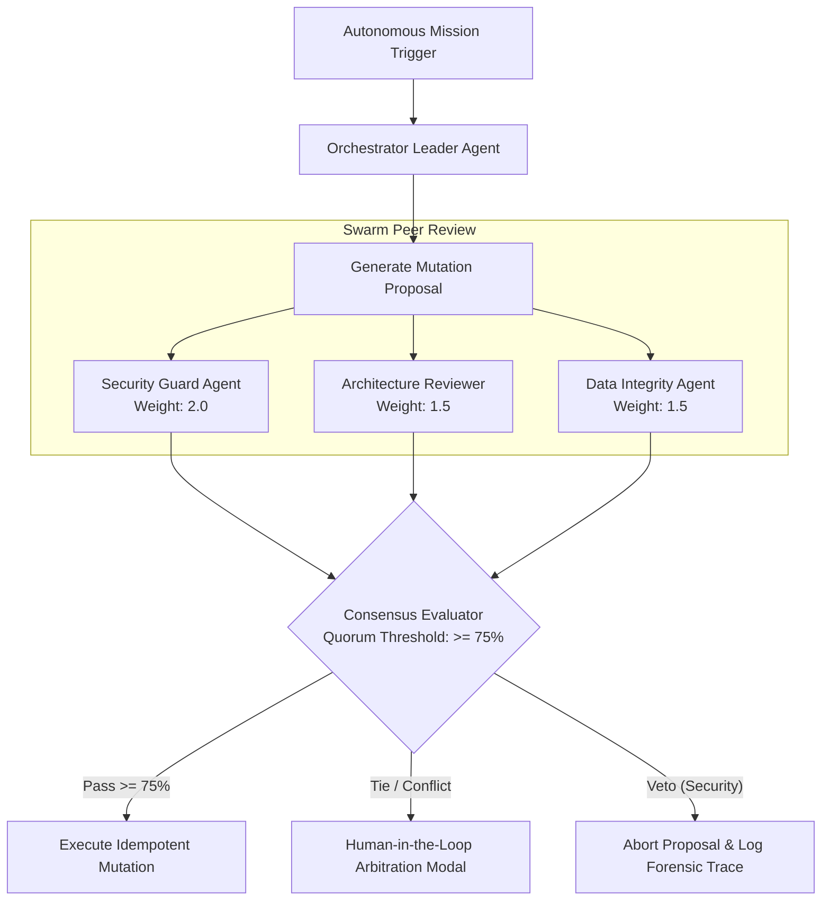

# Multi-Agent Consensus & Swarm Voting Protocols

> **Audience:** 🤝 Hybrid / Co-Pilot | 🤖 Agent / Autonomous | 🛡️ Safety & Governance  
> **Autonomy Level:** L3 to L5  
> **Telemetry Span:** `swarm.consensus.vote`

---

## 1. Overview & Problem Statement

In distributed multi-agent swarms (e.g. *Security Agent*, *Architect Agent*, *Database Agent*, and *Code Implementation Agent*), executing high-consequence mutations based on a single agent's inference introduces single-point-of-failure risks.

The **Oddjob Multi-Agent Consensus Protocol (OMCP)** enforces structured peer review, weighted voting quorum, and deterministic arbitration before applying mutations.



---

## 2. Quorum & Voting Weights

Every participating agent in a mission swarm possesses a role-specific voting weight:

| Agent Role | Voting Weight | Veto Power | Focus Area |
| :--- | :--- | :--- | :--- |
| **Security & Compliance Agent** | `2.0` | **YES** | PII leak detection, RBAC boundaries, CVE injection |
| **Architect Agent** | `1.5` | NO | Dependency graph integrity, interface contracts |
| **Data Integrity Agent** | `1.5` | NO | Foreign key invariants, database lock budgets |
| **Implementation Agent** | `1.0` | NO | Syntactic code correctness, test execution |

$$\text{Consensus Score} = \frac{\sum_{i=1}^{N} (w_i \times v_i)}{\sum_{i=1}^{N} w_i} \quad \text{where } v_i \in \{0, 1\}$$

A mutation proposal requires $\text{Score} \ge 0.75$ and **Zero Security Vetoes** to proceed autonomously without HIL escalation.

---

## 3. Proposal & Ballot Schema

```typescript
export interface SwarmConsensusProposal {
  proposalId: string; // UUID v4
  originatingAgentId: string;
  targetResource: string; // e.g. "urn:oddjob:database:prod_cluster"
  mutationSummary: string;
  proposedChanges: Array<{
    action: "CREATE" | "UPDATE" | "DELETE" | "SCHEMA_ALTER";
    entity: string;
    payload: Record<string, unknown>;
  }>;
  idempotencyKey: string;
  timeoutMs: number;
}

export interface SwarmBallot {
  proposalId: string;
  voterAgentId: string;
  vote: "APPROVE" | "REJECT" | "VETO";
  confidence: number; // 0.0 to 1.0
  reasoning: string;
  suggestedModifications?: string[];
  signature: string; // HMAC-SHA256
}
```

---

## 4. Split-Brain Mitigation & Raft Leases

When network latency or timeout causes subagent partitions:
1. **Time-Bound Leases:** Mutations acquire a 30-second Redis distributed lock (`SET resource_lock leader_id NX EX 30`).
2. **Monotonic Epoch Counters:** Every proposal carries an incrementing `epochNumber`. Late-arriving votes from stale epochs are rejected immediately.
3. **Graceful HIL Escalation:** If split consensus occurs ($50\% / 50\%$), the transaction halts and prompts human operators with diff side-by-side reviews.
