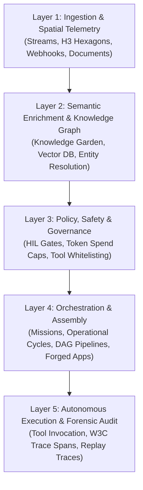

# Oddjob 5-Layer AI Control Plane & Core Architecture `[🧑 HUMAN]`

> **Audience:** `🧑 Human / Builder` &nbsp;|&nbsp; **Autonomy Scope:** `L0 to L4` &nbsp;|&nbsp; **Classification:** Architectural Foundation

---

## 1. The 5-Layer AI Control Plane `[🧑 Human]`

Oddjob structures all autonomous and assisted operations across five deterministic control layers:

1. **Layer 1 (Ingestion & Spatial Telemetry):** Ingests raw inputs from webhook event streams, tabular datasets, document dumps, and spatial coordinate feeds mapped to Uber H3 hexagonal indexes.
2. **Layer 2 (Semantic Enrichment):** Embeds, tags, and resolves entities into the persistent Knowledge Garden graph.
3. **Layer 3 (Policy & Governance):** Intercepts execution requests against confidence thresholds, spending ceilings, and permission gates.
4. **Layer 4 (Orchestration & Assembly):** Compiles high-level user objectives into executable DAGs, Missions, or interactive Forged Apps.
5. **Layer 5 (Execution & Forensics):** Executes tools idempotently with full W3C distributed tracing and replayable audit records.

---

## 2. Core Execution Abstractions `[🧑 Human]`

* **Mission:** A goal-oriented, multi-step autonomous campaign assigned to an agent or agent swarm with a defined objective and exit criteria.
* **Operational Cycle:** A recurring or event-triggered operational loop (e.g., hourly reconciliation, daily maintenance, continuous monitoring).
* **Pipeline (DAG):** A deterministic, dependency-ordered sequence of computational jobs, transformations, and tool executions.
* **Forged App:** A domain-specific, rapidly assembled user interface composed of reusable platform components and governed agent tools.

---

## 3. Telemetry & Distributed Tracing `[🤝 Hybrid]`

Every execution in Oddjob generates standard W3C `traceparent` headers, ensuring all tool calls, database mutations, and subagent delegations can be inspected via the **Armory X-Ray** explorer.
