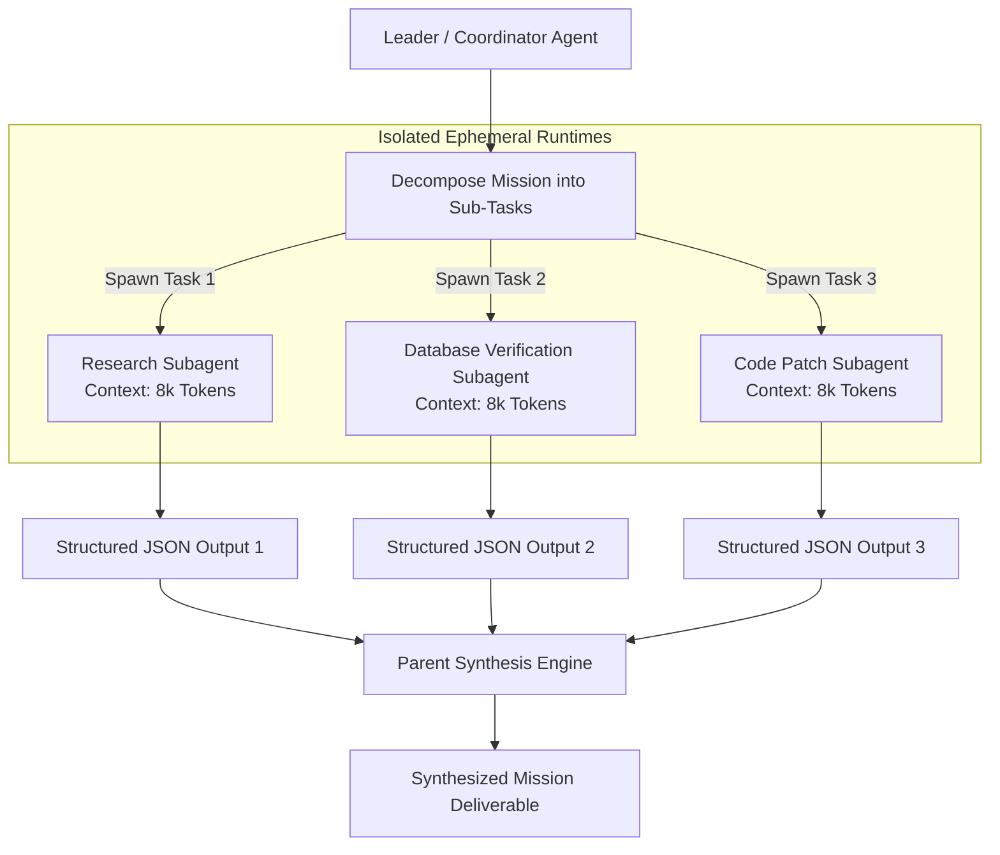

# Subagent Delegation & Parent-Child Task Handoffs

> **Audience:** 🤖 Agent / Autonomous | 🤝 Hybrid / Co-Pilot | 🛡️ Safety & Governance  
> **Autonomy Level:** L3 to L4
> **Telemetry Span:** `agent.subagent.spawn`

---

## 1. Architectural Model & Task Decomposition

When a mission requires multiple specialized operations (e.g. *Code Analysis*, *Database Querying*, and *Documentation Ingestion*), a single agent context can quickly degrade. Leader agents must break down the mission into independent sub-tasks and spawn ephemeral subagents.



---

## 2. Delegation Invariants & Recursion Limits

Agents must strictly adhere to the following operational invariants:

| Constraint | Limit / Rule | Rationale |
| :--- | :--- | :--- |
| **Maximum Recursion Depth** | **$3$ Levels** ($\text{Leader} \to \text{Subagent} \to \text{Worker}$) | Prevents unbounded agent recursion and runaway compute charges. |
| **Context Isolation** | Never pass full parent conversation history | Subagents must receive only the specific task prompt and relevant input schemas. |
| **Max Concurrent Children** | **$\le 5$ Parallel Subagents** | Protects database connection pools and external API rate limits. |
| **Timeout Ceiling** | **$120\text{s}$ per subagent** | Unresponsive subagents are terminated and routed to error recovery. |

---

## 3. Delegation Tool Invocation Pattern

```typescript
export interface SubagentSpawnPayload {
  taskName: string;
  assignedRole: "RESEARCH" | "CODE_EXEC" | "DB_INSPECTOR" | "DOC_SYNTHESIS";
  taskPrompt: string;
  expectedOutputSchema: Record<string, unknown>; // JSON Schema
  maxStepCount: number; // Default: 10
  timeoutMs: number;    // Default: 60,000
  w3cTraceparent: string; // Distributed trace lineage
}

// Example parent agent invocation
const result = await invokeSubagent({
  taskName: "Inspect Vendor Invoice Schema",
  assignedRole: "DB_INSPECTOR",
  taskPrompt: "Query the schema of vendor_invoices and return the column definitions as JSON.",
  expectedOutputSchema: {
    type: "object",
    properties: {
      columns: { type: "array", items: { type: "string" } },
      indexes: { type: "array", items: { type: "string" } }
    },
    required: ["columns"]
  },
  maxStepCount: 5,
  timeoutMs: 30000,
  w3cTraceparent: currentTraceparent
});
```

---

## 4. Parent Synthesis Protocol

1. **Schema Validation:** The parent must validate the child agent's returned JSON payload against `expectedOutputSchema` using Zod before consuming it.
2. **Failure Handling:** If a child fails or times out, the parent logs the error and decides whether to retry once or proceed with a graceful partial degradation.
3. **No Intermediate Log Bloat:** The parent must only incorporate the child's final validated payload into its working memory, discarding the child's raw step-by-step scratchpad.
