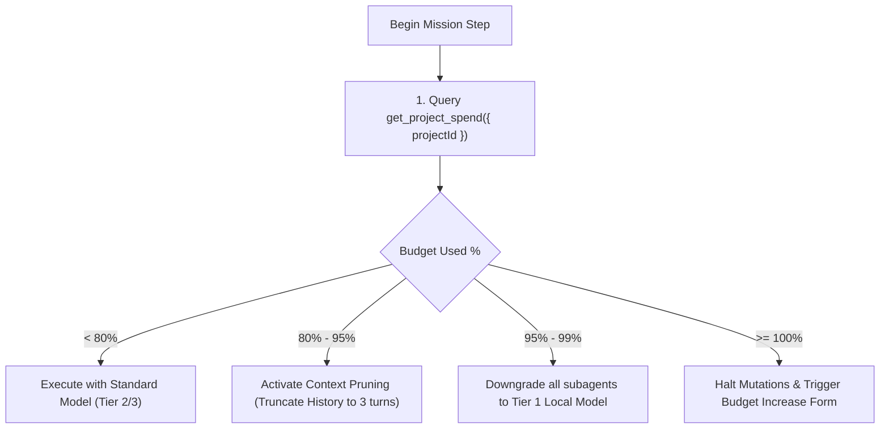

# System Limits, Quotas & Token Budget Management `[⚖️ GOVERNANCE]`

> **Audience:** `⚖️ Governance / Platform SRE & FinOps` &nbsp;|&nbsp; **Classification:** System Limits & Capacity Boundary

---

## 1. Global Platform System Limits Matrix `[🧑 Human]`

Oddjob enforces strict architectural boundaries to guarantee system stability and prevent rogue execution loops:

| System Parameter | Hard Upper Limit | Default Recommendation | Enforcement Mechanism |
| :--- | :--- | :--- | :--- |
| **Max Agent Turns per Task** | `50 turns` | `15 - 25 turns` | Orchestrator step loop counter |
| **Max Token Budget per Turn** | `8,192 tokens` | `150 - 350 tokens` (JIT HUD) | `PhaseCompiler` dynamic pruner |
| **Max Tool Execution Timeout** | `60 seconds` | `10 seconds` | Worker process watchdog timer |
| **Concurrent Workers per Org** | `100 workers` | `10 - 25 workers` | BullMQ Redis concurrency semaphore |
| **Max File Upload / Ingestion** | `100 MB` | `25 MB` | HTTP reverse proxy ingress limit |
| **Max Subagent Depth** | `3 levels` | `1 level` (Parent $\rightarrow$ Worker) | Delegation recursion guard |

---

## 2. Programmatic Quota Querying & Self-Regulation `[🤖 Agent Reference]`

Autonomous agents must actively self-regulate token consumption during long multi-step missions:



### Checking Project Spend Programmatically
```typescript
const spend = await get_project_spend({ projectId: "proj_9918" });

if (spend.percentOfCap > 0.90) {
  // Compress context before proceeding to next subtask
  console.warn(`Project spend at ${spend.percentOfCap * 100}%. Pruning conversation history.`);
}
```

---

## 3. Rate Limiting Headers & Backoff Rules `[🤖 Agent Reference]`

All inbound and outbound HTTP API requests track standard rate limit headers:

- `X-RateLimit-Limit`: Maximum allowed requests per sliding 60s window.
- `X-RateLimit-Remaining`: Remaining request count in current window.
- `X-RateLimit-Reset`: UTC epoch timestamp when current window resets.

**Agent Rule:** If `X-RateLimit-Remaining < 5`, agents MUST insert an artificial delay $\Delta t = \frac{\text{Reset} - \text{Now}}{\text{Remaining}}$ between sequential tool calls.
