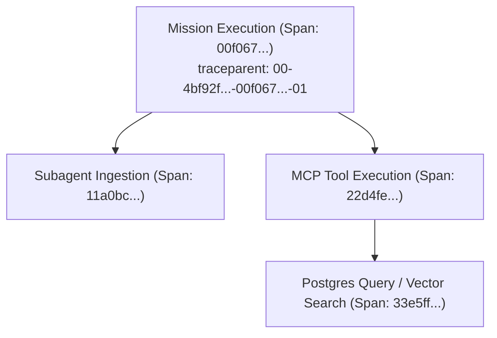

# W3C Distributed Tracing & Forensic Observability `[🤝 HYBRID]`

> **Audience:** `🤝 Hybrid` &nbsp;|&nbsp; **Compliance Standard:** `W3C Trace Context Level 1 & OpenTelemetry v1.28`

---

## 1. Trace Propagation Mechanics `[🤖 Agent & Builder]`

Every operation in Oddjob propagates a standardized W3C `traceparent` header across worker threads, HTTP clients, subagents, and database connections:

$$\text{traceparent} = \text{00}-\underbrace{\text{4bf92f3577b34da6a3ce929d0e0e4736}}_{\text{Trace ID (32 hex)}}-\underbrace{\text{00f067aa0ba902b7}}_{\text{Span ID (16 hex)}}-\underbrace{\text{01}}_{\text{Flags (Sampled)}}$$



---

## 2. Production OpenTelemetry Instrumentation (TypeScript) `[🧑 Human]`

```typescript
import { trace, context, SpanStatusCode } from "@opentelemetry/api";

const tracer = trace.getTracer("oddjob-mission-engine", "1.0.0");

export async function executeTracedOperation<T>(
  spanName: string,
  parentTraceparent: string | undefined,
  operation: (spanId: string) => Promise<T>
): Promise<T> {
  return tracer.startActiveSpan(spanName, async (span) => {
    try {
      const spanContext = span.spanContext();
      span.setAttribute("oddjob.trace_id", spanContext.traceId);
      span.setAttribute("oddjob.span_id", spanContext.spanId);

      const result = await operation(spanContext.spanId);

      span.setStatus({ code: SpanStatusCode.OK });
      return result;
    } catch (error: any) {
      span.recordException(error);
      span.setStatus({ code: SpanStatusCode.ERROR, message: error.message });
      throw error;
    } finally {
      span.end();
    }
  });
}
```

---

## 3. Forensic Trace Replay in Armory X-Ray `[🧑 Human]`

When an incident occurs:
1. Open `/armory/x-ray`.
2. Enter the `traceId` into the search bar.
3. The graph will highlight the exact execution path and pinpoint the failing node in red with duration latency and stack trace details.
