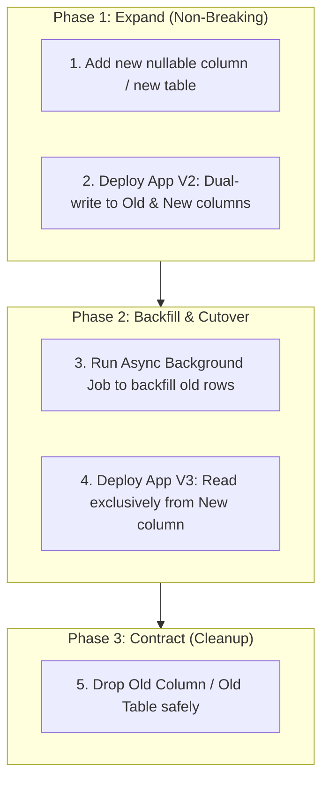
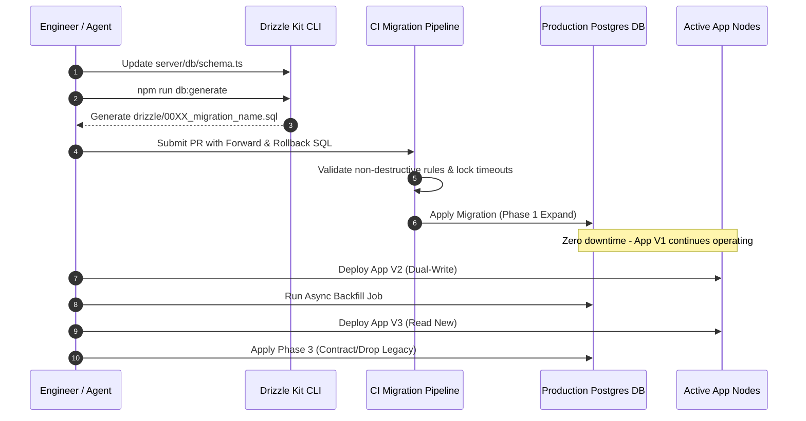

# Zero-Downtime Database Schema Migration & Rollback Standards `[🧑 HUMAN]`

> **Audience:** `🧑 Human / Database Engineer` &nbsp;|&nbsp; **Classification:** Architectural Governance & SDLC Standard

---

## 1. The Expand-and-Contract Migration Pattern `[🧑 Human]`

In a 24/7 high-availability distributed agent environment, database schema changes must NEVER lock tables or break running application instances. All schema modifications MUST follow the 3-phase **Expand and Contract** pattern:



---

## 2. Inviolable Schema Safety Rules `[🤖 Agent Reference]`

1. **Never Rename Columns Directly in SQL:**
   - Renaming `ALTER TABLE users RENAME COLUMN legacy_role TO role;` immediately crashes running application instances reading `legacy_role`.
   - **Instead:** Add `role`, dual-write, backfill, and drop `legacy_role` in a subsequent deployment.
2. **Never Add Columns with `NOT NULL` without a Default:**
   - Adding `ALTER TABLE jobs ADD COLUMN tenant_id UUID NOT NULL;` fails on existing tables with rows.
   - **Instead:** Add `tenant_id UUID DEFAULT '...' NOT NULL;` or add as nullable, backfill, then alter to `NOT NULL`.
3. **Use Concurrent Index Creation:**
   - Never run raw `CREATE INDEX idx_... ON large_table;` in production as it locks writes.
   - **Instead:** Use `CREATE INDEX CONCURRENTLY IF NOT EXISTS idx_...;`.
4. **Enforce Strict Statement Timeouts:**
   - Every migration session must execute:
     ```sql
     SET lock_timeout = '3s';
     SET statement_timeout = '30s';
     ```
     If a lock cannot be acquired within 3 seconds, the migration immediately aborts rather than queueing behind long transactions.

---

## 3. Step-by-Step Migration Execution Workflow `[🧑 Human]`



---

## 4. Rollback Verification Protocol `[🤖 Agent Reference]`

Every migration PR MUST include a tested rollback script that reverses the change without data loss.

| Migration Action | Rollback Procedure | Data Preservation Strategy |
| :--- | :--- | :--- |
| **Added Nullable Column** | `ALTER TABLE tbl DROP COLUMN col;` | Verify new column was not yet relied on for business logic. |
| **Added Index** | `DROP INDEX CONCURRENTLY IF EXISTS idx;` | Instant non-blocking rollback. |
| **Created New Table** | `DROP TABLE IF EXISTS new_table CASCADE;` | Verify foreign keys do not cascade into production tables. |
| **Altered Column Type** | Revert application read layer first; perform reverse migration. | Ensure fallback serializer supports both formats. |
