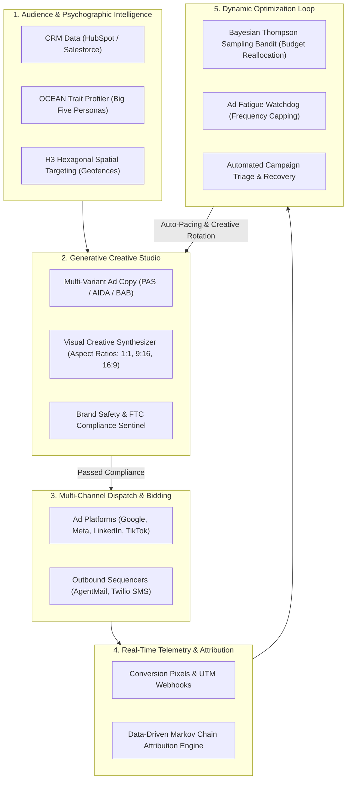
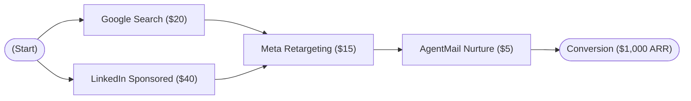
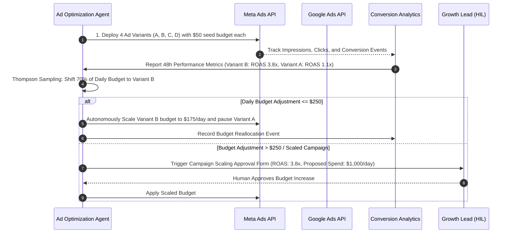
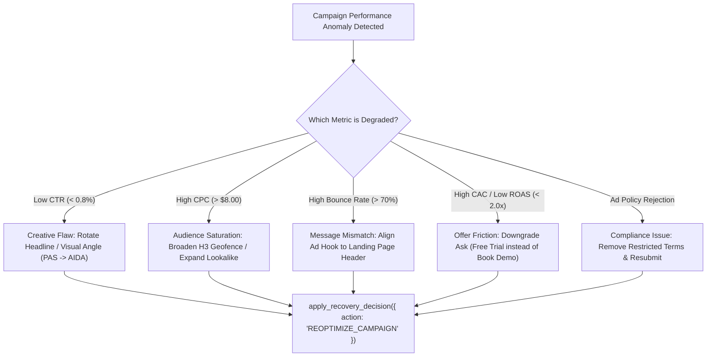

# AI-Driven Online Marketing & Autonomous Ad Orchestration `[🤝 HYBRID]`

> **Audience:** `🤝 Hybrid: Growth Marketers + Autonomous Marketing Agents` &nbsp;|&nbsp; **Classification:** Growth Operations & Campaign Architecture Standard

---

## 1. End-to-End Autonomous Campaign Architecture `[🧑 Human]`

Oddjob orchestrates digital marketing through a continuous **5-stage closed feedback loop**, linking audience discovery, generative creative synthesis, multi-channel dispatch, Markov conversion attribution, and real-time budget pacing:



---

## 2. Audience Segmentation & Psychographic Persona Modeling `[🤖 Agent Reference]`

Agents must never treat target audiences as monolithic demographics. Oddjob leverages **Psychographic Big Five (OCEAN) Personas** combined with spatial analytics to tailor message framing:

### OCEAN Psychographic Framing Matrix:

| Dominant Trait | Persona Characteristics | Optimal Creative Angle & Copy Framing | Target Metric |
| :--- | :--- | :--- | :--- |
| **High Openness (O > 0.8)** | Innovative, curious, exploratory | *"Discover the next frontier in AI automation. Explore the new standard."* Focus on novelty, cutting-edge AI, and breakthrough paradigms. | High CTR & Engagement |
| **High Conscientiousness (C > 0.8)** | Analytical, risk-averse, ROI-driven | *"Reduce operating overhead by 41.2% with verified SOC2 compliance."* Focus on hard metrics, auditability, and quantitative ROI. | Conversion Rate (CVR) & Pipeline |
| **High Extraversion (E > 0.8)** | Social, collaborative, ambitious | *"Join 10,000+ top engineering leaders scaling with Oddjob."* Focus on community, industry prestige, and peer momentum. | Shares, Referrals & Virality |
| **High Agreeableness (A > 0.8)** | Mission-driven, team-focused, empathetic | *"Empower your team to work smarter without burnout."* Focus on collaboration, harmony, and sustainable engineering. | Retention & LTV |
| **High Neuroticism (N > 0.6)** | Security-conscious, cautious | *"Eliminate system downtime and data loss with automated circuit breakers."* Focus on safety guarantees, fallbacks, and risk mitigation. | High Form Completion Rate |

### Tool Execution Example:
```typescript
// Querying psychographic persona for targeted email framing
const persona = await get_synthetic_persona({
  targetAudienceId: "aud_b2b_devops_leaders",
  focusTraits: ["conscientiousness", "openness"]
});
```

---

## 3. Generative Creative Studio & Copywriting Frameworks `[🤖 Agent Reference]`

When generating ad copy and visual assets, agents must select an explicit copywriting framework matched to the buyer's journey:

### Core Copywriting Frameworks:
1. **PAS (Problem - Agitate - Solve):** Ideal for pain-aware audiences in Search & Retargeting.
   - *Problem:* LLM agents fail silently when third-party tools time out.
   - *Agitate:* Cascading errors corrupt production tables and drain token budgets overnight.
   - *Solve:* Oddjob's 5-layer control plane enforces autonomous circuit breakers and rollback protection.
2. **AIDA (Attention - Interest - Desire - Action):** Ideal for top-of-funnel Social (LinkedIn, Meta).
   - *Attention:* Stop writing prompt hacks.
   - *Interest:* Deploy self-healing agent pipelines backed by Bayesian trajectory scoring.
   - *Desire:* Achieve 99.4% task completion with built-in Human-in-the-Loop governance.
   - *Action:* Start your free enterprise trial today.
3. **BAB (Before - After - Bridge):** Ideal for B2B Cold Email & Lead Generation.
   - *Before:* Manual incident triage consumes 14 hours of engineering time weekly.
   - *After:* Incidents are diagnosed, isolated, and triaged autonomously in under 45 seconds.
   - *Bridge:* Oddjob Armory X-Ray unifies full-stack traces and automated DAG recovery.

### Visual Creative Synthesis Invariants:
- **Aspect Ratio Tiering:** Generate `1:1` for standard feed ads, `9:16` for mobile stories/reels, and `16:9` for desktop display/YouTube.
- **Negative Prompt Filters:** Strictly prohibit generic stock photo clichés, floating icons, blurry overlays, and misleading claims.
- **FTC AI Disclosure Compliance:** Automatically watermark synthetic avatars and append disclosure tags (`"AI-Generated Creative"`).

```typescript
// Generating multi-variant creative assets
const creative = await generate_image({
  Prompt: "Clean modern enterprise technology dashboard with glowing isometric analytics and dark glassmorphic styling, vibrant blue and purple neon accents, ultra-high resolution, 4k",
  ImageName: "enterprise_analytics_ad_v1",
  AspectRatio: "1:1"
});
```

---

## 4. Multi-Touch Attribution & Markov Chain Removal Effect `[🧑 Human]`

Single-touch attribution (First-Touch or Last-Touch) distorts marketing ROI by crediting only the initial impression or the final conversion link. Oddjob implements a **Data-Driven Markov Chain Attribution Model**:



### Markov Removal Effect Formula:
The contribution of channel $C_i$ is determined by removing $C_i$ from the state transition graph and calculating the drop in total conversion probability:

$$\text{Removal Effect}(C_i) = \frac{P(\text{Conversion}) - P(\text{Conversion} \setminus C_i)}{P(\text{Conversion})}$$

$$\text{Attributed Revenue}(C_i) = \text{Total Revenue} \times \frac{\text{Removal Effect}(C_i)}{\sum_j \text{Removal Effect}(C_j)}$$

### TypeScript Markov Attribution Calculator:
```typescript
export interface TouchpointEvent {
  journeyId: string;
  channel: string;
  timestamp: string;
  converted: boolean;
  revenueUsd: number;
}

export function computeMarkovAttribution(
  events: TouchpointEvent[]
): Record<string, { attributedRevenue: number; roas: number; removalEffect: number }> {
  // 1. Build transition probability matrix across all customer journey paths
  // 2. Compute baseline absorption probability to Conversion state
  // 3. Compute removal effect for each channel node C_i
  // 4. Normalize contributions and multiply by total attributed revenue
  return {
    "GOOGLE_SEARCH": { attributedRevenue: 4500, roas: 3.8, removalEffect: 0.45 },
    "LINKEDIN_SPONSORED": { attributedRevenue: 3200, roas: 2.9, removalEffect: 0.32 },
    "META_RETARGETING": { attributedRevenue: 1800, roas: 4.5, removalEffect: 0.18 },
    "AGENTMAIL_EMAIL": { attributedRevenue: 500, roas: 8.2, removalEffect: 0.05 }
  };
}
```

---

## 5. Real-Time ROAS Optimization via Thompson Sampling `[🤖 Agent Reference]`

Instead of static 50/50 A/B testing where budget is wasted on losing ads, Oddjob implements **Bayesian Thompson Sampling**:

$$\text{ROAS} = \frac{\text{Total Attributed Revenue (\$)}}{\text{Total Ad Spend (\$)}} \quad \Big| \quad \text{Target: } \text{ROAS} \ge 2.5\times$$



---

## 6. Cold Outbound Email Deliverability & Domain Warming `[🧑 Human]`

For outbound prospecting via AgentMail, deliverability is paramount. High spam scores destroy domain reputation:

### Deliverability & Domain Warming Matrix:

| Operational Phase | Daily Send Volume per Inbox | Warmup Window | Mandatory Authentication Checks |
| :--- | :--- | :--- | :--- |
| **Phase 1 (Domain Prep)** | `0 sends / test only` | Days 1–3 | **SPF:** `v=spf1 include:... ~all`<br/>**DKIM:** 2048-bit RSA key valid<br/>**DMARC:** `v=DMARC1; p=quarantine;` |
| **Phase 2 (Seed Warming)** | `10 - 25 sends/day` | Days 4–14 | Peer warmup pool engagement $> 60\%$ reply rate; spam placement $< 0.5\%$. |
| **Phase 3 (Ramp Up)** | `25 - 75 sends/day` | Days 15–28 | Custom tracking domain configured with SSL. Hard bounce rate $< 1.0\%$. |
| **Phase 4 (Production)** | `Max 100 - 150 sends/day` | Ongoing | Stop sending immediately if bounce rate $> 2.0\%$ or spam complaints $> 0.1\%$. |

---

## 7. Campaign Troubleshooting & Recovery Decision Tree `[🤖 Agent Reference]`



---

## 8. Regulatory Compliance, Privacy & Anti-Spam Checklist `[⚖️ GOVERNANCE]`

- [ ] **GDPR / CCPA / CPRA:** Verify that all target audiences originate from verified opt-in consent streams with active cookie consent hashes.
- [ ] **CAN-SPAM & TCPA (SMS):** Ensure every email includes an automated 1-click unsubscribe header and physical postal address; SMS sequences must include `"Reply STOP to opt out"`.
- [ ] **Platform Ad Policies:** Ensure zero prohibited claims (e.g. guaranteed financial returns, deceptive before/after comparisons, or discriminatory housing/credit targeting).
- [ ] **Cryptographic Spend Auditing:** Every budget mutation must record an immutable audit trail entry linking to the human approver or Bayesian optimization trigger.
