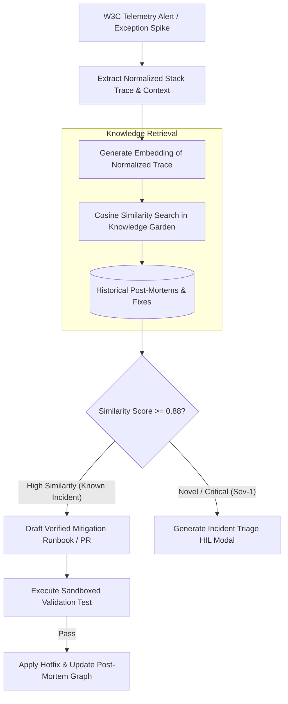

# Automated Incident Triage & Root-Cause Classification

> **Audience:** 🤖 Agent / Autonomous | 🤝 Hybrid / Co-Pilot | 🛡️ Safety & Governance  
> **Autonomy Level:** L2 to L4  
> **Telemetry Span:** `incident.triage.evaluate`

---

## 1. Overview & Architecture

When production incidents trigger error spikes across microservices, manual triage creates high Mean-Time-to-Detect (MTTD). The **Oddjob Automated Incident Triage Pattern** allows agents to ingest telemetry signals, extract stack traces, match against known historical post-mortems in the Knowledge Garden, and propose automated remediation steps.



---

## 2. Stack-Trace Normalization & Fingerprinting

Raw stack traces contain dynamic memory addresses and line offsets that prevent exact matching. Agents must normalize traces before embedding:

```typescript
export function normalizeStackTrace(rawTrace: string): string {
  return rawTrace
    // Remove memory addresses (0x7ffeefbff5e0)
    .replace(/0x[0-9a-fA-F]+/g, "<HEX_ADDR>")
    // Remove dynamic line/column numbers
    .replace(/:\d+:\d+/g, ":<LINE>")
    // Remove ephemeral timestamps & UUIDs
    .replace(/[0-9a-f]{8}-[0-9a-f]{4}-[0-9a-f]{4}-[0-9a-f]{4}-[0-9a-f]{12}/gi, "<UUID>")
    // Normalize OS file paths
    .replace(/[a-zA-Z]:\\[^\s)]+/g, "<FILEPATH>")
    .replace(/\/[a-zA-Z0-9_\-./]+/g, "<FILEPATH>")
    .trim();
}
```

---

## 3. Severity Classification Matrix

Agents classify incoming incidents according to four deterministic tiers:

| Severity | Threshold | Autonomous Action | Escalation SLA |
| :--- | :--- | :--- | :--- |
| **SEV-1 (Critical)** | Financial write failure, auth bypass, data loss | Freeze mutating pipelines, isolate host | Instant (Immediate PagerDuty + HIL) |
| **SEV-2 (High)** | Service degradation $> 5\%$ of tenant requests | Apply circuit breaker, scale pods | 15 minutes |
| **SEV-3 (Medium)** | Isolated worker crash with successful retry | Record incident, cluster in Knowledge Garden | 4 hours |
| **SEV-4 (Low)** | Deprecation warning, cosmetic UI glitch | Create Jira backlog ticket | 24 hours |

---

## 4. Automated Post-Mortem Linking

When an incident is resolved, the agent publishes an immutable knowledge node into Postgres and Qdrant:

```typescript
await knowledgeGraphService.createNode({
  organizationId: orgId,
  label: `POST_MORTEM: ${incidentCode}`,
  properties: {
    sourceType: "incident_post_mortem",
    severity: "SEV-2",
    rootCauseCategory: "DATABASE_CONNECTION_POOL_EXHAUSTION",
    mitigationApplied: "Incremented maxConnections from 20 to 50 and added 5000ms acquire timeout.",
    traceFingerprint: normalizedFingerprint,
    resolvedAt: new Date().toISOString(),
  }
});
```
