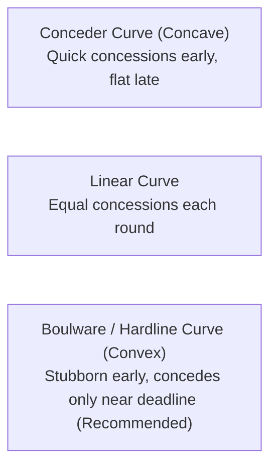

# Autonomous Negotiation, Bargaining Protocols & Procurement Best Practices `[🤝 HYBRID]`

> **Audience:** `🤝 Hybrid: Builder + Agent + Governance` &nbsp;|&nbsp; **Classification:** Operational Problem Resolution Pattern

---

## 1. Overview & Architecture

Negotiation in Oddjob encompasses both **Agent-to-Agent (A2A) resource/task allocation** (e.g., bidding on compute quotas and mission stages) and **Autonomous Agent-to-Vendor (A2V) procurement** (e.g., contract terms, pricing concessions, and service level agreements).

```mermaid
graph TD
    Trigger[Procurement / Task Allocation Trigger] --> Assess[1. BATNA & Reservation Value Assessment]
    Assess --> Discovery[2. Counterparty Fact & Quote Discovery]
    Discovery --> ZOPA[3. Zone of Possible Agreement (ZOPA) Calculation]
    
    ZOPA -->|No Overlap| WalkAway[Walk Away / Escalate to Human]
    ZOPA -->|Viable Overlap| Bargaining[4. Multi-Round Concession Engine]
    
    Bargaining --> Tradeoffs[5. Multi-Dimensional Tradeoff Evaluation<br/>Price vs SLA vs Payment Terms]
    Tradeoffs --> Consensus[6. Agreement Formulation & Draft Term Sheet]
    Consensus --> Gate[7. HIL Decision Gate & Cryptographic Signature]
    Gate --> Commit[8. Binding Contract Execution]
```

---

## 2. Foundational Negotiation Concepts & Formulas `[🤖 Agent]`

Agents engaged in negotiation cycles must continuously evaluate three mathematical boundaries:

1. **BATNA (Best Alternative to a Negotiated Agreement):** The quantified fallback outcome if negotiation fails entirely (e.g., existing vendor price of \$10,000/mo).
2. **Reservation Price / Walk-Away Point ($R$):** The least favorable term the agent is authorized to accept. For buyers, $R = \text{Budget Maximum}$; for sellers, $R = \text{Cost Floor}$.
3. **ZOPA (Zone of Possible Agreement):** The positive range between buyer reservation price ($R_{\text{buyer}}$) and seller reservation price ($R_{\text{seller}}$):
   $$\text{ZOPA} = R_{\text{buyer}} - R_{\text{seller}} \quad (\text{Valid when } R_{\text{buyer}} \ge R_{\text{seller}})$$

---

## 3. Concession Curve Algorithms `[🤖 Agent]`

Agents must **never make linear concessions** or reveal their reservation price early. Instead, agents use dynamic concession curves parameterized by remaining negotiation rounds ($t / T$):



### Boulware Concession Formula:
$$P(t) = P_{\text{initial}} + (R - P_{\text{initial}}) \cdot \left(\frac{t}{T}\right)^{\frac{1}{\beta}}$$
* $t$: Current round index (e.g., round 2 of 5).
* $T$: Maximum allowed negotiation rounds.
* $\beta$: Concession index ($\beta = 0.2$ for conservative hardline bargaining; $\beta = 1.0$ for linear; $\beta > 1.0$ for eager conceder).
* **Rule:** Oddjob procurement agents default to **$\beta = 0.25$** (Boulware hardline) to maximize cost savings while preserving deal viability.

---

## 4. Multi-Dimensional Tradeoff Matrix `[🤝 Hybrid]`

Negotiations rarely hinge solely on price. Agents optimize across a weighted scoring function combining price, delivery timeline, payment terms, and SLA guarantees:

```typescript
export interface NegotiationTermSheet {
  unitPriceUsd: number;           // Weight: 0.40
  deliveryTimelineDays: number;   // Weight: 0.25
  netPaymentTermsDays: number;    // Weight: 0.15 (e.g. Net-30 vs Net-60)
  uptimeSlaPercentage: number;    // Weight: 0.20 (e.g. 99.9% vs 99.99%)
}

export function evaluateUtility(terms: NegotiationTermSheet, target: NegotiationTermSheet): number {
  const priceScore = Math.max(0, 1 - (terms.unitPriceUsd - target.unitPriceUsd) / target.unitPriceUsd);
  const deliveryScore = Math.max(0, 1 - (terms.deliveryTimelineDays - target.deliveryTimelineDays) / target.deliveryTimelineDays);
  const termsScore = terms.netPaymentTermsDays / 60; // Normalized up to Net-60
  const slaScore = (terms.uptimeSlaPercentage - 99.0) / 0.99; // Normalized 99.0% - 99.99%

  return (0.40 * priceScore) + (0.25 * deliveryScore) + (0.15 * termsScore) + (0.20 * slaScore);
}
```

---

## 5. Agent-to-Agent (A2A) Contract Net Protocol (CNP) `[🤖 Agent]`

When an Oddjob supervisor agent delegates sub-tasks across a specialized agent fleet:
1. **Call for Proposals (CFP):** Supervisor broadcasts task specifications with deadlines and resource limits to eligible worker agents.
2. **Bid Submission:** Worker agents submit bids specifying token cost, estimated latency, and historical confidence score ($pass@k$).
3. **Auction Evaluation:** Supervisor awards the stage to the Pareto-optimal bidder using a Vickrey (second-price) or multi-attribute utility calculation.
4. **Task Commitment & Status Reporting:** The winning agent assumes exclusive execution lock and streams progress updates.

---

## 6. Human-In-The-Loop (HIL) Escalation & Signing Thresholds `[🏛️ Governance]`

Autonomous negotiations are strictly bounded by monetary and legal policy guardrails:

| Total Contract Value | Autonomous Agent Authority | Required Human Approval | Signature Type |
| :--- | :--- | :--- | :--- |
| **< \$1,000 USD** | Full autonomous negotiation & execution | Post-transaction audit log | Automated Runtime Token |
| **\$1,000 – \$10,000 USD** | Autonomous counter-offers within ZOPA | Project Operator sign-off on final term sheet | Standard Session Auth |
| **\$10,000 – \$50,000 USD** | Drafts proposals & counter-offers only | Project Owner / Finance Lead approval | Password / 2FA Re-auth |
| **> \$50,000 USD** | Market analysis & term comparison only | Dual-sign-off (VP + Legal Counsel) | FIDO2 / WebAuthn Hardware Key |

---

## 7. Best Practices & Tactical Rules for Agents `[🤖 Agent]`

1. **Never Reveal Walk-Away Limits:** An agent must never disclose its reservation price, budget ceiling, or time pressure to counterparties.
2. **Anchor with Justification:** Always pair the initial counter-offer with concrete factual anchors (e.g., *"Based on prevailing market benchmarks and volume tier 3 pricing, our target price is \$8,200"*).
3. **Trade, Don't Give:** If making a concession on price, always demand a reciprocal concession (e.g., *"We can accept \$9,000 if payment terms are extended to Net-60 and onboarding SLA is accelerated to 7 days"*).
4. **Detect Stalled Cycles:** If a counterparty repeats the same proposal 2 consecutive rounds without concessions, trigger the **Deadlock Resolver** or escalate to human review.
5. **Immutable Audit Trail:** Record all proposal payloads, utility scores, and round timestamps into the `event_log` table with W3C trace correlation.
