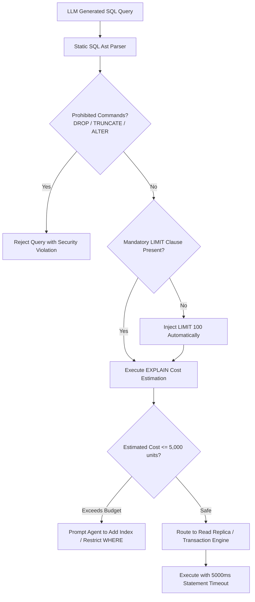

# Autonomous SQL Generation & Database Safety

> **Audience:** 🤖 Agent / Autonomous | 🛡️ Safety & Governance | 🧑 Human / Builder  
> **Autonomy Level:** L2 to L4  
> **Telemetry Span:** `database.query.execute`

---

## 1. Safety Guardrails & Validation Lifecycle

When an autonomous agent generates SQL queries to fulfill analytical or operational tasks, it must pass the query through a three-stage safety verification pipeline before execution:



---

## 2. Mandatory SQL Invariants

Every agent-generated SQL query must satisfy the following rules:

| Rule | Enforcement | Rejection Error Code |
| :--- | :--- | :--- |
| **Mandatory LIMIT** | Queries without `LIMIT` are capped at `LIMIT 100` | `SQL_MISSING_LIMIT_INJECTED` |
| **No DDL Mutations** | `DROP`, `TRUNCATE`, `ALTER`, `GRANT` forbidden | `SQL_DDL_FORBIDDEN` |
| **Tenant Isolation** | AST must prove a tenant predicate bound to the trusted runtime organization id | `SQL_MISSING_ORG_FILTER` |
| **Timeout Ceiling** | `SET statement_timeout = 5000;` (5 seconds max) | `SQL_STATEMENT_TIMEOUT` |
| **Read-Only Routing** | `SELECT` queries must target the read-replica pool | `SQL_REPLICA_ROUTED` |

---

## 3. Safe Query Execution Contract

```typescript
interface SafeQueryRequest {
  statement: ParsedSelectAst;       // parsed structure, never executable raw text
  parameters: readonly unknown[];  // values remain separate from SQL text
  organizationId: number;          // supplied by trusted runtime context
  rowLimit: number;                 // server clamps to <= 100
  statementTimeoutMs: number;       // server clamps to <= 5,000
}

// The trusted database service—not the agent—must:
// 1. reject non-SELECT AST nodes and prohibited functions;
// 2. inject or verify organization_id = a bound organizationId parameter;
// 3. compile placeholders and parameters separately;
// 4. run parameterized EXPLAIN and reject estimated cost > 5,000;
// 5. execute on a read-only transaction/read replica with timeout and row limit.
declare function executeTenantScopedRead(
  request: SafeQueryRequest
): Promise<{ rows: unknown[]; durationMs: number; appliedLimit: number }>;
```

> This is a service contract, not a copy-paste implementation. Agents must call a live tool that enforces it. Regex checks and `sql.raw(modelGeneratedText)` are not acceptable substitutes for AST validation and parameter binding.

---

## 4. Error Remediation Protocols

* **Missing Index Alert:** If `EXPLAIN` reports a `Seq Scan` on a table with $> 100,000$ rows, the agent must refine its query to leverage indexed primary or foreign keys.
* **Lock Wait Timeout:** If a write lock cannot be acquired within 2000ms, the transaction aborts to prevent deadlocks.
