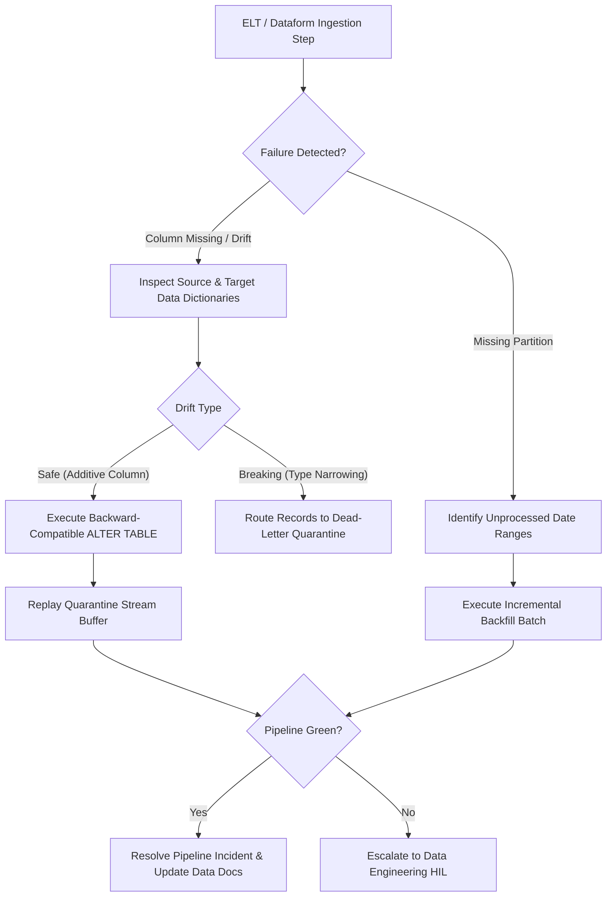

# Self-Healing Data Pipelines & Schema Drift Remediation

> **Audience:** 🤖 Agent / Autonomous | 🧑 Human / Builder | 🛡️ Safety & Governance  
> **Autonomy Level:** L3 to L4  
> **Telemetry Span:** `pipeline.self_heal.execute`

---

## 1. Problem Statement & Self-Healing Loop

Upstream telemetry providers or database migrations frequently alter payload shapes (e.g. adding new fields, changing nullability, or altering integer precision). Without automated self-healing, downstream ELT/dbt/Dataform pipelines fail abruptly, breaking operational analytics.



---

## 2. Safe Schema Evolution Rules

Agents must adhere to strict backward compatibility policies when self-healing:

| Drift Event | Action | Required Approval | Recovery Protocol |
| :--- | :--- | :--- | :--- |
| **New Optional Column** | Additive Evolution | **Autonomous (L3)** | `ALTER TABLE target ADD COLUMN field TYPE;` |
| **Widened Numeric Precision** | Safe Evolution | **Autonomous (L3)** | `INT4` $\to$ `INT8` or `FLOAT` $\to$ `NUMERIC` |
| **Dropped Column** | Deprecation Soft-Delete | **HIL Gate (L2)** | Mark column as deprecated; do NOT `DROP COLUMN` |
| **Type Conflict (String $\to$ Int)** | Quarantine DLQ | **Autonomous (L3)** | Write to `raw_quarantine_dlq` and alert team |

---

## 3. Autonomous Partition Backfill Script

When processing gaps occur due to upstream webhook downtimes:

```typescript
export async function executePartitionBackfill(
  tableName: string,
  startPartition: string, // "YYYY-MM-DD"
  endPartition: string,
  dryRun: boolean = true
): Promise<{ repairedPartitions: number; totalRowsProcessed: number }> {
  const missingIntervals = await findMissingDatePartitions(tableName, startPartition, endPartition);
  
  if (missingIntervals.length === 0) {
    return { repairedPartitions: 0, totalRowsProcessed: 0 };
  }

  let totalRows = 0;
  for (const dateStr of missingIntervals) {
    if (!dryRun) {
      const rows = await reprocessPartitionBatch(tableName, dateStr);
      totalRows += rows;
    }
  }

  return {
    repairedPartitions: missingIntervals.length,
    totalRowsProcessed: totalRows,
  };
}
```

---

## 4. Telemetry & Data Quality Invariants

1. **Row Count Parity:** Verify $\text{Source Count} \approx \text{Target Count}$ within $\pm 0.05\%$.
2. **Freshness SLA:** Pipeline execution latency must remain under 15 minutes.
3. **Quarantine Monitoring:** DLQ depth exceeding 500 records automatically opens a High-Priority SRE ticket.
