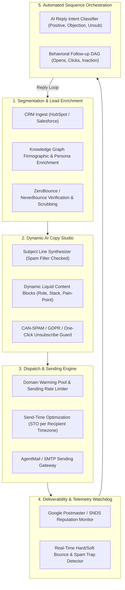
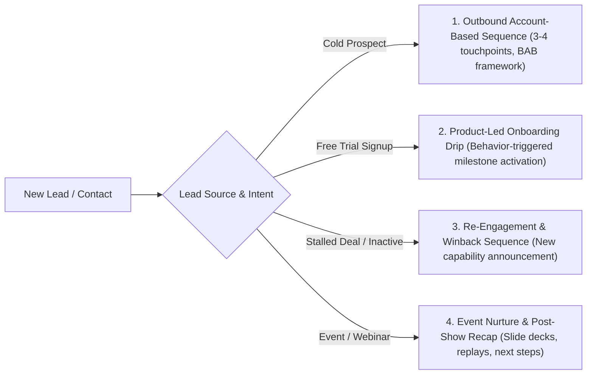
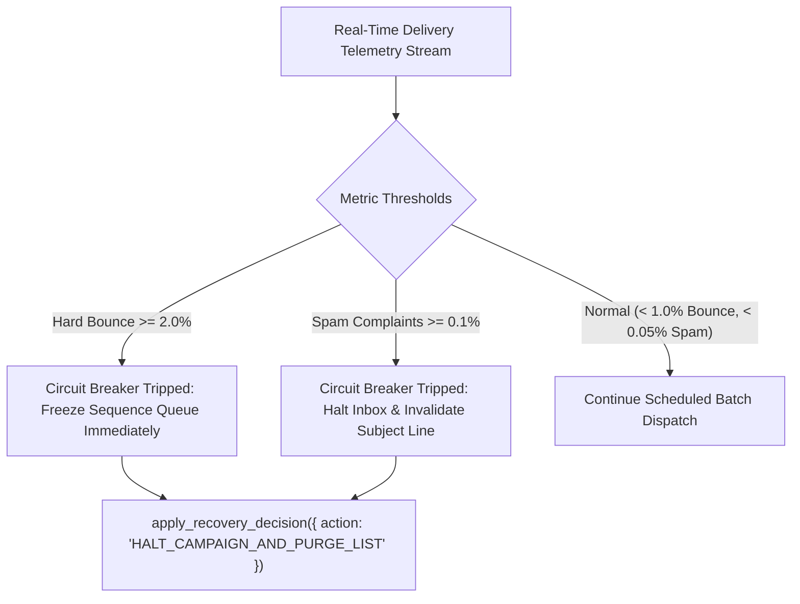

# AI-Driven Email Marketing & Lifecycle Sequence Standards `[🤝 HYBRID]`

> **Audience:** `🤝 Hybrid: Growth Marketers + Autonomous Email Operations Agents` &nbsp;|&nbsp; **Classification:** Growth Operations & Messaging Infrastructure Standard

---

## 1. End-to-End Email Lifecycle Architecture `[🧑 Human]`

Oddjob orchestrates email marketing through a continuous **5-stage lifecycle framework**, mapping customer state changes to automated dynamic sequences:



---

## 2. Technical Deliverability & DNS Authentication Invariants `[🧑 Human]`

High email deliverability is a prerequisite for revenue. Without rigorous DNS authentication, AI-generated emails land directly in spam folders.

### Mandatory DNS Authentication Suite:

| Protocol | Purpose | Standard Configuration Specification |
| :--- | :--- | :--- |
| **SPF (Sender Policy Framework)** | Authorizes IP addresses permitted to send mail for the domain. | `v=spf1 include:_spf.oddjob.io include:sendgrid.net ~all` |
| **DKIM (DomainKeys Identified Mail)** | Cryptographic signature verifying message body integrity. | **2048-bit RSA key**, rotated every 90 days. Selector: `oddjob2026._domainkey.company.com`. |
| **DMARC (Domain-based Message Authentication)** | Enforces policy when SPF/DKIM fail; prevents domain spoofing. | `v=DMARC1; p=quarantine; pct=100; rua=mailto:dmarc-reports@company.com; sp=reject;` |
| **BIMI (Brand Indicators for Message Identification)** | Displays verified company logo in Gmail/Apple Mail inboxes. | `v=BIMI1; l=https://company.com/logo.svg; a=https://company.com/vmc.pem;` |
| **Custom Tracking Domain** | White-labels tracking links with dedicated SSL to prevent shared-domain reputation poisoning. | `track.company.com CNAME link.oddjob.io` (with valid Let's Encrypt TLS certificate). |

---

## 3. The 4 Core Email Lifecycle Sequences `[🤖 Agent Reference]`

Agents must dynamically assign leads to the appropriate sequence DAG based on lifecycle state:



### Sequence Specifications:

#### A. Cold Outbound B2B Sequence (BAB Framework)
- **Target:** Unfamiliar prospects matching Ideal Customer Profile (ICP).
- **Tone:** Plaintext, consultative, peer-to-peer (avoid flashy HTML graphics that trigger promotional tabs).
- **Cadence:**
  - *Day 1:* Initial Hook (Pain-Point Observation & Concrete Proof).
  - *Day 4:* Value-Add Case Study (2-minute video or metric breakdown).
  - *Day 8:* Quick 1-Question Check-in.
  - *Day 14:* Graceful Break-up Email with resource link.

#### B. Product-Led Onboarding Drip (Behavioral Triggers)
- **Target:** Self-serve trial signups.
- **Trigger Invariant:** Never send timed emails blindly. Trigger emails based on in-app telemetry:
  - *If User created project but added no tools:* Send "How to connect your first MCP tool in 60 seconds".
  - *If User ran 5 missions successfully:* Send "Inviting your team to CREW collaboration rooms".

---

## 4. AI Copywriting, Subject Lines & Personalization Rules `[🤖 Agent Reference]`

### Subject Line Engineering Rules:
1. **Length Ceiling:** Keep subject lines between **28 to 48 characters** ($4\text{ to }7\text{ words}$) to ensure full visibility on mobile devices.
2. **Spam Trigger Word Blacklist:** Prohibit terms like `"FREE"`, `"GUARANTEE"`, `"100% OFF"`, `"ACT NOW"`, `"MAKE $$$"`, `$$$`, and excessive exclamation marks (`!!!`).
3. **Dynamic Liquid Merge Tokens:** Personalize using enriched knowledge context:
   ```liquid
   
   Scaling your Drizzle migrations without downtime
   
   Governed AI automation for your engineering workflows
   
   ```

### High-Converting Subject Line Archetypes:
- **Curiosity Gap:** `"Quick question regarding {{company}}'s API latency"`
- **Direct Metric:** `"How {{peer_company}} cut triage time by 64%"`
- **Personalized Observation:** `"Noticed your team is scaling {{tool_name}}"`

---

## 5. Send-Time Optimization (STO) & Pacing Algorithms `[🤖 Agent Reference]`

1. **Recipient Timezone Normalization:**
   - Outbound marketing emails must be dispatched between **8:30 AM and 10:30 AM** or **1:30 PM and 3:00 PM** in the **recipient's local timezone**.
   - Prohibit dispatching between 9:00 PM and 7:00 AM local time or on weekends for B2B lists.
2. **Burst Pacing & IP Throttling:**
   - To avoid triggering spam rate limiters at Google and Microsoft:
     $$\text{Max Send Rate} = 1 \text{ email every } 45\text{ to }90\text{ seconds per inbox}$$
   - Distribute sends across warm inboxes in a round-robin pool.

---

## 6. Email Deliverability Watchdog & Circuit-Breaker Invariants `[🤖 Agent Reference]`

Agents monitoring campaigns must continuously calculate deliverability health metrics:

$$\text{Hard Bounce Rate} = \frac{\text{Hard Bounces}}{\text{Total Sent}} \times 100 \quad \Big| \quad \text{Ceiling: } < 1.0\%$$

$$\text{Spam Complaint Rate} = \frac{\text{Spam Reports}}{\text{Total Delivered}} \times 100 \quad \Big| \quad \text{Ceiling: } < 0.08\%$$

### Circuit Breaker Trigger Logic:


---

## 7. Regulatory Compliance & Anti-Spam Governance `[⚖️ GOVERNANCE]`

Every marketing and outbound email dispatched by Oddjob MUST strictly adhere to global privacy frameworks:

- [ ] **CAN-SPAM Act (US):**
  - Accurate `From:` header clearly identifying the sender organization.
  - Non-deceptive subject lines directly reflecting email content.
  - Physical postal address included in the email footer.
  - Functional opt-out mechanism honored within **$\le 24\text{ hours}$**.
- [ ] **RFC 8058 One-Click List-Unsubscribe:**
  - Header `List-Unsubscribe: <https://company.com/unsub?id=...>, <mailto:unsub@company.com>`
  - Header `List-Unsubscribe-Post: List-Unsubscribe=One-Click`
- [ ] **GDPR / CASL Consent Audit Trail:**
  - Record the verified opt-in timestamp, source IP, and legal consent basis in the Knowledge Graph for every European/Canadian contact before queuing messages.
