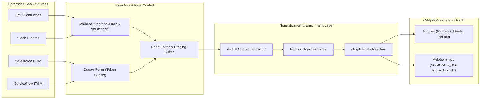

# Enterprise SaaS Data Ingestion & Normalization `[🤖 AGENT]`

> **Audience:** `🤖 Agent Executable & Integration Builder` &nbsp;|&nbsp; **Classification:** Problem Resolution Pattern

---

## 1. End-to-End Ingestion & Normalization Pipeline `[🧑 Human]`

Oddjob normalizes disparate SaaS data streams into unified Knowledge Graph entities through an asynchronous, rate-limited processing pipeline:



---

## 2. Rate Limiting & Resilient Pagination Invariants `[🤖 Agent Reference]`

When pulling records via bulk or incremental REST APIs:

1. **Token Bucket Rate Limiter**:
   - Limit requests to **$\le 80\%$** of upstream provider's published maximum rate limit.
   - Example: For Salesforce (100 req/min), cap agent requests at `80 req/min` (1 req every 750ms).
2. **Deterministic Cursor Pagination**:
   - Always persist the latest `next_cursor` or `updated_at_gt` watermark in the sync state table after every page batch.
   - Never iterate unbounded loops without maximum page guards (`maxPages = 500`).
3. **Exponential Jitter Backoff**:
   - On HTTP 429 (Too Many Requests), extract `Retry-After` header. If missing, apply exponential backoff with full jitter:
     $$T_{\text{wait}} = \min(60, 2^{\text{attempt}} \times 0.5) + \text{random}(0, 1)$$

---

## 3. Webhook HMAC Security Verification `[🧑 Human]`

Every inbound SaaS webhook MUST verify cryptographic authenticity before payload deserialization:

```typescript
import crypto from "node:crypto";

export function verifyWebhookSignature(
  rawBody: string | Buffer,
  headerSignature: string,
  secretKey: string
): boolean {
  const computedHash = crypto
    .createHmac("sha256", secretKey)
    .update(rawBody)
    .digest("hex");
  
  const expectedSignature = `v0=${computedHash}`;
  
  // Timing-safe equal comparison prevents timing attack vectors
  return crypto.timingSafeEqual(
    Buffer.from(headerSignature, "utf-8"),
    Buffer.from(expectedSignature, "utf-8")
  );
}
```

---

## 4. Entity Normalization & Graph Mapping Contract `[🤖 Agent Reference]`

All inbound records must be mapped into canonical Knowledge Graph nodes conforming to the standard schema:

| SaaS Source Record | Canonical Graph Type | Standard Properties | Primary Relationships |
| :--- | :--- | :--- | :--- |
| **Jira Issue / Bug** | `ENTITY:WORK_ITEM` | `title`, `key`, `priority`, `status`, `severity` | `REPORTED_BY` $\rightarrow$ `User`<br/>`BLOCKS` $\rightarrow$ `WorkItem` |
| **Slack Message** | `ENTITY:CONVERSATION_EVENT` | `channelId`, `authorId`, `timestamp`, `text` | `MENTIONS` $\rightarrow$ `User`<br/>`IN_THREAD` $\rightarrow$ `Conversation` |
| **Salesforce Deal** | `ENTITY:OPPORTUNITY` | `amount`, `stage`, `closeDate`, `account` | `OWNED_BY` $\rightarrow$ `User`<br/>`ASSOCIATED_WITH` $\rightarrow$ `Organization` |
| **ServiceNow Incident** | `ENTITY:INCIDENT` | `number`, `impact`, `urgency`, `state`, `cmdbCi` | `AFFECTS` $\rightarrow$ `Service`<br/>`ASSIGNED_TO` $\rightarrow$ `User` |
