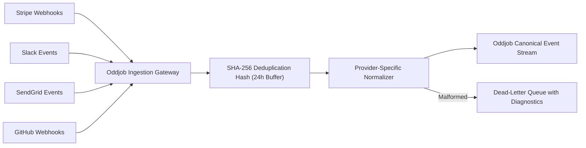

# Event Stream Ingestion & Multi-Provider Normalization `[🤖 AGENT]`

> **Audience:** `🤖 Agent / Autonomous` &nbsp;|&nbsp; **Autonomy:** `L3 / L4` &nbsp;|&nbsp; **Layer:** `Layer 1 (Ingestion)`

---

## 1. Multi-Provider Ingestion Architecture `[🧑 Human]`



---

## 2. Multi-Provider Mapping Matrix `[🤖 Agent Reference]`

### A. Stripe Inbound Mapping
```typescript
export function normalizeStripeEvent(raw: any) {
  return {
    eventId: `stripe_${raw.id}`,
    sourceSystem: "stripe",
    eventType: raw.type, // e.g. "payment_intent.succeeded"
    occurredAt: new Date(raw.created * 1000).toISOString(),
    entityId: raw.data.object.customer || raw.data.object.id,
    payload: {
      amountCents: raw.data.object.amount,
      currency: raw.data.object.currency,
      status: raw.data.object.status
    }
  };
}
```

### B. Slack Event Mapping
```typescript
export function normalizeSlackEvent(raw: any) {
  return {
    eventId: `slack_${raw.event_id}`,
    sourceSystem: "slack",
    eventType: raw.event.type, // e.g. "app_mention" or "message"
    occurredAt: new Date(raw.event_time * 1000).toISOString(),
    entityId: raw.event.user,
    payload: {
      channel: raw.event.channel,
      text: raw.event.text,
      threadTs: raw.event.thread_ts || raw.event.ts
    }
  };
}
```

### C. SendGrid Inbound Email Mapping
```typescript
export function normalizeSendGridEvent(raw: any) {
  return {
    eventId: `sendgrid_${raw.sg_message_id}`,
    sourceSystem: "sendgrid",
    eventType: raw.event, // e.g. "delivered" or "inbound_parse"
    occurredAt: new Date(raw.timestamp * 1000).toISOString(),
    entityId: raw.email,
    payload: {
      subject: raw.subject,
      sender: raw.from,
      recipient: raw.to,
      spamScore: raw.spam_score
    }
  };
}
```
