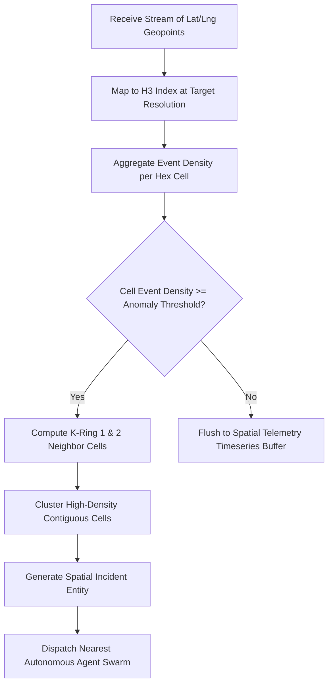

# Hexagonal H3 Spatial Analytics & Geo-Signal Resolution `[🤖 AGENT]`

> **Audience:** `🤖 Agent / Autonomous` &nbsp;|&nbsp; **Autonomy Scope:** `L3 / L4` &nbsp;|&nbsp; **Layer:** `Layer 1 & Layer 4`

---

## 1. Architectural Concept `[🧑 Human]`
Traditional lat/long bounding-box queries suffer from geometric distortion and uneven neighbor distances. Oddjob uses **Uber H3 hexagonal indexing** to partition planetary space into uniform discrete cells. This enables linear-time proximity lookups, invariant neighborhood radii (k-ring), and real-time Eulerian cluster aggregation.



---

## 2. Executable TypeScript Implementation (`h3-js`) `[🤖 Agent]`

```typescript
import { latLngToCell, gridDisk, polygonToCells, cellToLatLng } from "h3-js";

export interface GeoSignal {
  id: string;
  latitude: number;
  longitude: number;
  severity: number;
  timestamp: string;
}

export interface SpatialCluster {
  parentH3Index: string;
  centroid: [number, number];
  signalCount: number;
  totalSeverity: number;
  affectedH3Cells: string[];
}

export class H3SpatialAnalyticsEngine {
  /**
   * Aggregates raw geospatial signals into discrete H3 hexagonal clusters.
   * @param signals List of GPS coordinates and event weights
   * @param resolution H3 index resolution (Default: 8 ~ 460m radius)
   * @param anomalyThreshold Minimum aggregate severity to declare an incident
   */
  public static clusterSignals(
    signals: GeoSignal[],
    resolution = 8,
    anomalyThreshold = 10
  ): SpatialCluster[] {
    const cellDensityMap = new Map<string, { count: number; severity: number; lat: number; lng: number }>();

    // 1. Bin each signal into its parent H3 hexagon
    for (const signal of signals) {
      const h3Index = latLngToCell(signal.latitude, signal.longitude, resolution);
      const existing = cellDensityMap.get(h3Index) || { count: 0, severity: 0, lat: signal.latitude, lng: signal.longitude };
      
      existing.count += 1;
      existing.severity += signal.severity;
      cellDensityMap.set(h3Index, existing);
    }

    const clusters: SpatialCluster[] = [];
    const processedCells = new Set<string>();

    // 2. Scan for high-density cells and compute contiguous k-ring clusters
    for (const [cellIndex, data] of cellDensityMap.entries()) {
      if (processedCells.has(cellIndex) || data.severity < anomalyThreshold) continue;

      // Compute immediate 1-ring neighbors
      const neighbors = gridDisk(cellIndex, 1);
      const clusterCells: string[] = [];
      let totalClusterCount = 0;
      let totalClusterSeverity = 0;

      for (const nCell of neighbors) {
        processedCells.add(nCell);
        const neighborData = cellDensityMap.get(nCell);
        if (neighborData) {
          clusterCells.push(nCell);
          totalClusterCount += neighborData.count;
          totalClusterSeverity += neighborData.severity;
        }
      }

      const [centroidLat, centroidLng] = cellToLatLng(cellIndex);

      clusters.push({
        parentH3Index: cellIndex,
        centroid: [centroidLat, centroidLng],
        signalCount: totalClusterCount,
        totalSeverity: totalClusterSeverity,
        affectedH3Cells: clusterCells
      });
    }

    return clusters.sort((a, b) => b.totalSeverity - a.totalSeverity);
  }
}
```
