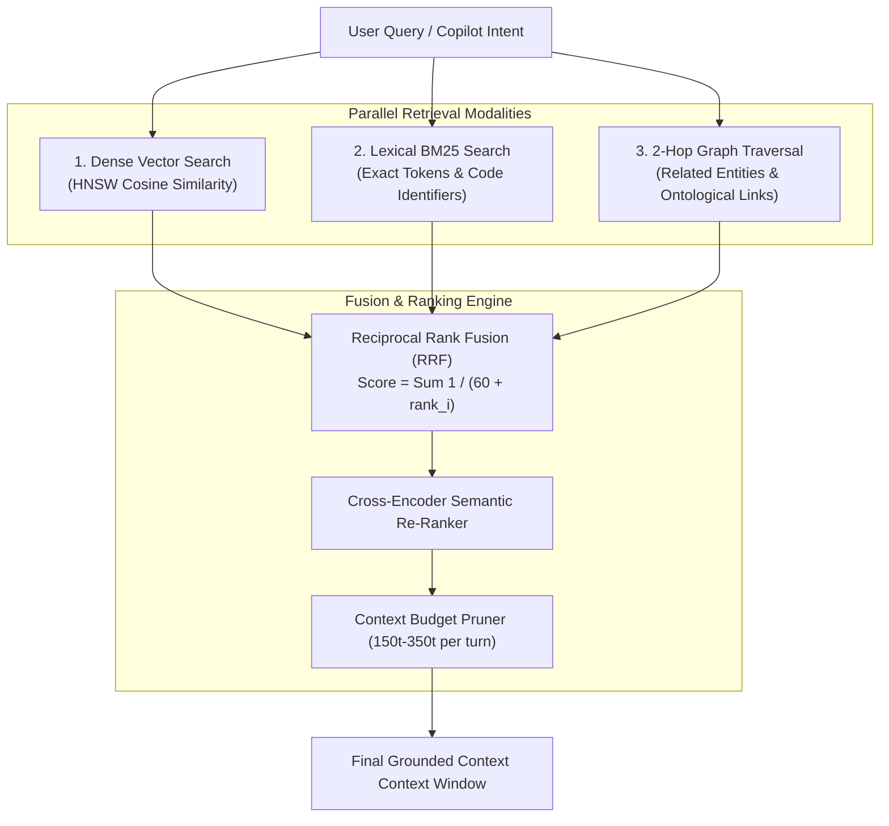

# Hybrid Vector, BM25 & Knowledge Graph Retrieval `[🤖 AGENT]`

> **Audience:** `🤖 Agent Executable & Search Engineer` &nbsp;|&nbsp; **Classification:** Retrieval Architecture & Algorithmic Pattern

---

## 1. Tri-Modal Retrieval Architecture `[🧑 Human]`

Traditional vector search suffers from keyword loss (exact acronyms, IDs, version numbers), while keyword search lacks semantic context. Oddjob unifies three complementary search modalities:



---

## 2. Reciprocal Rank Fusion (RRF) Formula `[🤖 Agent Reference]`

The composite relevancy score $R(d)$ for document $d$ across the 3 search modalities $M = \{\text{Vector}, \text{BM25}, \text{Graph}\}$ is calculated using standard constant $k = 60$:

$$R(d) = \sum_{m \in M} \frac{w_m}{k + \text{rank}_m(d)}$$

Where:
- $w_{\text{Vector}} = 1.0$ (Semantic meaning)
- $w_{\text{BM25}} = 1.2$ (Exact identifiers, function names, error codes)
- $w_{\text{Graph}} = 1.1$ (Connected entity relevance)

### TypeScript Implementation

```typescript
export interface RankedResult {
  id: string;
  score: number;
  content: string;
  metadata: Record<string, any>;
}

export function reciprocalRankFusion(
  vectorResults: RankedResult[],
  bm25Results: RankedResult[],
  graphResults: RankedResult[],
  k = 60
): RankedResult[] {
  const scores = new Map<string, { item: RankedResult; rrfScore: number }>();

  const ingest = (list: RankedResult[], weight: number) => {
    list.forEach((item, rank) => {
      const existing = scores.get(item.id);
      const contribution = weight / (k + rank + 1);
      if (existing) {
        existing.rrfScore += contribution;
      } else {
        scores.set(item.id, { item, rrfScore: contribution });
      }
    });
  };

  ingest(vectorResults, 1.0);
  ingest(bm25Results, 1.2);
  ingest(graphResults, 1.1);

  return Array.from(scores.values())
    .sort((a, b) => b.rrfScore - a.rrfScore)
    .map(({ item, rrfScore }) => ({ ...item, score: rrfScore }));
}
```

---

## 3. Temporal Memory Decay & Recency Weighting `[🧑 Human]`

In dynamic agent environments, recent signals and state changes should carry higher relevancy than aged historical data.

The decay multiplier $D(t)$ applies an exponential half-life decay:

$$D(t) = e^{-\lambda \Delta t} \quad \text{where } \lambda = \frac{\ln(2)}{T_{\text{half-life}}}$$

- For **Live Incident / Telemetry Nodes**: $T_{\text{half-life}} = 2 \text{ hours}$
- For **User Interaction / Conversation History**: $T_{\text{half-life}} = 24 \text{ hours}$
- For **Architecture / Platform Documentation**: $T_{\text{half-life}} = \infty$ (Decay disabled)

---

## 4. Context Budgeting & Compaction Invariants `[🤖 Agent Reference]`

1. **Top-K Selection**:
   - Extract top 5 results post-RRF ranking.
2. **Context Window Ceiling**:
   - Total compiled search injection must remain within **350 tokens** per Copilot turn.
3. **Deduplication**:
   - If a Graph entity is already represented in the 1-hop active user context, suppress duplicate document snippets to conserve prompt bandwidth.
