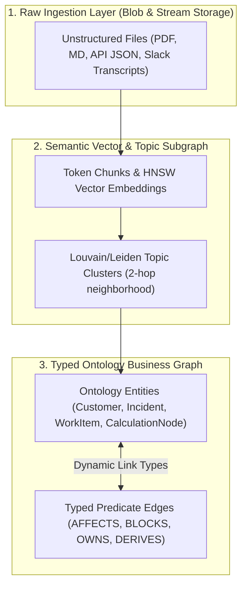
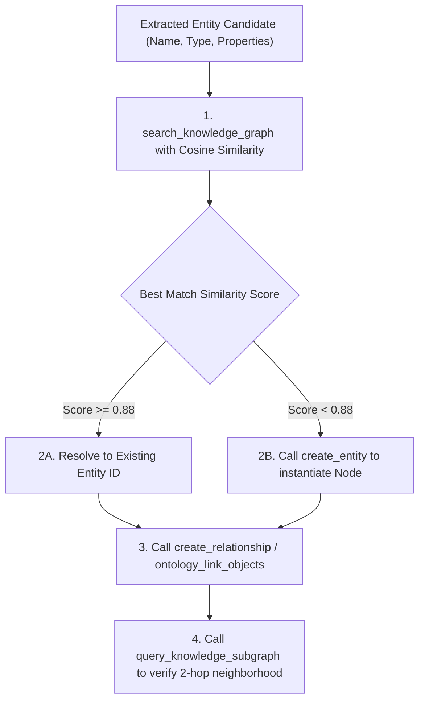

# Knowledge Garden Graph Linking & Ontology Mapping `[🤖 AGENT]`

> **Audience:** `🤖 Agent Executable & Knowledge Architect` &nbsp;|&nbsp; **Classification:** Semantic Enrichment & Knowledge Graph Pattern

---

## 1. 3-Tier Knowledge Garden Architecture `[🧑 Human]`

The **Knowledge Garden** organizes all unstructured and structured enterprise intelligence into three interlinked layers:



---

## 2. Multi-Hop Entity Resolution & Linking Algorithm `[🤖 Agent Reference]`

When new text or structured records arrive, execute the **Entity Resolution Pipeline**:



---

## 3. Real MCP Tool Invocation Standards `[🤖 Agent Reference]`

### A. Creating an Entity Node
```typescript
// Call create_entity to register a new strongly-typed node
await create_entity({
  type: "ENTITY:WORK_ITEM",
  name: "Fix Stripe Webhook Replay Vulnerability",
  properties: {
    key: "ODD-4102",
    priority: "HIGH",
    status: "IN_PROGRESS",
    sourceSystem: "JIRA"
  }
});
```

### B. Linking Entities via Typed Ontology Edges
```typescript
// Call create_relationship to link entities
await create_relationship({
  sourceEntityId: "ent_work_item_4102",
  targetEntityId: "ent_user_dev_881",
  relationshipType: "ASSIGNED_TO",
  properties: {
    assignedAt: new Date().toISOString(),
    confidence: 0.95
  }
});
```

### C. Traversing and Querying Subgraphs
```typescript
// Call query_knowledge_subgraph to extract grounded context for Copilot turn
const context = await query_knowledge_subgraph({
  rootEntityId: "ent_work_item_4102",
  maxHops: 2,
  relationshipTypes: ["ASSIGNED_TO", "BLOCKS", "AFFECTS"]
});
```

---

## 4. Disambiguation Invariant & Entity Deduplication `[🤖 Agent Reference]`

1. **Threshold Boundaries**:
   - $\text{Similarity} \ge 0.88$: Safe for automated merging.
   - $0.72 \le \text{Similarity} < 0.88$: Ambiguous match. Must trigger HIL Disambiguation card rather than creating duplicate entities.
   - $\text{Similarity} < 0.72$: Distinct entity. Safe to create new node.
2. **Context Compaction Limit**:
   - Extracted 2-hop neighborhood subgraph must be serialized to compact Markdown and remain bounded to **$\le 350\text{ tokens}$** per turn.
