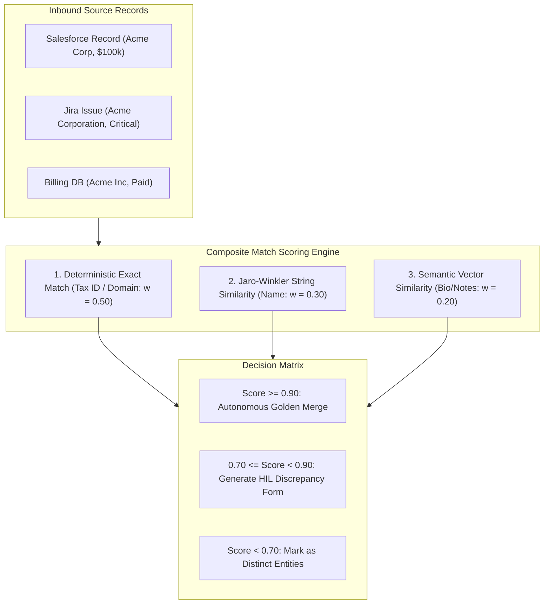

# Multi-Source Entity Reconciliation & Conflict Resolution `[🤝 HYBRID]`

> **Audience:** `🤝 Hybrid: Data Stewards + Autonomous Deduplication Agents` &nbsp;|&nbsp; **Classification:** Data Quality & Problem Resolution Pattern

---

## 1. Multi-Source Ingestion & Merge Architecture `[🧑 Human]`

When records stream in from Salesforce, ServiceNow, Jira, and PostgreSQL, identical real-world entities often carry slight variations. Oddjob executes a deterministic reconciliation pipeline:



---

## 2. Composite Match Scoring Formula `[🤖 Agent Reference]`

The composite match score $S_{\text{match}}(A, B)$ between candidate entities $A$ and $B$ is computed as:

$$S_{\text{match}}(A, B) = w_{\text{exact}} S_{\text{exact}} + w_{\text{fuzzy}} S_{\text{JW}}(\text{name}_A, \text{name}_B) + w_{\text{vector}} S_{\text{cos}}(\mathbf{v}_A, \mathbf{v}_B)$$

Where:
- $w_{\text{exact}} = 0.50$: Exact identifier match (Tax ID, Verified Domain, Email domain). $S_{\text{exact}} \in \{0.0, 1.0\}$.
- $w_{\text{fuzzy}} = 0.30$: Jaro-Winkler string similarity across normalized entity legal titles.
- $w_{\text{vector}} = 0.20$: Cosine similarity between LLM summary embeddings.

---

## 3. Conflict Resolution Precedence Rules `[🤖 Agent Reference]`

When merging conflicting attribute values into the **Golden Master Entity**:

| Attribute Type | Winning Precedence Rule | Fallback Mechanism |
| :--- | :--- | :--- |
| **Financial / Balance ($)** | Authoritative Billing System (e.g. Stripe / SAP) wins. | Most recent verified timestamp. |
| **Contact Email / Address** | Most recently updated timestamp with verified bounce check. | Append secondary contact aliases. |
| **Lifecycle State (Status)** | Strict State Machine progression (Active $>$ Suspended $>$ Closed). | HIL Review required on regressive status. |
| **Incident Urgency** | Maximum severity rule ($\max(\text{P1}, \text{P2}) = \text{P1}$). | Never downgrade severity autonomously. |

---

## 4. Merge Provenance Schema & Tombstone Invariant `[🤖 Agent Reference]`

When merging duplicate entity `Entity_B` into golden master `Entity_A`:
1. **Preserve Tombstone**: `Entity_B` is marked `status: "MERGED_TOMBSTONE"`, with `mergedIntoId: "Entity_A"`.
2. **Re-route Edges**: All relational edges previously pointing to `Entity_B` are migrated to `Entity_A`.
3. **Record Provenance**:
```json
{
  "operation": "ENTITY_RECONCILIATION_MERGE",
  "masterEntityId": "ent_acme_master_01",
  "absorbedEntityId": "ent_acme_sfdc_99",
  "compositeMatchScore": 0.94,
  "reconciledFields": {
    "annualRevenue": { "source": "SALESFORCE", "value": 1500000 },
    "primaryDomain": { "source": "BILLING_DB", "value": "acme.com" }
  },
  "timestamp": "2026-08-27T15:53:00Z"
}
```
