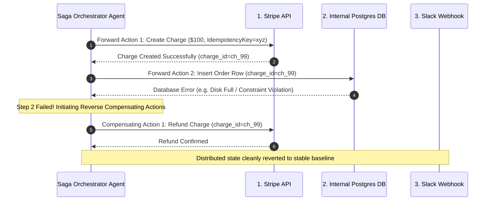

# Distributed Saga Orchestration & Idempotent Writeback `[🤖 AGENT]`

> **Audience:** `🤖 Agent Executable & Distributed Systems Architect` &nbsp;|&nbsp; **Classification:** Architectural Pattern & Writeback Reliability

---

## 1. The Distributed Saga Pattern `[🧑 Human]`

When an agent coordinates a complex multi-system mutation (e.g. Charge Customer in Stripe $\rightarrow$ Create Order in Postgres $\rightarrow$ Post Confirmation in Slack), traditional two-phase commit is impossible across external HTTP APIs. Oddjob implements the **Saga Pattern**:



---

## 2. Mandatory Idempotency Key Standard `[🤖 Agent Reference]`

To prevent duplicate charges or double records when network timeouts occur, every mutating tool call MUST generate and pass a deterministic idempotency key:

$$\text{IdempotencyKey} = \text{SHA256}(\text{TenantId} + \text{MissionId} + \text{StepIndex} + \text{AttemptNumber})$$

### Rules:
1. If a tool call times out (HTTP 504), the agent may safely retry using the **identical idempotency key**.
2. Upstream endpoints returning cached responses with the same key must be treated as successful executions.

---

## 3. Saga Forward and Compensating Definition Matrix `[🤖 Agent Reference]`

Every step registered in a multi-action agent mission must declare its inverse companion:

| Forward Action Step | Tool Invocation | Corresponding Compensating Tool | Inverse Operation |
| :--- | :--- | :--- | :--- |
| **1. Reserve Inventory** | `inventory_reserve_sku` | `inventory_release_sku` | Decrements reservation counter |
| **2. Charge Payment** | `stripe_create_charge` | `stripe_create_refund` | Full refund citing failed order |
| **3. Insert Database Row** | `db_insert_record` | `db_delete_record` / Soft Delete | Mark row status as `CANCELLED_ROLLBACK` |
| **4. Provision Cloud VM** | `aws_deploy` | `code_rollback` / `aws_terminate` | Tear down provisioned instance |

---

## 4. Saga Execution Schema Contract `[🤖 Agent Reference]`

```typescript
export interface SagaStep {
  stepId: string;
  forwardAction: {
    tool: string;
    params: Record<string, any>;
  };
  compensatingAction: {
    tool: string;
    params: (forwardResult: any) => Record<string, any>;
  };
}

export interface SagaExecutionLog {
  sagaId: string;
  completedSteps: Array<{ stepId: string; result: any }>;
  status: "IN_PROGRESS" | "COMMITTED" | "COMPENSATING" | "FAILED_COMPENSATION";
}
```
