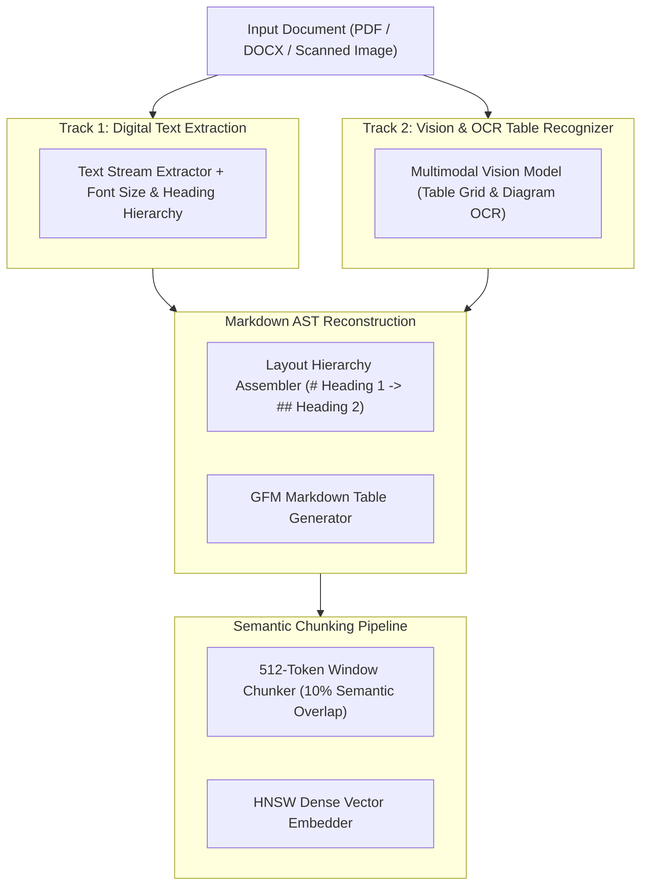

# Multimodal Document Parsing & Table Extraction `[🤖 AGENT]`

> **Audience:** `🤖 Agent Executable & Document Ingestion Specialist` &nbsp;|&nbsp; **Classification:** Extraction & Normalization Pattern

---

## 1. Document Extraction & AST Normalization Pipeline `[🧑 Human]`

Unstructured documents (PDFs, PPTX, DOCX, XLSX) pass through a dual-track extraction engine to produce semantic Markdown ASTs:



---

## 2. Table Preservation & Grid Invariants `[🤖 Agent Reference]`

Financial and technical tables must NEVER be flattened into raw unaligned text streams.

### Standard Conversion Rules:
1. **GitHub-Flavored Markdown Tables:** Always convert detected tabular data into standard GFM tables with header separators:
   ```markdown
   | Metric Name | Q1 2026 Actual | Q2 2026 Target | Variance (%) |
   | :--- | :--- | :--- | :--- |
   | ARR Growth | $12.4M | $14.0M | -11.4% |
   | Gross Margin | 78.2% | 80.0% | -2.25% |
   ```
2. **Merged Cells Handling:** For multi-column headers, repeat the parent category label in child columns (e.g. `Revenue (Americas) | Revenue (EMEA)`).
3. **Footnotes & Disclaimers:** Append table footnotes directly below the table blockquote.

---

## 3. Semantic Chunking Strategy `[🤖 Agent Reference]`

When dividing normalized documents for vector indexing:

- **Chunk Size:** `512 tokens` (optimal balance between context density and retrieval precision).
- **Chunk Overlap:** `50 tokens (10%)` to prevent splitting sentences or equations at chunk boundaries.
- **Section Boundary Respect:** Never split across `# Heading 1` or `## Heading 2` boundaries if the section fits within a single chunk.
- **Metadata Ingestion:** Every chunk must retain `sourceDocumentId`, `pageNumber`, and `headingBreadcrumb` (e.g. `"Financials > Balance Sheet > Liabilities"`).
