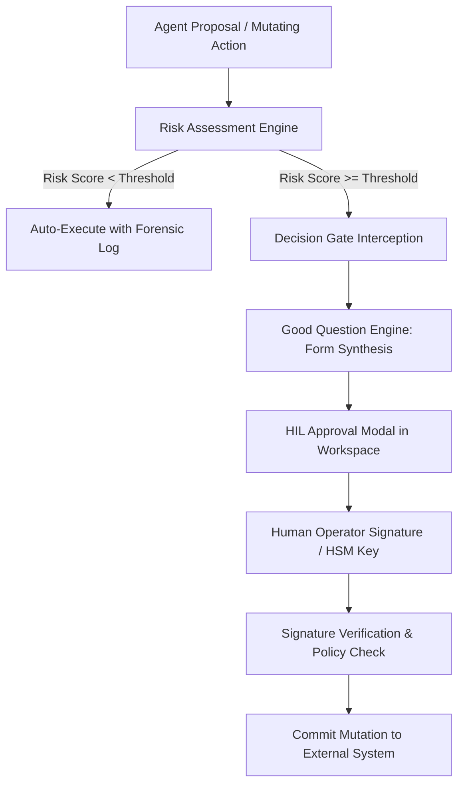

# Autonomous Decision Gates and Cryptographic Signatures

## 1. Overview & Architecture

When Oddjob agents perform high-impact operations (e.g., executing financial writebacks, deleting databases, updating DNS records, or issuing external wire transfers), autonomous execution is intercepted by **Decision Gates**. These gates leverage the **Good Question Engine (GQE)** and require explicit human-in-the-loop attestation and digital signatures.



---

## 2. Risk Classification Matrix

Operations are classified dynamically based on their action metadata, blast radius, and financial exposure:

| Risk Tier | Risk Score | Approval Required | Signature Requirement |
| :--- | :--- | :--- | :--- |
| **Tier 0: Low** | 0.0 – 0.29 | None (Autonomous) | Automated Runtime Assertion |
| **Tier 1: Moderate** | 0.30 – 0.69 | Single Operator Approval | Standard Session Token |
| **Tier 2: High** | 0.70 – 0.89 | Project Owner Approval | Password / 2FA Re-verification |
| **Tier 3: Critical** | 0.90 – 1.00 | Multi-Party Dual Sign-off | WebAuthn / FIDO2 Passkey Signature |

---

## 3. Cryptographic Decision Signatures

Approved decisions generate an immutable cryptographic receipt containing the proposal hash, human approver identity, timestamp, and signature:

```json
{
  "gateId": "gate-849204-cf9b",
  "missionId": "m-99210-dispatch",
  "action": "sql_database_migration",
  "proposalSha256": "e3b0c44298fc1c149afbf4c8996fb92427ae41e4649b934ca495991b7852b855",
  "approver": {
    "userId": 104,
    "email": "lead.engineer@acme.com",
    "role": "owner"
  },
  "signature": {
    "algorithm": "ECDSA_P256_SHA256",
    "publicKey": "MFkwEwYHKoZIzj0CAQYIKoZIzj0DAQcDQgAE...",
    "value": "304502210084f7b2c9...",
    "timestamp": "2026-08-26T20:15:30Z"
  }
}
```

---

## 4. Good Question Engine (GQE)

The Good Question Engine minimizes human review fatigue by distilling complex technical diffs into clear, decisive questions with quantified impact statements:

* **Ineffective Prompt:** *"Do you approve running SQL migration 008?"*
* **GQE Synthesized Prompt:** *"Migration `008_add_customer_indices` will add a B-Tree index on `orders.account_id` (4.2M rows). Expected database lock duration: ~1.2s. Estimated cost: $0.00. Proceed with zero-downtime concurrent build?"*

---

## 5. Best Practices & Guidelines

1. **Idempotency Keys:** Every decision gate must generate an idempotency key to prevent accidental duplicate approvals if a human double-clicks the submission button.
2. **Time-To-Live (TTL):** Pending approval gates expire automatically after 24 hours (or a custom configured mission timeout) to prevent stale authorizations.
3. **Forensic Storage:** Signed decision receipts are stored in cold append-only storage and cannot be altered by administrators or database operators.
