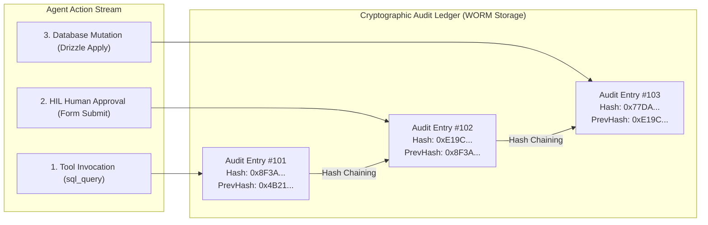

# Cryptographic Audit Trails & Compliance Standards `[⚖️ GOVERNANCE]`

> **Audience:** `⚖️ Governance / Chief Information Security Officer & Compliance Auditor` &nbsp;|&nbsp; **Classification:** Regulatory Compliance & Audit Standard

---

## 1. Cryptographic Hash-Chained Audit Trail Architecture `[🧑 Human]`

To satisfy SOC2 Type II, HIPAA, and ISO 27001 requirements, Oddjob implements a **Write-Once-Read-Many (WORM)** hash-chained ledger:



---

## 2. Mandatory Audit Envelope Schema `[🤖 Agent Reference]`

Every tool invocation and human decision MUST emit an immutable audit envelope:

```typescript
export interface AuditEnvelope {
  id: string; // UUID v4
  sequenceNumber: number;
  timestamp: string; // ISO-8601 UTC
  organizationId: string;
  projectId: string;
  userId: string; // Actor: human user or agent ID
  action: string; // e.g. "TOOL_EXECUTION:external_sql_query"
  traceparent: string; // W3C distributed tracing context
  inputPayloadRedacted: Record<string, any>;
  outputPayloadRedacted: Record<string, any>;
  metadata: {
    modelTierUsed?: string;
    tokenSpend?: number;
    blastRadiusScore?: number;
    hilApprovalSignature?: string;
  };
  previousEntryHash: string; // SHA-256 of Entry N-1
  currentEntryHash: string;  // SHA-256 of this entry
}
```

---

## 3. Automated PII & Sensitive Credential Redaction `[🤖 Agent Reference]`

Before an audit envelope is serialized to disk or indexed into OpenTelemetry:

| Sensitive Pattern | Redaction Rule | Replacement Format |
| :--- | :--- | :--- |
| **API Keys & Bearer Tokens** | Regex pattern `/(bearer|sk_live_|ghp_)[a-zA-Z0-9_\-]{16,}/i` | `"[REDACTED_API_KEY]"` |
| **Credit Card Numbers** | Luhn algorithm + PAN regex | `"************" + last4` |
| **Social Security Numbers** | Pattern `/\b\d{3}-\d{2}-\d{4}\b/` | `"[REDACTED_SSN]"` |
| **Customer Passwords** | Field name matching `password`, `secret`, `api_key` | `"[REDACTED_CREDENTIAL]"` |

---

## 4. Fail-Closed Invariant `[⚖️ GOVERNANCE]`

If the audit log service encounters a disk full, permission error, or database timeout:
- The agent execution engine MUST immediately **FAIL-CLOSED**.
- No state mutation or tool call may proceed if its corresponding audit record cannot be written and signed.
