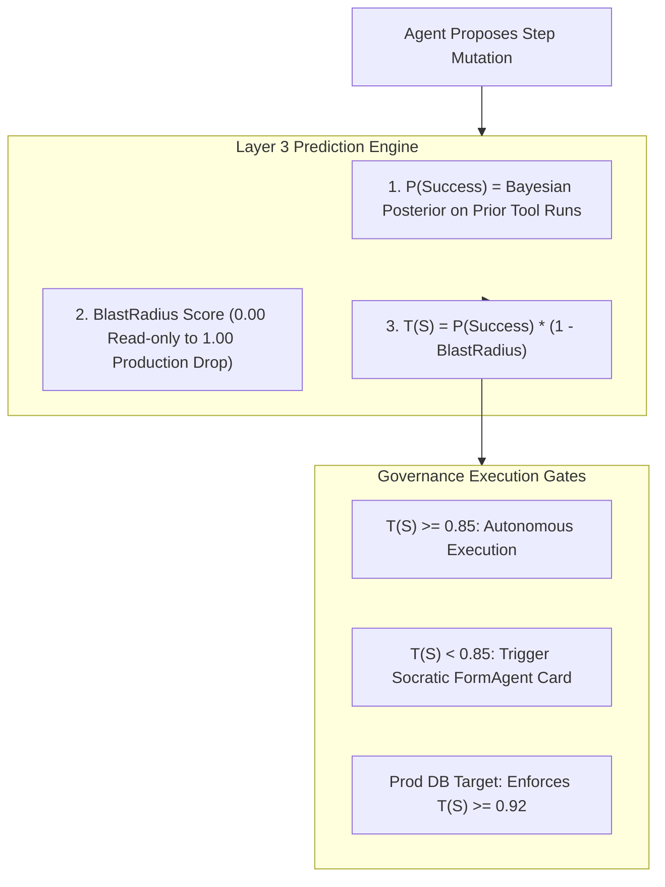

# Bayesian Trajectory Scoring & Confidence Gates `[⚖️ GOVERNANCE]`

> **Audience:** `⚖️ Governance / AI Safety & Orchestration Architect` &nbsp;|&nbsp; **Classification:** Safety Gate & Decision Boundary

---

## 1. Safe Transition Formula & Trajectory Scoring `[🧑 Human]`

Oddjob governs every agent action through the **Bayesian Trajectory Score $T(S)$**, balancing historical model reliability against the irreversible blast radius of the proposed action:

$$T(S_{\text{next}}) = P(\text{Success} \mid S_{t-1}, S_t) \times (1 - \text{BlastRadius}(S_{\text{next}}))$$



---

## 2. Dynamic Thresholding Matrix `[🤖 Agent Reference]`

| Environment / Action Type | Minimum $T(S)$ Required for Auto-Exec | If Below Threshold Action |
| :--- | :--- | :--- |
| **Local Scratch / Read-Only** | $T(S) \ge 0.70$ | Execute autonomously; log trace. |
| **Standard Workspace Code Edit** | $T(S) \ge 0.85$ | Present Interactive Diff Viewer Card to user. |
| **Production Database / Secret Rotation** | $T(S) \ge 0.92$ | **Mandatory Human Signature** required regardless of score. |
| **External Communication (Email/Slack)** | $T(S) \ge 0.90$ | Render draft preview with single-click approve button. |

---

## 3. Good Question Engine (GQE) & Entropy Reduction `[🤖 Agent Reference]`

When an agent encounters ambiguity ($T(S) < 0.85$), it must NEVER ask lazy, open-ended questions like *"What should I do next?"*.

The **Good Question Engine (GQE)** generates minimal-entropy Socratic questions that maximize information gain:

$$\Delta H = H(\text{State}_{\text{prior}}) - H(\text{State}_{\text{posterior}}) \ge 0.5 \text{ bits}$$

### GQE Decision Card Invariants:
1. **Concrete Options Only:** Provide 2–4 distinct selectable choices with explicit trade-offs.
2. **Recommended Default:** Mark the optimal architectural choice with `(Recommended)`.
3. **No Redundant Confirmation:** Never ask "Are you sure?" unless irreversible data loss is imminent.

### Example FormAgent Generation Signature
```typescript
// Invoking GQE to present an unambiguous decision card
await render_intake_form({
  formId: "form_db_migration_strategy",
  title: "Database Migration Strategy Confirmation",
  description: "Target table 'orders' contains 2.4M rows. Direct column alter will lock writes for ~4.2 seconds.",
  fields: [
    {
      id: "strategy",
      type: "RADIO",
      label: "Select Migration Strategy",
      options: [
        { label: "(Recommended) Zero-Downtime Expand-and-Contract (Dual write + Async backfill)", value: "EXPAND_CONTRACT" },
        { label: "Scheduled Maintenance Window (Direct alter with brief write lock)", value: "DIRECT_LOCK" }
      ],
      defaultValue: "EXPAND_CONTRACT"
    }
  ]
});
```

---

## 4. Lateral Governed AI Action Gate Rail & Spatial Dispatch `[🧑 Human]`

For high-stakes operational mutations, Oddjob renders the [`CrewGovernanceGateRail.tsx`](../../../client/src/components/agent-chat/rails/CrewGovernanceGateRail.tsx) inside the CREW lateral rail hub:

1. **Autonomous Checkpoint Mounting**:
   - Capabilities invoke `request_governance_approval` or `dispatch_spatial_squad`.
   - Prediction engine evaluates trajectory safety $T(S_{next})$.
2. **Blast Radius Analysis**:
   - Evaluates affected services, estimated execution cost USD, tenant blast radius, and data destruction risk flags.
3. **Dual Sign-Off Enforcement**:
   - Actions targeting critical infrastructure or physical assets with $T(S) < 0.85$ strictly mandate human approval (`[✅ Approve & Execute]` or `[❌ Reject with Reason]`).

