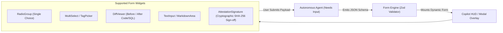

# HIL Form Schemas & Interactive Widgets `[🤝 HYBRID]`

> **Audience:** `🤝 Hybrid: Frontend Engineers + Autonomous Form Agents` &nbsp;|&nbsp; **Classification:** UI Schema & Governance Standard

---

## 1. HIL Form Architecture & Component Registry `[🧑 Human]`

Oddjob renders interactive governance forms dynamically from declarative JSON schemas generated by agents:



---

## 2. Standard HIL Field Schema Definitions `[🤖 Agent Reference]`

Every field in an agent-synthesized form must conform to the standard TypeScript/Zod definitions:

```typescript
export type HILFieldType = 
  | "RADIO" 
  | "MULTI_SELECT" 
  | "TEXT" 
  | "TEXTAREA" 
  | "DIFF_VIEWER" 
  | "NUMBER" 
  | "SWITCH" 
  | "ATTESTATION_CHECKBOX";

export interface HILFormField {
  id: string;
  type: HILFieldType;
  label: string;
  description?: string;
  required: boolean;
  defaultValue?: any;
  placeholder?: string;
  options?: Array<{ label: string; value: string; description?: string }>;
  diffData?: {
    originalContent: string;
    proposedContent: string;
    language: "typescript" | "sql" | "json" | "markdown" | "python";
  };
  validation?: {
    min?: number;
    max?: number;
    pattern?: string;
    errorMessage?: string;
  };
}

export interface HILFormSchema {
  formId: string;
  title: string;
  description: string;
  submitButtonText?: string;
  cancelButtonText?: string;
  fields: HILFormField[];
}
```

---

## 3. High-Impact Widget Configurations `[🤖 Agent Reference]`

### A. DiffViewer Widget (Code & SQL Reviews)
```json
{
  "id": "sql_migration_diff",
  "type": "DIFF_VIEWER",
  "label": "Review Proposed SQL Schema Migration",
  "required": true,
  "diffData": {
    "language": "sql",
    "originalContent": "ALTER TABLE customers ADD COLUMN balance NUMERIC(10,2);",
    "proposedContent": "ALTER TABLE customers ADD COLUMN balance NUMERIC(10,2) DEFAULT 0.00 NOT NULL;"
  }
}
```

### B. AttestationCheckbox Widget (Compliance Sign-off)
```json
{
  "id": "compliance_attestation",
  "type": "ATTESTATION_CHECKBOX",
  "label": "I confirm that I have verified the backup snapshot and authorize the schema change.",
  "required": true
}
```

---

## 4. Submission Lifecycle & Resumption Contract `[🧑 Human]`

1. **Atomic State Suspension:** When `render_intake_form` is called, the agent’s execution turn transitions to `SUSPENDED_AWAITING_HIL`.
2. **Schema Validation on Ingress:** The client-side form validates all inputs against the Zod schema before dispatching the submit event.
3. **Resumption Payload:** The agent receives a clean, validated JSON object:
```json
{
  "formId": "form_db_migration_strategy",
  "submittedAt": "2026-08-27T15:53:50Z",
  "submittedBy": "usr_99182",
  "values": {
    "strategy": "EXPAND_CONTRACT",
    "compliance_attestation": true
  }
}
```
