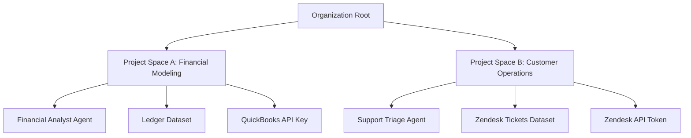

# Multi-Tenant RBAC and Project Space Isolation

## 1. Overview & Architecture

Oddjob is designed for high-density multi-tenancy with strict organizational boundaries and granular **Project Space** partitions. A single organization may host dozens of distinct project teams, each with dedicated agent deployments, knowledge datasets, compute budgets, and pipeline secrets.



---

## 2. Project Role Hierarchy

Access within Project Spaces is governed by a 4-tier Role-Based Access Control (RBAC) hierarchy:

| Role | Permissions | Use Case |
| :--- | :--- | :--- |
| **`viewer`** | Read-only access to mission runs, logs, and dashboard metrics. Cannot run agents or approve HIL gates. | Stakeholders, Auditors, Observers |
| **`operator`** | Can launch existing missions, trigger agents, and respond to HIL approval requests. Cannot edit blueprints. | Operations Staff, Triage Teams |
| **`editor`** | Full authoring access: create/modify agents, custom tools, pipelines, datasets, and apps. | Engineers, Data Scientists |
| **`owner`** | Administrative control: manage project membership, assign roles, set token/compute budgets, and archive spaces. | Project Leads, Tech Leads |

---

## 3. Server-Side Boundary Enforcement

All domain service methods querying multi-tenant resources must accept a typed `AuthenticatedContext` and enforce project isolation via `withProjectScope`:

```typescript
import { eq, and, or, isNull } from "drizzle-orm";
import { apps } from "@shared/schema.js";

export async function listProjectApps(ctx: AuthenticatedContext, projectId: number) {
  // Enforce caller has view access to this project
  await requireProjectPermission(ctx, projectId, "viewer");

  return await db.select().from(apps).where(
    and(
      eq(apps.organizationId, ctx.organizationId),
      or(
        eq(apps.projectId, projectId),
        and(isNull(apps.projectId), eq(apps.isSystem, true)) // System global blueprints
      )
    )
  );
}
```

---

## 4. Cross-Project Data Leakage Prevention

1. **Context Scoping:** When an AI agent executes within a project room (`/workspace/chat/crew-proj44-...`), the LLM system prompt is strictly injected with that project's metadata and allowed tool definitions.
2. **Vector Space Partitioning:** Embeddings stored in `knowledge_embeddings` contain a mandatory `project_id` foreign key. Cosine similarity queries automatically filter by `project_id = :projectId` or `project_id IS NULL`.
3. **Secret Isolation:** Project secrets stored in the Vault are encrypted using separate envelope keys per project space.

---

## 5. Audit & Compliance

Every privilege elevation, membership change, or cross-project data export produces an immutable audit record in the `event_log` table with the actor's identity, IP address, user-agent, and W3C trace ID.
