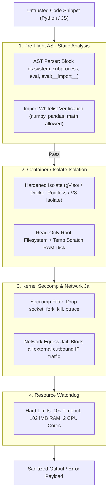

# Secure Code Sandboxing & Runtime Governance `[⚖️ GOVERNANCE]`

> **Audience:** `⚖️ Governance / Security Architect` &nbsp;|&nbsp; **Classification:** Security Governance & Execution Boundary

---

## 1. Multi-Layer Defense Architecture `[🧑 Human]`

Untrusted code generated by LLMs or external users is subjected to a 4-tier security sandbox before, during, and after execution:



---

## 2. Python AST Static Blacklist & Whitelist Invariants `[🤖 Agent Reference]`

Before passing code to the Python executor, the AST engine checks against forbidden tokens:

### Forbidden Python Modules & Builtins
- `os`, `sys`, `subprocess`, `shutil`, `pty`, `socket`, `http`
- `eval`, `exec`, `__import__`, `globals`, `locals`, `getattr(..., "__class__")`
- File system access outside `/workspace/scratch/`

```python
# Standard AST Safety Checker Snippet
import ast

FORBIDDEN_CALLS = {"eval", "exec", "compile", "__import__", "open"}
FORBIDDEN_MODULES = {"os", "sys", "subprocess", "shutil", "socket", "requests", "http"}

class SecurityASTValidator(ast.NodeVisitor):
    def visit_Import(self, node):
        for alias in node.names:
            if alias.name.split(".")[0] in FORBIDDEN_MODULES:
                raise SecurityError(f"Import of '{alias.name}' is prohibited in sandbox.")
        self.generic_visit(node)

    def visit_Call(self, node):
        if isinstance(node.func, ast.Name) and node.func.id in FORBIDDEN_CALLS:
            raise SecurityError(f"Invocation of '{node.func.id}()' is prohibited.")
        self.generic_visit(node)
```

---

## 3. Strict Execution Resource Limits `[🧑 Human]`

| Parameter | Standard Sandbox Limit | Heavy / ML Compute Limit | Enforcement Mechanism |
| :--- | :--- | :--- | :--- |
| **Max Wall-Clock Duration** | `10 seconds` | `60 seconds` | Kernel `SIGALRM` + Node watchdog |
| **Max Memory (RSS)** | `1024 MB` | `4096 MB` | Linux cgroups `memory.max` |
| **Max CPU Utilization** | `2 Cores (200%)` | `4 Cores (400%)` | Linux cgroups `cpu.max` |
| **Scratch Disk Space** | `256 MB` | `1024 MB` | In-memory `tmpfs` volume |
| **Network Egress** | `0 (Completely Disabled)` | Explicit API Allowlist | iptables / Network namespace drop |

---

## 4. Remediation & Incident Quarantine `[🤖 Agent Reference]`

If code attempts an evasion technique (e.g. reflection to access `object.__subclasses__`):
1. **Immediate Execution Kill**: Send `SIGKILL` to sandbox process container.
2. **Session Quarantine**: Temporarily lock agent execution state to prevent automated retries with alternative payloads.
3. **Forensic Logging**: Record exact source code AST and metadata into the tamper-proof Audit Trail with severity `CRITICAL_SECURITY_ALERT`.
