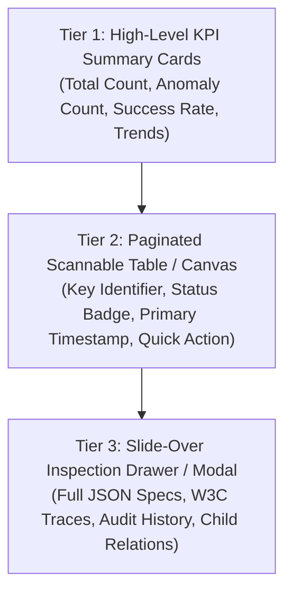

# Progressive Disclosure & Information Density `[🤝 HYBRID]`

> **Audience:** `🤝 Hybrid: Builder + Agent` &nbsp;|&nbsp; **Classification:** UI Design Principles

---

## 1. The 3-Tier Progressive Disclosure Rule `[🤖 Agent]`
When building user interfaces for large enterprise datasets, agents **MUST NOT** dump all fields onto a single flat table. Instead, structure the screen across three progressive discovery tiers:

---

## 2. Component Guidelines `[🤖 Agent Implementation]`
* **Slide-over Drawer:** Use `<motion.div>` with a 360px–480px width, sticky header, multi-tab body (`Overview`, `Connections`, `Specs`, `Telemetry`), and escape key close handler.
* **Badges & Statuses:** Use semantic pill badges with light tinted backgrounds (`bg-emerald-500/10 text-emerald-400 border border-emerald-500/20`).
* **Table Scannability:** Keep primary table columns to a maximum of 5–6 essential columns with truncated overflow and tooltips on hover.
