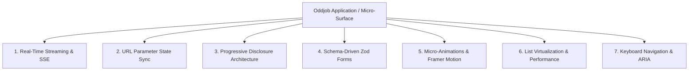
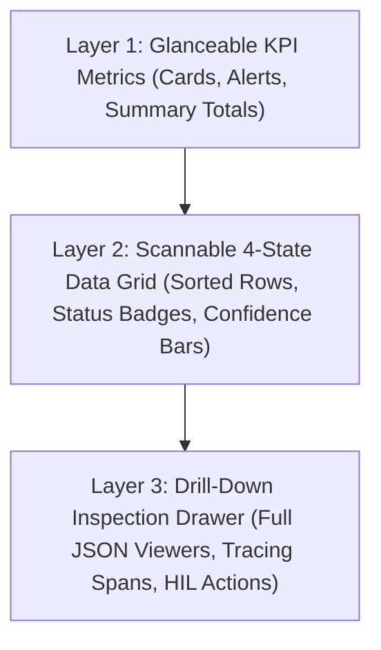

# Advanced App Building Playbook & Production Frontend Standards `[🤝 HYBRID]`

> **Audience:** `🤝 Hybrid: Builder + Agent` &nbsp;|&nbsp; **Classification:** Frontend Engineering Runbook & Code Patterns

---

## 1. Overview & Architecture

When building interactive applications, custom dashboards, or operational tools in Oddjob, agents and engineers must adhere to production-grade frontend engineering standards. These standards guarantee high performance, real-time synchronization, fluid motion, accessibility, and zero-flicker state hydration.



---

## 2. Real-Time Streaming with Server-Sent Events (SSE) `[🤝 Hybrid]`

For live agent execution logs, spatial alerts, and real-time metric streams, applications must connect to SSE channels (`EventSource`) rather than aggressive polling intervals.

### Production SSE Streaming Hook Pattern:
```tsx
import { useEffect, useState, useRef } from "react";

export function useMissionStream(missionId: string) {
  const [events, setEvents] = useState<any[]>([]);
  const [isConnected, setIsConnected] = useState(false);
  const bufferRef = useRef<any[]>([]);

  useEffect(() => {
    if (!missionId) return;

    const eventSource = new EventSource(`/api/missions/${encodeURIComponent(missionId)}/stream`);

    eventSource.onopen = () => setIsConnected(true);

    eventSource.onmessage = (e) => {
      try {
        const payload = JSON.parse(e.data);
        bufferRef.current.push(payload);
      } catch (err) {
        console.error("Malformed SSE payload", err);
      }
    };

    eventSource.onerror = () => {
      setIsConnected(false);
      eventSource.close();
    };

    // Render throttle: batch buffer into React state every 100ms
    const timer = setInterval(() => {
      if (bufferRef.current.length > 0) {
        setEvents((prev) => [...prev, ...bufferRef.current].slice(-500)); // Bounded buffer
        bufferRef.current = [];
      }
    }, 100);

    return () => {
      clearInterval(timer);
      eventSource.close();
    };
  }, [missionId]);

  return { events, isConnected };
}
```

---

## 3. URL Parameter State Synchronization & Deep Linking `[🤝 Hybrid]`

All active filter facets, search strings, active tab selections, and selected drawer entity IDs must synchronize with the URL query parameters so that views are shareable and bookmarkable.

### URL Sync Pattern with `wouter`:
```tsx
import { useLocation, useSearch } from "wouter";
import { useCallback, useMemo } from "react";

export function useUrlFilterState() {
  const [location, setLocation] = useLocation();
  const searchString = useSearch();

  const params = useMemo(() => new URLSearchParams(searchString), [searchString]);
  const status = params.get("status") || "ALL";
  const query = params.get("q") || "";
  const selectedId = params.get("id") || null;

  const setFilter = useCallback((key: string, value: string | null) => {
    const nextParams = new URLSearchParams(searchString);
    if (value === null || value === "" || value === "ALL") {
      nextParams.delete(key);
    } else {
      nextParams.set(key, value);
    }
    const queryString = nextParams.toString();
    setLocation(queryString ? `${location.split("?")[0]}?${queryString}` : location.split("?")[0], { replace: true });
  }, [location, searchString, setLocation]);

  return { status, query, selectedId, setFilter };
}
```

---

## 4. Progressive Disclosure & Information Hierarchy `[🧑 Human]`

Information must be organized into 3 clear conceptual layers to avoid cognitive overload:



1. **Glanceable Summary:** Display high-level aggregates at the top (e.g., total volume, error rates, financial impact).
2. **Scannable Table:** Present core records with visual hierarchy (status pill, confidence score, time elapsed).
3. **Slide-over Drawer:** Use a side drawer (`Sheet`) for in-depth inspection when clicking a row, preserving the main grid's context.

---

## 5. Schema-Driven Forms with Zod & React Hook Form `[🤝 Hybrid]`

Forms must be strictly typed and validated prior to submitting mutations to backend endpoints:

```tsx
import { useForm } from "react-hook-form";
import { zodResolver } from "@hookform/resolvers/zod";
import { z } from "zod";
import { Input } from "@domain-ui/core/ui/components/ui/input";
import { Button } from "@domain-ui/core/ui/components/ui/button";
import { Form, FormControl, FormField, FormItem, FormLabel, FormMessage } from "@domain-ui/core/ui/components/ui/form";
import { Loader2 } from "lucide-react";

export const ConfigFormSchema = z.object({
  webhookUrl: z.string().url("Must be a valid HTTPS webhook URL"),
  batchThreshold: z.number().int().min(1).max(10000),
  enableAutoHeal: z.boolean().default(true),
});

export type ConfigFormData = z.infer<typeof ConfigFormSchema>;

export function ConfigForm({ onSubmit, isPending }: { onSubmit: (data: ConfigFormData) => void; isPending: boolean }) {
  const form = useForm<ConfigFormData>({
    resolver: zodResolver(ConfigFormSchema),
    defaultValues: { webhookUrl: "", batchThreshold: 50, enableAutoHeal: true },
  });

  return (
    <Form {...form}>
      <form onSubmit={form.handleSubmit(onSubmit)} className="space-y-4">
        <FormField
          control={form.control}
          name="webhookUrl"
          render={({ field }) => (
            <FormItem>
              <FormLabel>Notification Webhook URL</FormLabel>
              <FormControl><Input placeholder="https://api.domain.com/hook" {...field} /></FormControl>
              <FormMessage />
            </FormItem>
          )}
        />
        <Button type="submit" disabled={isPending || form.formState.isSubmitting}>
          {isPending && <Loader2 className="mr-2 h-4 w-4 animate-spin" />}
          Save Changes
        </Button>
      </form>
    </Form>
  );
}
```

---

## 6. Motion Design & Micro-Animations (`framer-motion`) `[🤝 Hybrid]`

Use subtle micro-interactions to provide spatial orientation and a polished feel:

```tsx
import { motion, AnimatePresence } from "framer-motion";

export function AnimatedList({ items }: { items: Array<{ id: string; title: string }> }) {
  return (
    <div className="space-y-2">
      <AnimatePresence mode="popLayout">
        {items.map((item, index) => (
          <motion.div
            key={item.id}
            initial={{ opacity: 0, y: 8 }}
            animate={{ opacity: 1, y: 0 }}
            exit={{ opacity: 0, scale: 0.96 }}
            transition={{ duration: 0.18, delay: index * 0.03 }}
            className="p-3 rounded-lg border border-border/60 bg-card/40 hover:border-primary/40 transition-colors"
          >
            {item.title}
          </motion.div>
        ))}
      </AnimatePresence>
    </div>
  );
}
```

---

## 7. Keyboard Navigation & Accessibility (A11y) `[🧑 Human]`

* **Global Hotkeys:** Bind keydown listeners for standard app shortcuts (`/` for search, `Escape` to close drawers).
* **Focus Management:** When opening an inspection drawer, ensure focus moves into the drawer and returns to the trigger row upon close.
* **Semantic ARIA:** Use `aria-expanded`, `aria-controls`, and `role="region"` on collapsible sidebars and toolbars.

---

## 8. Summary Checklist for App Authors & Agents

- [ ] **SSE Streaming:** Used for high-frequency logs and metrics with batching.
- [ ] **URL Sync:** Active filters, query strings, and drawer selections persist in the URL.
- [ ] **4-State UI:** Loading shimmers, illustrative empty states, inline error alerts, and formatted data grids.
- [ ] **Theme Tokens:** Exclusively using semantic Tailwind classes (`bg-card`, `text-foreground`, `border-border`).
- [ ] **Zod Forms:** Client-side validation with inline error messaging.
- [ ] **Framer Motion:** Smooth stagger animations with `AnimatePresence`.
- [ ] **Accessibility:** Keyboard shortcuts and ARIA attributes present.
