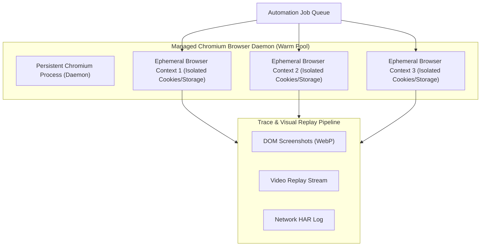

# Headless Browser Automation & Visual Replay Standards `[🤖 AGENT]`

> **Audience:** `🤖 Agent Executable & Automation Engineer` &nbsp;|&nbsp; **Classification:** Component Standard & Execution Runbook

---

## 1. Browser Lifecycle & Worker Pool Architecture `[🧑 Human]`

Launching a full browser process per task creates severe memory overhead. Oddjob implements a pooled context architecture with disposable incognito sessions:

---

## 2. Resilient Locator Hierarchy Invariants `[🤖 Agent Reference]`

Agents must NEVER use brittle, generated CSS selectors like `#main > div:nth-child(3) > button.btn-primary-2x`.

### Locator Priority Tier:
1. **Tier 1 (Best): Accessibility Roles & ARIA**:
   - `page.getByRole('button', { name: 'Submit Application' })`
   - `page.getByLabel('Email Address')`
2. **Tier 2: Visible User Text**:
   - `page.getByText('Confirm & Pay')`
3. **Tier 3: Test IDs**:
   - `page.getByTestId('checkout-btn')`
4. **Tier 4 (Forbidden): Brittle Structural Selectors**:
   - Direct XPaths `/html/body/div[2]/form/input[1]` or index-based CSS paths are strictly banned.

---

## 3. Stealth Evasion & Anti-Bot Invariants `[🧑 Human]`

When interacting with external web targets:
- **Mask WebDriver Flags**: Set `navigator.webdriver = false` and pass standard user-agent strings.
- **Human-Like Input Jitter**: Introduce natural randomized typing delays ($30\text{ms}–90\text{ms}$ per keystroke) rather than instant programmatic value injection.
- **Viewport Normalization**: Always launch standard 1920x1080 desktop or 390x844 mobile viewports with valid device scale factors.

---

## 4. Visual Snapshot Diffing & Failure Triage `[🤖 Agent Reference]`

When a step fails:
1. **Capture Full Page Snapshot**: Generate `.webp` visual screenshot and capture current DOM tree HTML.
2. **Log Network HAR Trace**: Record all pending, failed (4xx/5xx), or CORS-blocked network requests.
3. **Pass to Vision Model**: Invoke `vision_describe_screenshot` to diagnose if the page is displaying a modal, cookie consent overlay, or CAPTCHA blocking the target element.
