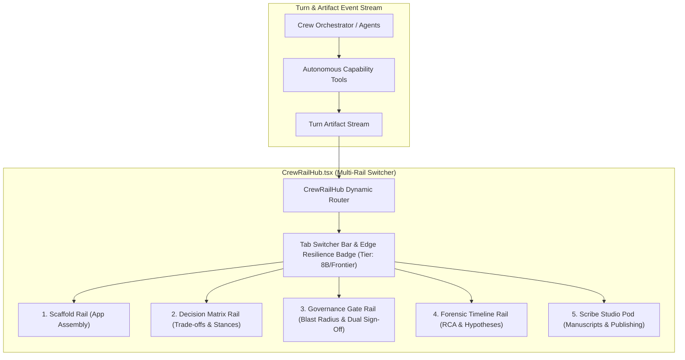

# CREW Specialized Rails & Lateral Governance Hub Guide

Oddjob's CREW Rooms feature a lateral, dockable **Multi-Rail Architecture** that anchors multi-turn collaborative sessions with persistent, interactive visual surfaces.

Rather than cluttering the chat stream with temporary text dumps, specialized rails provide continuous interactive state—such as full-stack app scaffolds, multi-criteria trade-off matrices, dual-custody governance gates, forensic incident timelines, and longform manuscript studios.

---

## 1. Architecture & Multi-Rail Hub (`CrewRailHub`)

All specialized rails are unified inside `CrewRailHub.tsx`, mounted to the right of the CREW message canvas:

### Top Multi-Rail Tab Switcher
When multiple specialized artifacts exist in a room or when room session modes dictate, `CrewRailHub` renders a segmented tab switcher:
- `[ 🧩 Scaffold | ⚖️ Decision Matrix | 🛡️ Governance (N) | ⏳ Forensics (N) | 📜 Scribe Studio ]`
- **Edge Resilience Indicator**: Displays real-time model routing tier (`⚡ Tier: 8B/Frontier`) indicating that Bayesian trajectory scoring and adaptive model tiering are active.

---

## 2. Specialized Rail Surfaces

### A. Decision & Trade-off Matrix Rail (`CrewDecisionMatrixRail.tsx`)
- **Archetype Modes**: `mode: "decide"`, architecture evaluations, framework comparisons, vendor selection.
- **Key Features**:
  - **Consensus Gauge**: Real-time dial showing collective squad agreement percentage (`0-100%`).
  - **Scorecard Breakout**: Interactive criteria breakdown bars with custom weighting factors (e.g. `Latency (1.5x)`, `Throughput (2.0x)`, `Cost (1.0x)`).
  - **Persona Positions**: Visual stance tags showing specialist votes and confidence (e.g. `@Architect: Apache Kafka (90% conf)`).
  - **1-Click Adoption**: `[🎯 Adopt Option]` button that posts the chosen recommendation directly into the collaborative deliberation loop.

### B. Governed AI Action Gate Rail (`CrewGovernanceGateRail.tsx`)
- **Archetype Modes**: `mode: "operate"`, `mode: "review"`, live schema migrations, infrastructure deployments, field squad dispatch.
- **Key Features**:
  - **Pending Queue & Risk Badges**: Color-coded risk tiering (🟢 Low, 🟡 Medium, 🔴 High, 🚨 Critical).
  - **Blast Radius Inspector**: Analyzes affected services, estimated cost USD, tenant blast radius counts, and data destruction risk warnings.
  - **Execution Payload Preview**: Formatted code view of target mutation parameters.
  - **Dual-Custody Sign-Off**: Interactive `[✅ Approve & Execute]` and `[❌ Reject with Reason]` triggers.

### C. Forensic RCA Timeline Rail (`CrewForensicTimelineRail.tsx`)
- **Archetype Modes**: `mode: "investigate"`, incident war rooms, root cause analysis (RCA), anomaly diagnostics.
- **Key Features**:
  - **Chronological Event Ribbon**: Vertical timeline with timestamp chips and severity nodes (`critical` 🔴, `error` 🟠, `warning` 🟡, `info` 🔵).
  - **Root Cause Hypothesis Tracker**: Live hypothesis cards with confidence badges (`Confirmed RCA`, `High Prob`, `Investigating`, `Disproved`).
  - **Chat Focus Trigger**: `[🔍 Investigate Event in Chat]` focuses the composer with targeted incident context.

### D. Modular Assembly Puzzle Scaffold Rail (`ModularAssemblyPuzzleRail.tsx`)
- **Archetype Modes**: `mode: "explore"`, full-stack app forging, pipeline DAG design.
- **Key Features**:
  - 4 vertically interlocking puzzle layers: Host & Auth $\rightarrow$ Database & Schema $\rightarrow$ Pipelines & APIs $\rightarrow$ UI Theme & Screens.
  - 1-Click App Forge Theme Picker and project deployer.

### E. Scribe Studio Pod (`ScribeStudioPod.tsx`)
- **Archetype Modes**: Longform manuscripts, SaaS MSAs, PR/FAQs, architectural RFCs.
- **Key Features**:
  - 12-station Hero's Journey subway tracks with branching/merging.
  - 1-Click `[🚀 Publish to Project]` creating canonical deliverables in `file_blobs` and `crew_attachments`.

---

## 3. Autonomous Capability Tools

Agents invoke specialized rails using structured runtime tools registered in [`server/domain/tools/v1/capabilities/crew-rail-tools.ts`](../../../server/domain/tools/v1/capabilities/crew-rail-tools.ts):

| Tool Name | Key Parameters | Emitted Artifact / Rail |
| :--- | :--- | :--- |
| `propose_decision_matrix` | `topic`, `candidates[]`, `criteria[]`, `personaStances[]` | `crew_decision_matrix_pod` $\rightarrow$ `CrewDecisionMatrixRail` |
| `request_governance_approval` | `actionKey`, `actionTitle`, `riskTier`, `blastRadius`, `executionPayload` | `crew_governance_gate_pod` $\rightarrow$ `CrewGovernanceGateRail` |
| `pin_forensic_event` | `incidentTitle`, `eventTimestamp`, `severity`, `source`, `hypothesis` | `crew_forensic_timeline_pod` $\rightarrow$ `CrewForensicTimelineRail` |
| `dispatch_spatial_squad` | `targetH3Index`, `squadId`, `missionObjective`, `assetRiskClass` | `crew_governance_gate_pod` $\rightarrow$ `CrewGovernanceGateRail` |

---

## 4. Spatial Squad Dispatch & Bayesian Trajectory Evaluation

When an agent or operator dispatches a squad to a physical location via `dispatch_spatial_squad`:
1. The tool resolves the target Uber H3 hexagonal coordinate (e.g. `8828308281fffff`).
2. It executes a mathematical safety evaluation via [`PredictionEngine.evaluateTrajectory`](../../../server/domain/ai/core/prediction-engine.service.ts):
   $$T(S_{next}) = P(\text{Success} \mid S_{t-1}, S_t) \times (1 - \text{BlastRadius})$$
3. If the asset risk is `critical` or the safe score $T(S_{next}) < 0.85$, the tool automatically flags `requiresDualSignOff = true` and mounts the pending checkpoint in the **Governance Gate Rail** for human operator verification before physical dispatch.
