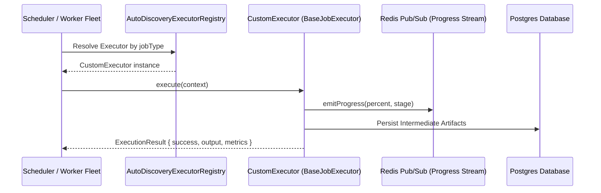

# Custom Executor Development Guide

## 1. Overview & Architecture

Executors in Oddjob represent discrete units of backend computation, external orchestration, or autonomous agent task execution. All executors extend the `BaseJobExecutor` class and are automatically discovered by the `AutoDiscoveryExecutorRegistry` upon server boot.



---

## 2. Executor Interface Contract

Every custom executor must implement the `execute` method, declare its supported `jobType`, and specify input/output Zod schemas:

```typescript
import { BaseJobExecutor, JobExecutionContext, JobExecutionResult } from "./base-job-executor.js";
import { z } from "zod";

export const MyCustomInputSchema = z.object({
  targetEndpoint: z.string().url(),
  payload: z.record(z.unknown()),
  retryCount: z.number().int().min(0).default(3),
});

export type MyCustomInput = z.infer<typeof MyCustomInputSchema>;

export class MyCustomExecutor extends BaseJobExecutor {
  public readonly jobType = "my_custom_job_type";

  public async execute(context: JobExecutionContext<MyCustomInput>): Promise<JobExecutionResult> {
    const { input, logger, span } = context;

    logger.info(`Starting execution for job ${context.jobId}`);
    
    // 1. Report progress (0% - 100%)
    await this.emitProgress(context, 10, "Validating payload...");

    // 2. Execute business logic with distributed tracing
    const result = await span.traceChild("network-call", async () => {
      return await performOperation(input.targetEndpoint, input.payload);
    });

    await this.emitProgress(context, 100, "Execution completed successfully");

    return {
      success: true,
      output: result,
      metrics: {
        recordsProcessed: Array.isArray(result) ? result.length : 1,
        durationMs: context.getDurationMs(),
      },
    };
  }
}
```

---

## 3. Auto-Discovery & Hot-Reload

Oddjob automatically registers all executor classes located in `server/domain/jobs/core/executors/` matching `*-executor.ts`. 

To ensure auto-discovery:
1. Export the executor class as a named export or default export.
2. Ensure the class inherits from `BaseJobExecutor`.
3. Provide a unique string literal for `public readonly jobType`.

---

## 4. Error Handling & Retry Policies

When an executor encounters a transient error:
* **Retryable Errors:** Throw a `TransientExecutionError` to trigger exponential backoff according to the mission's retry policy.
* **Terminal Errors:** Throw a standard `Error` or return `{ success: false, error: "Validation failed" }` to mark the step as failed immediately without wasting compute retries.

---

## 5. Best Practices & Guidelines

1. **Structured Logging:** Always use `context.logger` rather than `console.log` so logs are correlated with the job's W3C Trace ID.
2. **Context Cancellation:** Check `context.isCancelled()` periodically during long-running iterations to gracefully stop when a user aborts the mission.
3. **Memory Limits:** Stream large files to disk or S3 rather than buffering multi-gigabyte payloads in Node.js heap memory.
