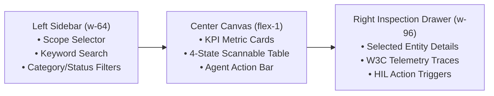

# Forged Apps Architecture & Production Assembly Blueprint `[🤝 HYBRID]`

> **Audience:** `🤝 Hybrid: Builder + Agent` &nbsp;|&nbsp; **Classification:** Architecture Blueprint & Starter Code

---

## 1. The Canonical 3-Column Forged App Layout `[🧑 Human]`

Forged Apps in Oddjob use a 3-column responsive layout built on top of Tailwind CSS and `@domain-ui` design primitives:



---

## 2. Complete Copy-Pasteable React Boilerplate `[🤝 Hybrid]`

```tsx
import React, { useState, useMemo } from "react";
import { useQuery, useMutation, useQueryClient } from "@tanstack/react-query";
import { apiRequest } from "@/lib/queryClient";
import { Card, CardContent, CardHeader, CardTitle, CardDescription } from "@domain-ui/core/ui/components/ui/card";
import { Button } from "@domain-ui/core/ui/components/ui/button";
import { Badge } from "@domain-ui/core/ui/components/ui/badge";
import { Input } from "@domain-ui/core/ui/components/ui/input";
import { Skeleton } from "@domain-ui/core/ui/components/ui/skeleton";
import { useToast } from "@domain-ui/core/ui/hooks/use-toast";
import { 
  Search, RefreshCw, Sparkles, Filter, X, ArrowRight, 
  CheckCircle2, AlertTriangle, Activity, Database, Play 
} from "lucide-react";
import { motion, AnimatePresence } from "framer-motion";
import { cn } from "@/lib/utils";

interface ForgedRecord {
  id: string;
  name: string;
  category: string;
  status: "ACTIVE" | "PENDING_REVIEW" | "DEGRADED";
  confidenceScore: number;
  lastUpdated: string;
}

export default function StandardForgedApp() {
  const [search, setSearch] = useState("");
  const [selectedStatus, setSelectedStatus] = useState<string>("ALL");
  const [selectedRecordId, setSelectedRecordId] = useState<string | null>(null);
  const { toast } = useToast();
  const queryClient = useQueryClient();

  // 1. Data Fetching
  const { data: records = [], isLoading, isError, refetch, isFetching } = useQuery<ForgedRecord[]>({
    queryKey: ["/api/forged-records", selectedStatus, search],
    queryFn: async () => {
      const res = await apiRequest("GET", `/api/forged-records?status=${selectedStatus}&search=${search}`);
      return res.json();
    },
    staleTime: 30_000,
  });

  // 2. Action Trigger (Launch Agent Mission)
  const triggerMission = useMutation({
    mutationFn: async (recordId: string) => {
      return (await apiRequest("POST", `/api/missions/launch`, { recordId })).json();
    },
    onSuccess: () => {
      toast({ title: "Mission Dispatched", description: "Autonomous cycle started." });
      queryClient.invalidateQueries({ queryKey: ["/api/forged-records"] });
    }
  });

  const selectedRecord = useMemo(() => 
    records.find(r => r.id === selectedRecordId) ?? null,
    [records, selectedRecordId]
  );

  return (
    <div className="flex h-screen bg-background text-foreground overflow-hidden">
      
      {/* ── COLUMN 1: FILTER SIDEBAR ── */}
      <aside className="w-64 flex-shrink-0 border-r border-border/80 bg-card/20 p-4 space-y-4 flex flex-col">
        <div className="flex items-center gap-2 pb-3 border-b border-border/60">
          <div className="w-7 h-7 rounded-lg bg-primary/10 border border-primary/20 flex items-center justify-center">
            <Activity className="w-4 h-4 text-primary" />
          </div>
          <div>
            <h2 className="text-xs font-black uppercase tracking-wider text-foreground">Mission Control</h2>
            <p className="text-[10px] text-muted-foreground">Forged Operations</p>
          </div>
        </div>

        {/* Search */}
        <div className="relative">
          <Search className="absolute left-2.5 top-1/2 -translate-y-1/2 w-3.5 h-3.5 text-muted-foreground" />
          <Input 
            value={search} 
            onChange={e => setSearch(e.target.value)} 
            placeholder="Search records..." 
            className="h-8 pl-8 text-xs bg-background/50 border-border"
          />
        </div>

        {/* Status Filters */}
        <div className="space-y-1">
          <p className="text-[9px] font-black uppercase tracking-widest text-muted-foreground mb-2">Status</p>
          {["ALL", "ACTIVE", "PENDING_REVIEW", "DEGRADED"].map(status => (
            <button
              key={status}
              onClick={() => setSelectedStatus(status)}
              className={cn(
                "w-full text-left px-2.5 py-1.5 rounded-lg text-xs font-semibold transition-all",
                selectedStatus === status ? "bg-primary text-primary-foreground shadow-sm" : "text-muted-foreground hover:bg-foreground/5"
              )}
            >
              {status.replace(/_/g, " ")}
            </button>
          ))}
        </div>
      </aside>

      {/* ── COLUMN 2: MAIN WORKSPACE CANVAS ── */}
      <main className="flex-1 min-w-0 p-6 overflow-y-auto space-y-6">
        
        {/* KPI Metrics */}
        <div className="grid grid-cols-1 sm:grid-cols-3 gap-4">
          <Card className="bg-card/40 border-border/80">
            <CardHeader className="p-4 pb-1"><CardDescription className="text-xs">Total Records</CardDescription></CardHeader>
            <CardContent className="p-4 pt-0"><p className="text-2xl font-bold text-foreground tabular-nums">{records.length}</p></CardContent>
          </Card>
          <Card className="bg-card/40 border-border/80">
            <CardHeader className="p-4 pb-1"><CardDescription className="text-xs">Requires Review</CardDescription></CardHeader>
            <CardContent className="p-4 pt-0"><p className="text-2xl font-bold text-amber-400 tabular-nums">{records.filter(r => r.status === 'PENDING_REVIEW').length}</p></CardContent>
          </Card>
          <Card className="bg-card/40 border-border/80">
            <CardHeader className="p-4 pb-1"><CardDescription className="text-xs">Healthy State</CardDescription></CardHeader>
            <CardContent className="p-4 pt-0"><p className="text-2xl font-bold text-emerald-400 tabular-nums">{records.filter(r => r.status === 'ACTIVE').length}</p></CardContent>
          </Card>
        </div>

        {/* 4-State Scannable Table */}
        <Card className="border-border bg-card/30">
          <CardHeader className="flex flex-row items-center justify-between border-b border-border/40 p-4">
            <div>
              <CardTitle className="text-sm font-bold">Operational Entities</CardTitle>
              <CardDescription className="text-xs">Select any row to inspect technical details</CardDescription>
            </div>
            <Button size="sm" variant="outline" onClick={() => refetch()} disabled={isFetching} className="h-7 text-xs">
              <RefreshCw className={cn("w-3 h-3 mr-1.5", isFetching && "animate-spin")} /> Refresh
            </Button>
          </CardHeader>
          <CardContent className="p-0">
            {isLoading ? (
              <div className="p-4 space-y-2">
                {Array.from({ length: 5 }).map((_, i) => <Skeleton key={i} className="h-12 w-full" />)}
              </div>
            ) : isError ? (
              <div className="p-8 text-center space-y-3">
                <AlertTriangle className="w-8 h-8 text-rose-400 mx-auto" />
                <p className="text-xs text-muted-foreground">Failed to load records.</p>
                <Button size="sm" onClick={() => refetch()}>Try Again</Button>
              </div>
            ) : records.length === 0 ? (
              <div className="p-12 text-center space-y-2">
                <Database className="w-8 h-8 text-muted-foreground/40 mx-auto" />
                <p className="text-xs font-semibold">No records found matching filters.</p>
              </div>
            ) : (
              <div className="divide-y divide-border/40">
                {records.map(record => (
                  <div
                    key={record.id}
                    onClick={() => setSelectedRecordId(record.id)}
                    className={cn(
                      "p-3 px-4 flex items-center justify-between hover:bg-foreground/[0.03] transition-colors cursor-pointer",
                      selectedRecordId === record.id && "bg-primary/10 border-l-2 border-primary"
                    )}
                  >
                    <div className="min-w-0 space-y-0.5">
                      <p className="text-xs font-bold text-foreground truncate">{record.name}</p>
                      <p className="text-[10px] text-muted-foreground font-mono">{record.id} • {record.category}</p>
                    </div>
                    <div className="flex items-center gap-3">
                      <Badge variant="outline" className={cn(
                        "text-[9px] font-mono",
                        record.status === "ACTIVE" ? "bg-emerald-500/10 text-emerald-400 border-emerald-500/30" : "bg-amber-500/10 text-amber-400 border-amber-500/30"
                      )}>
                        {record.status}
                      </Badge>
                      <ArrowRight className="w-3.5 h-3.5 text-muted-foreground/50" />
                    </div>
                  </div>
                ))}
              </div>
            )}
          </CardContent>
        </Card>
      </main>

      {/* ── COLUMN 3: SLIDE-OVER INSPECTION DRAWER ── */}
      <AnimatePresence>
        {selectedRecord && (
          <motion.aside
            initial={{ width: 0, opacity: 0 }}
            animate={{ width: 384, opacity: 1 }}
            exit={{ width: 0, opacity: 0 }}
            className="flex-shrink-0 border-l border-border bg-card/60 p-5 space-y-4 overflow-y-auto"
          >
            <div className="flex items-start justify-between">
              <div>
                <Badge variant="outline" className="text-[9px] uppercase font-mono">{selectedRecord.category}</Badge>
                <h3 className="text-sm font-bold text-foreground mt-1">{selectedRecord.name}</h3>
                <p className="text-[10px] text-muted-foreground font-mono">{selectedRecord.id}</p>
              </div>
              <Button size="icon" variant="ghost" className="w-6 h-6" onClick={() => setSelectedRecordId(null)}>
                <X className="w-3.5 h-3.5" />
              </Button>
            </div>

            <div className="p-3 rounded-lg bg-background/50 border border-border space-y-2 text-xs">
              <p className="text-[10px] font-black uppercase tracking-wider text-muted-foreground">Confidence Metric</p>
              <p className="text-xl font-bold text-emerald-400 tabular-nums">{(selectedRecord.confidenceScore * 100).toFixed(0)}%</p>
            </div>

            <Button
              className="w-full text-xs font-bold gap-2"
              onClick={() => triggerMission.mutate(selectedRecord.id)}
              disabled={triggerMission.isPending}
            >
              <Play className="w-3.5 h-3.5" /> Launch Autonomous Resolution
            </Button>
          </motion.aside>
        )}
      </AnimatePresence>

    </div>
  );
}
```
