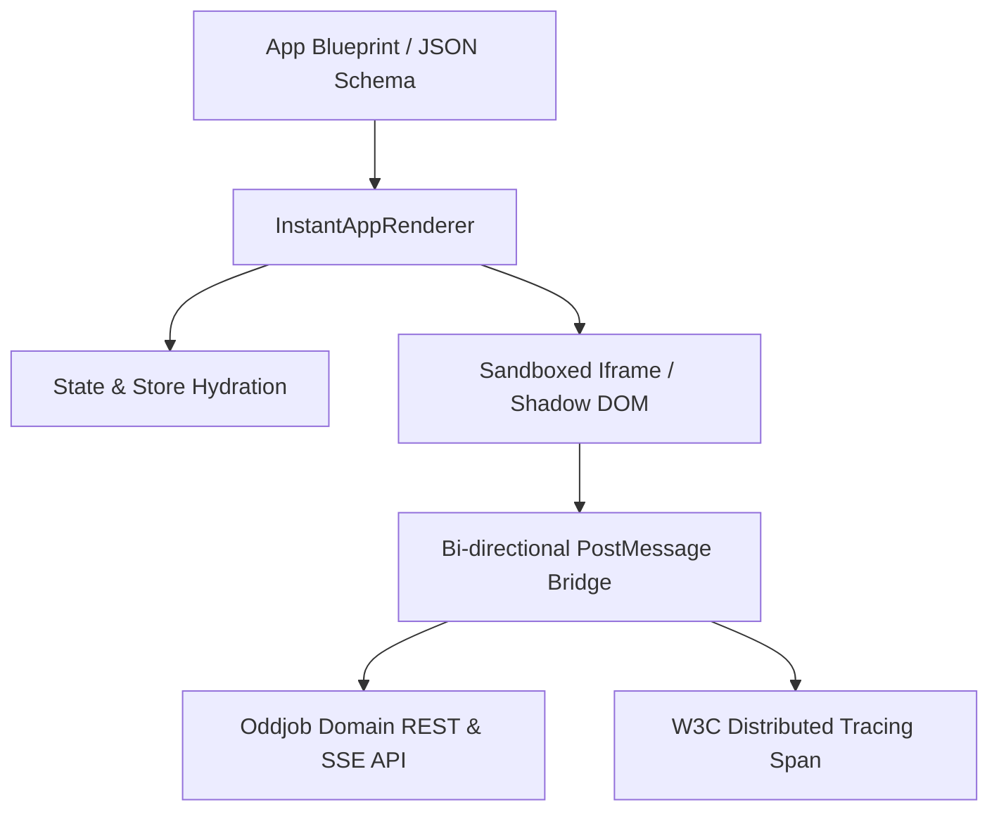

# Instant Apps and Micro-Frontend Rendering

## 1. Overview & Architecture

Instant Apps in Oddjob are dynamic, single-page micro-surfaces assembled autonomously by platform agents or human engineers from structured JSON/YAML blueprint specifications. They run either embedded directly within the Oddjob workspace shell or sandboxed inside isolated iframes for external client delivery.



---

## 2. Core Rendering Runtime

Instant Apps are rendered by the `InstantAppRenderer` component (`@domain-ui/core/ui/components/shared/InstantAppRenderer.tsx`). The renderer consumes an AST (Abstract Syntax Tree) describing:
1. **Layout Grid & Containers:** Flexbox/CSS grid definitions with responsive breakpoints.
2. **Interactive Form Fields:** Dynamic inputs mapped to underlying dataset columns or execution triggers.
3. **Data Visualizations:** Chart components (Bar, Line, Area, Scatter, Hexagonal H3 Maps) with live websocket bindings.
4. **Action Triggers:** Buttons, toggles, and sliders linked to backend job executions, pipeline runs, or HIL approval gates.

---

## 3. Communication Bridge & Security Contracts

When running inside sandboxed environments:
* **CSP Headers:** Scripts are executed under strict `Content-Security-Policy: default-src 'self'; script-src 'nonce-...'; style-src 'unsafe-inline'` policies.
* **RPC Protocol:** All communication between the host workspace shell and the Instant App occurs over a structured postMessage protocol:

```typescript
export interface InstantAppRpcMessage<T = any> {
  id: string;
  source: 'oddjob-instant-app-host' | 'oddjob-instant-app-child';
  action: 'MUTATE_FIELD' | 'SUBMIT_FORM' | 'REQUEST_HIL' | 'INVOKE_TOOL';
  payload: T;
  traceContext: {
    traceparent: string;
    spanId: string;
  };
}
```

---

## 4. Theme & Token Inheritance

Instant Apps automatically inherit the active Oddjob theme tokens (`--primary`, `--background`, `--card`, `--border`, `--accent`) using standard CSS variables:

```css
.instant-app-container {
  background-color: var(--card, #18181b);
  color: var(--foreground, #fafafa);
  border-radius: var(--radius, 0.75rem);
  border: 1px solid var(--border, rgba(255, 255, 255, 0.1));
}
```

---

## 5. Best Practice Guidelines

1. **Deterministic Hydration:** Always include an initial fallback state within the blueprint so the app renders immediately before network calls resolve.
2. **Error Boundaries:** Every interactive widget must be wrapped in an `ErrorBoundary` to prevent a single faulty chart or calculation node from crashing the micro-surface.
3. **Resource Attribution:** All mutation events dispatched from an Instant App must include the active `projectId` and `organizationId` headers.
