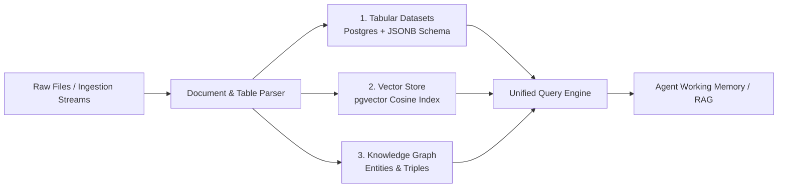

# Knowledge Garden and Dataset Schemas

## 1. Overview & Architecture

The **Knowledge Garden** is Oddjob's unified knowledge and data persistence fabric. It connects three distinct data topologies into a cohesive semantic layer:
1. **Relational Datasets:** Strongly-typed tabular data stored in PostgreSQL with dynamic schema metadata.
2. **Vector Embeddings:** Chunked semantic document indices for cosine similarity RAG search.
3. **Property Graph Triples:** RDF-style Entity-Relationship-Entity triples mapping platform dependencies and business logic.



---

## 2. Dataset Schema Definition

Datasets are defined using structured schema objects stored in `datasets.schema_definition`. A dataset column specification includes type, nullability, primary key constraints, and semantic tags:

```json
{
  "columns": [
    {
      "name": "incident_id",
      "type": "string",
      "primaryKey": true,
      "nullable": false,
      "semanticRole": "entity_identifier"
    },
    {
      "name": "severity",
      "type": "string",
      "enum": ["low", "medium", "high", "critical"],
      "nullable": false
    },
    {
      "name": "h3_index",
      "type": "string",
      "semanticRole": "spatial_cell"
    },
    {
      "name": "estimated_cost_usd",
      "type": "decimal",
      "precision": 10,
      "scale": 2
    }
  ],
  "indexes": [
    { "columns": ["h3_index"], "type": "btree" },
    { "columns": ["severity"], "type": "btree" }
  ]
}
```

---

## 3. Project Scoping & Isolation

Datasets can exist at two privilege tiers:
* **Organization-Wide Datasets (`project_id: null`):** Accessible across all workspaces within the organization (e.g., global employee directory, shared product catalogs).
* **Project-Scoped Datasets (`project_id: 44`):** Bound strictly to a single Project Space. The `withProjectScope()` middleware enforces that queries from agents or users in Project A cannot query or mutate Project B's datasets.

---

## 4. Querying Datasets in Agent Code

Agents interact with Datasets via typed tools and the `datasetService`:

```typescript
import { datasetService } from "@domain/knowledge/core/dataset/core-service.js";

// Query records with pagination and filtering
const records = await datasetService.queryDataset({
  orgId: 342,
  projectId: 3,
  datasetId: "incidents_q3",
  filters: [
    { column: "severity", operator: "eq", value: "critical" },
    { column: "estimated_cost_usd", operator: "gte", value: 1000 }
  ],
  limit: 50
});
```

---

## 5. Best Practices & Guidelines

1. **Schema Evolution:** When appending new columns to existing datasets, ensure new fields are nullable or supply a default value to prevent migration failures on legacy records.
2. **Batch Ingestion:** Use `datasetService.batchInsert(orgId, datasetId, records, { batchSize: 500 })` for high-throughput streaming to avoid lock contention.
3. **Graph Linking:** Always emit entity relationships upon insertion so that tabular rows are automatically indexed into the Property Graph.
