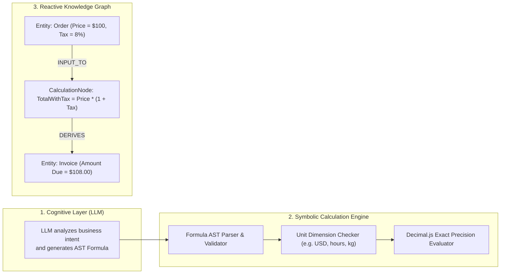
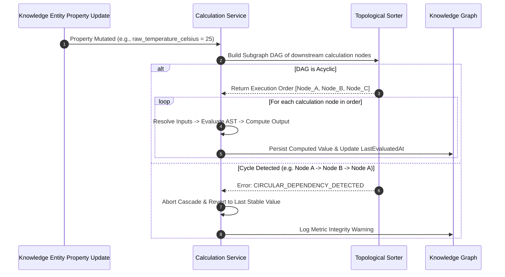

# Neuro-Symbolic Calculation Nodes & AST Cascades `[🤝 HYBRID]`

> **Audience:** `🤝 Hybrid (Analytics Engineers + Mathematical Agents)` &nbsp;|&nbsp; **Classification:** Component Architecture & Calculation Engine

---

## 1. Neuro-Symbolic Architecture Overview `[🧑 Human]`

LLMs frequently hallucinate arithmetic calculations. Oddjob uses **Neuro-Symbolic Calculation Nodes** to separate cognitive semantic reasoning from deterministic algebraic computation:



---

## 2. Calculation Node Schema Contract `[🤖 Agent Reference]`

Every calculation node registered in the Knowledge Garden must conform to the standard structure:

```typescript
export interface CalculationNodeDefinition {
  id: string;
  name: string;
  description: string;
  formula: string; // e.g. "basePrice * (1 + taxRate) - discount"
  ast?: Record<string, any>;
  inputs: Array<{
    variableName: string;
    sourceEntityId: string;
    sourceProperty: string;
    unit: string; // e.g. "USD", "ratio", "seconds"
    defaultValue?: number;
  }>;
  output: {
    unit: string;
    precision: number; // decimal places, e.g. 2
    roundingMode: "ROUND_HALF_UP" | "FLOOR" | "CEIL";
  };
  reactive: boolean; // Auto-trigger downstream on input mutation
}
```

---

## 3. Reactive Graph Cascades & Circular Dependency Prevention `[🧑 Human]`

When an upstream entity property changes, the calculation engine propagates updates topologically:



---

## 4. Arithmetic Invariants & Precision Rules `[🤖 Agent Reference]`

1. **Exact Decimal Representation**:
   - Never use native floating-point math `0.1 + 0.2 === 0.30000000000000004` for currency or inventory. Always use `Decimal.js` or `BigNumber`.
2. **Strict Unit Reconciliation**:
   - Adding mismatched dimensions (e.g. `USD + EUR` without an exchange rate node, or `meters + seconds`) must throw a typed `DIMENSIONAL_ANALYSIS_ERROR`.
3. **Divide-by-Zero Handling**:
   - Formulas must define explicit null-handling or fallback values for zero divisors (e.g. `denominator === 0 ? null : numerator / denominator`).
