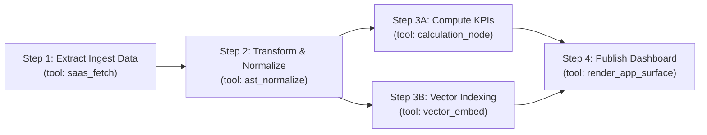

# DAG Pipeline Assembly & Mission Orchestration `[🤝 HYBRID]`

> **Audience:** `🤝 Hybrid: Pipeline Architects + Autonomous Mission Orchestrators` &nbsp;|&nbsp; **Classification:** Component Architecture & Assembly Standard

---

## 1. Directed Acyclic Graph (DAG) Pipeline Model `[🧑 Human]`

Oddjob structures complex workflows as **Directed Acyclic Graphs (DAGs)** where each node represents an isolated executor step and edges represent data dependencies:



---

## 2. Step Variable Interpolation Syntax `[🤖 Agent Reference]`

Downstream steps dynamically reference outputs from preceding upstream steps using the double-brace mustache syntax:

### Standard Reference Patterns:
- `{{steps.<stepId>.output.<propertyName>}}`
- `{{env.<environmentVariableName>}}`
- `{{context.organizationId}}`
- `{{context.userId}}`

### Example Pipeline Manifest Payload:
```json
{
  "pipelineId": "pipe_customer_onboarding_v2",
  "name": "Automated Customer Onboarding Pipeline",
  "steps": [
    {
      "id": "fetch_customer",
      "executor": "salesforce_get_record",
      "inputs": {
        "recordId": "{{context.targetRecordId}}",
        "objectType": "Lead"
      }
    },
    {
      "id": "provision_account",
      "executor": "db_insert_record",
      "dependsOn": ["fetch_customer"],
      "inputs": {
        "tableName": "accounts",
        "companyName": "{{steps.fetch_customer.output.Company}}",
        "email": "{{steps.fetch_customer.output.Email}}"
      }
    },
    {
      "id": "send_welcome_email",
      "executor": "send_agentmail",
      "dependsOn": ["provision_account"],
      "inputs": {
        "recipientEmail": "{{steps.fetch_customer.output.Email}}",
        "accountId": "{{steps.provision_account.output.id}}",
        "templateId": "tmpl_welcome_v1"
      }
    }
  ]
}
```

---

## 3. Conditional Branching & Error Handling Policies `[🤖 Agent Reference]`

Each DAG step can declare conditional execution rules and fallback policies:

| Property | Values | Description |
| :--- | :--- | :--- |
| **`condition`** | `{{steps.check.output.isVip}} == true` | Evaluated prior to step execution. If false, step is skipped. |
| **`onFailure`** | `ABORT_PIPELINE` \| `CONTINUE` \| `RETRY_THEN_HALT` | Dictates pipeline behavior when step throws an error. |
| **`maxRetries`** | `0 - 3` | Number of automatic retries before triggering failure policy. |
| **`timeoutSeconds`** | `10 - 300` | Hard deadline for step completion before watchdog cancellation. |
